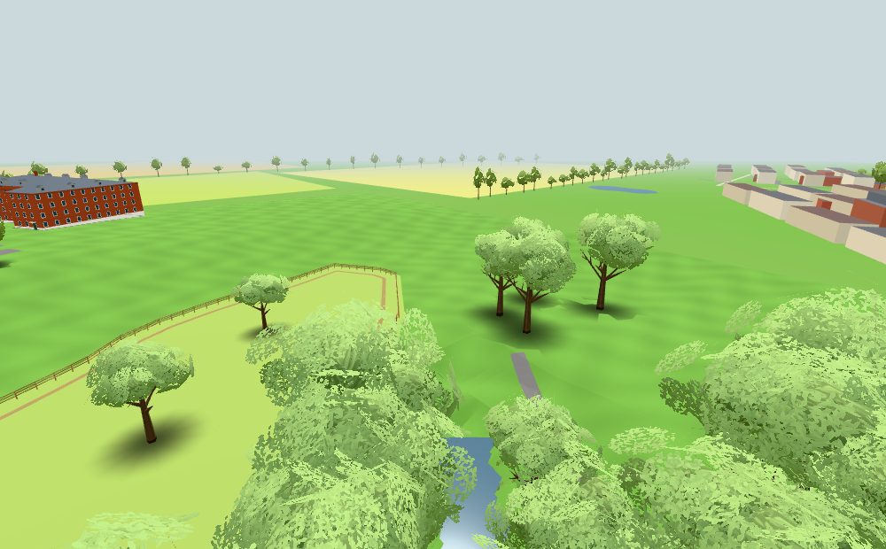
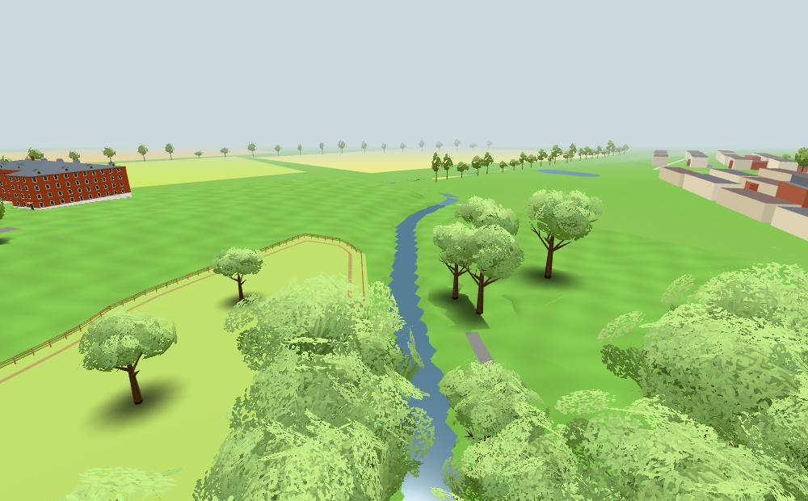
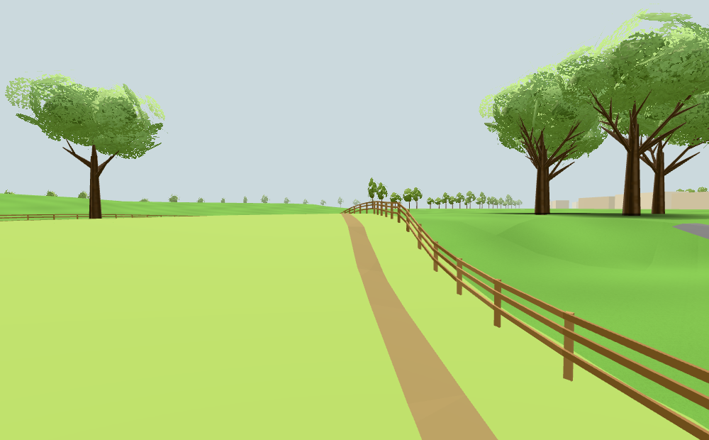
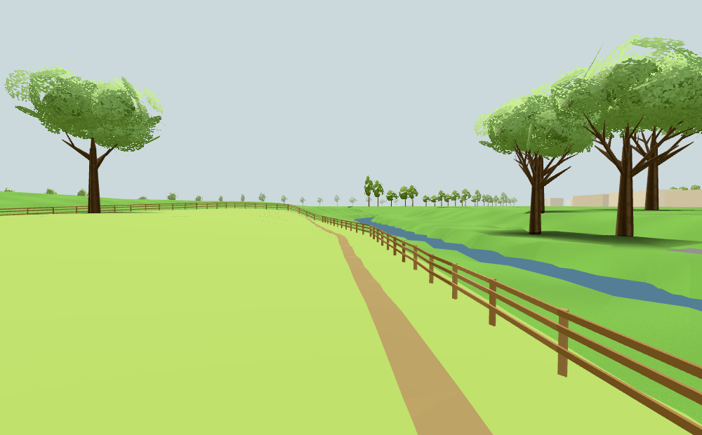
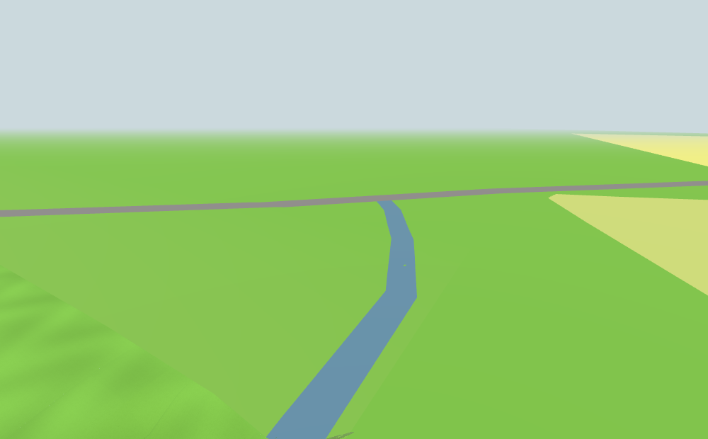
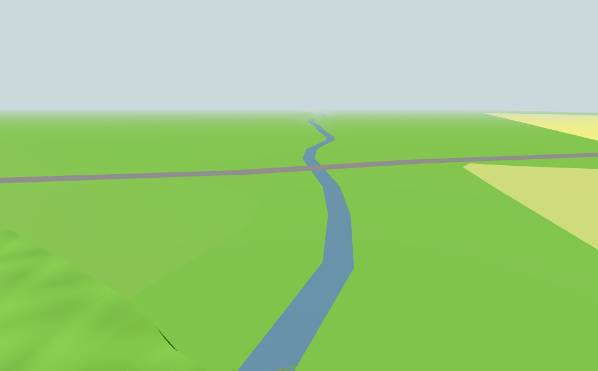
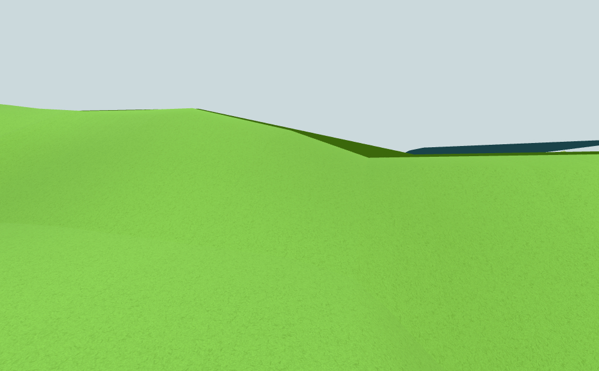
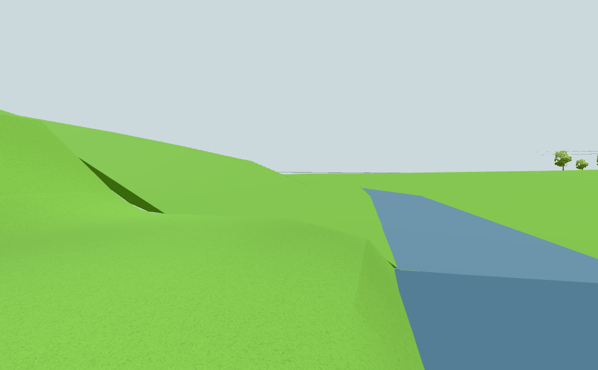

# Ån fortsätter genom terrängkanten, #231

Egna bilder av den publika visningen, 1000 × 620, full Chromium med SwiftShader, fast sommartid.
Menyerna döljs endast för bildfångst med appens befintliga `[hidden]`-regel; scenens material, dimma och rendering ändras inte.
Bas före: `995ea013c450e567c87b68dfe6f6c14e614105df`. Källan är det selektiva neutrala urvalet från
originalets `59d737b28a7d46deb95b0c2688f897e73013cd7d`, inte originalbilder eller privat apphistorik.

| Vy | Före | Efter |
| --- | --- | --- |
| Väster, flygvy |  |  |
| Väster, markvy |  |  |
| Öster, flygvy |  |  |
| Öster, markvy |  |  |

Västerut fortsätter vattenfåran över det tidigare avslutet. Österut ersätts den uppstigande markkanten av öppet vatten
med anslutande strand, och ån följer krökarna vidare genom dimman. De fjärran måtten och nivåerna är antaganden,
medan planläget förutom sista västliga tangentpunkten följer OSM. Befintliga brohöjder och markdata är bevarade.

`result.json` innehåller kameror, 50 emitterade geometri-/strandkontroller, 10 vattenstrålar i den faktiska hela scenen,
nätverks-/browserfellistor och original-lagringssentineler. Käll-/nivåkontrollen samt sju befintliga fall-/bro-/publika
vattenbarriärkontroller är gröna; även `npm test` (106 moduler) och `npm run build` är gröna.
Ingen fysisk telefon eller bred profilrunda har körts. Dirigenten granskar integrationen, publicerar bildbevis före stängning
och verifierar den faktiska Pages-körningen.
