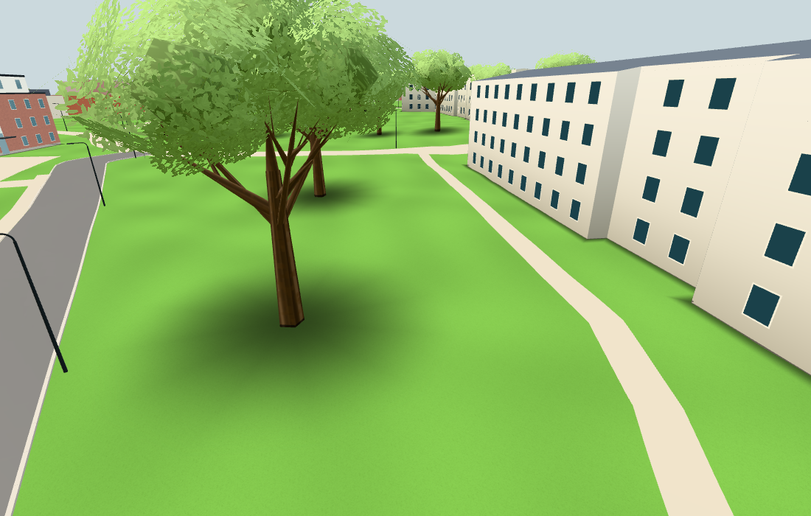
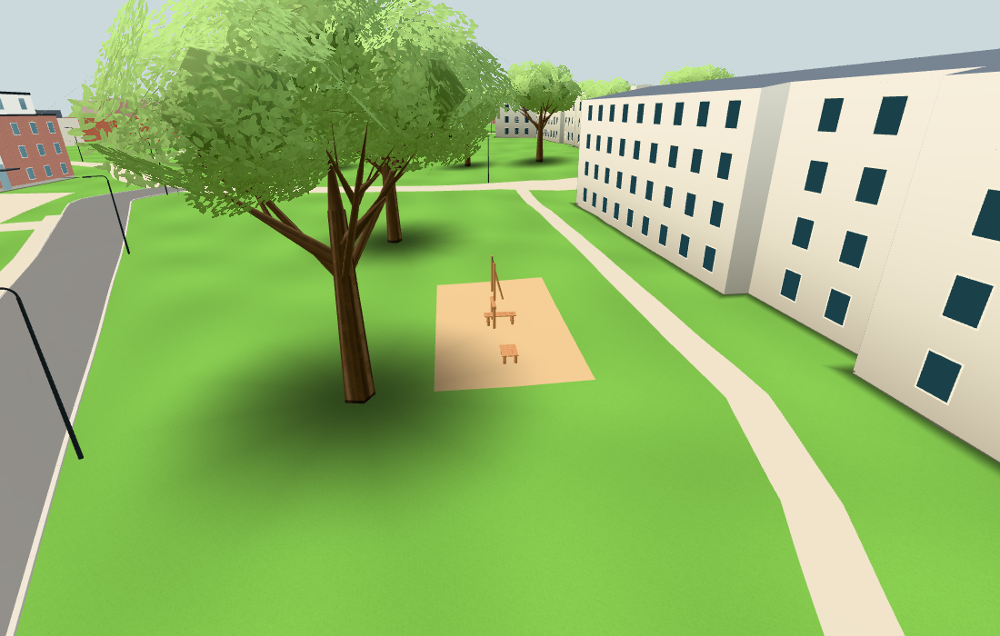
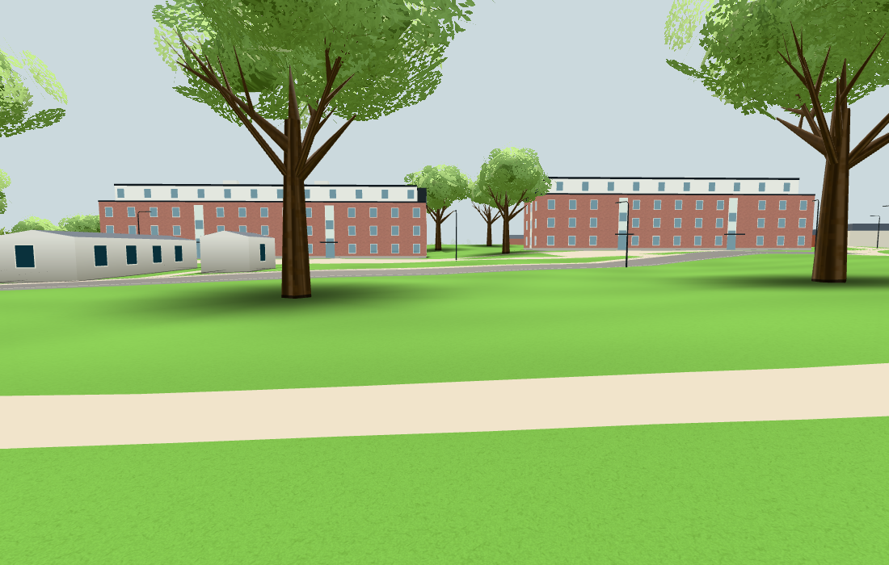
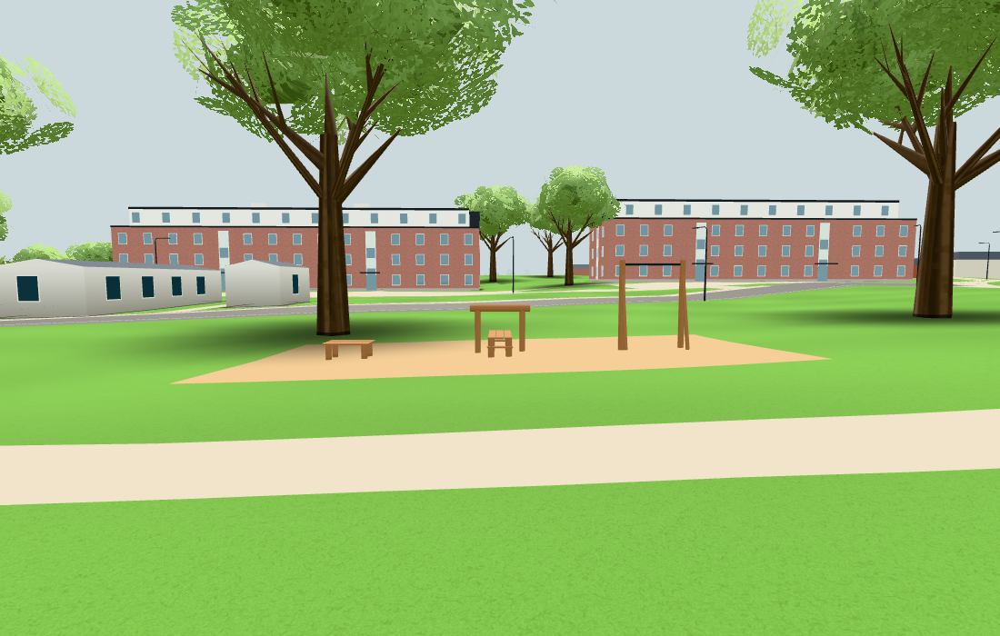

# Passivt träutegym vid Karpvägen, #234

Egna publika före/efterbilder, 1100 × 700, full Chromium/SwiftShader och fast sommartid. Bildfångsten döljer endast
menyöverlägg genom appens befintliga `[hidden]`-regel. Scenens material och rendering ändras inte.
Bas `9e27bbb30ca5422ffe293dcc41b6a22bc5b55bf9`, implementation `1bf0b46c1f5ce97f73d2d24d251d06c3b322d8ff`.
Selektiv neutral originalkälla: `52be76d1e4d50521edb042c99805cbbdbcf21140`; inga originalbilder överförs.

| Vy | Före | Efter |
| --- | --- | --- |
| Platsen i omgivningen |  |  |
| Redskapen från sidan |  |  |

Granskningen visar tre fasta stationstyper: ett räcke med stöd, en träbänk med fast stock och en låg stegbräda.
Flisytan följer befintlig terräng och lämnar träden, vägen och gångbanan kvar. Plats (-143,33), mått, färger och frigång
är bildtolkade antaganden; bilderna visar modellens resultat, inte verifierad utrustning på platsen.
Översiktsparet kommer från det första gröna passet; sidoparet från det sista gröna passet på identisk produktkod.
En skymd alternativ översikt valdes bort. Ingen ny produkt- eller renderingsändring gjordes mellan passen.

`result.json`: 21/21 verkliga geometri-/kollisionskontroller, tolv ritade stödfötter nedstuckna 0,045 m i marken,
flis minst 0,03149 m över den faktiskt ritade terrängen, bänk/step/stöd som stoppar Navigation och fri gång under stången.
Tre statiska batcher ger +3 ritanrop och +840 trianglar i de matchade vyerna, utan ny textur eller interaktionsmål.
Browserfelen och de externa anropen är noll; originalets lokala/session-lagringssentineler är orörda i båda faserna.
Native komponentkontroll, `npm test` (108 moduler), `npm run build` och diffkontroll är gröna.

Ingen träningslogik, animation, kamera-/inputkoppling, räknare, poäng eller lagring tillkommer.
Ingen fysisk telefon eller bred profilrunda kördes. Dirigenten publicerar bildbevis före stängning och verifierar
slutlig integration och faktisk Pages-körning.
