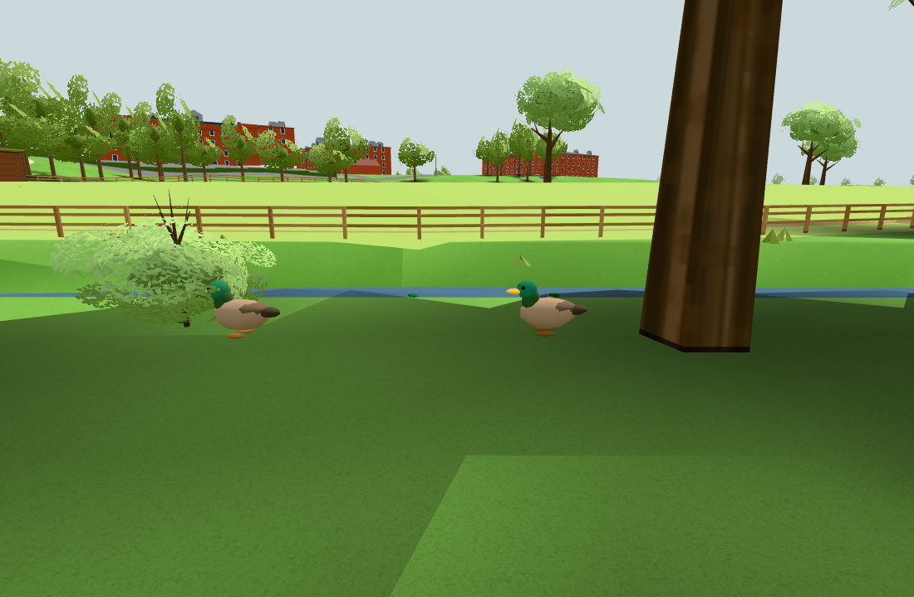

# Passiv ankflock vid Höje å (#235)

Public base: `e4b858ece26d207aacf1c35ee66dde3bb1bc4489`.
Reviewed original: `578ecc09b02c7355e299fc58d0e0127b622ee85a` (#1815).
Only the duck model, ambient movement and selected configuration were adapted. No newer reward/bread
helpers, original screenshots, personal assets/history, services, storage, audio, interaction or game
systems were imported. See [the reviewed selection and policy exception](../../upstream.md#passiv-ankflock-vid-höje-å-235).

The four ducks alternate local bank and water goals around public river station x≈−160/z≈207.
Ground contact uses the actual public `renderedTerrainY`; water uses public `waterYAt`. Location,
appearance and behaviour are visual guesses, not a survey of animals on site.

Checks:
- `node --test tools/duckambienttest.mjs`: 2/2 pass. Four deterministic 600-second runs stay within the
  local habitat, visit bank and water, maintain surface contact and bounded travel; selected modules
  and configuration exclude interaction/audio/storage/service dependencies. Node's unbuilt terrain
  sampler is analytic; the actual built terrain is separately checked in Chromium. [Raw output](node.txt).
- `npm test`: 110 modules audited; import graph, personal/service/storage boundaries, plans and
  app identity pass. [Raw output](npm-test.txt).
- `npm run build`: static build `56fb22affbbccb1d09fc19f2`. [Raw output](build.txt).
- Actual public app in Chromium/SwiftShader: four meshes share one geometry and one material, no
  shadows or targets. A 300-second controlled simulation on the built terrain has no invalid
  positions/contact/habitat samples; maximum 0.085001 m per 0.1-second step; bank and water both visited.
  Far animals freeze and disappear; hidden animals disappear. Original local/session storage
  sentinels survive; zero external requests/page errors. [Result](browser.json), [raw output](browser.txt).
- Identical camera with ducks shown/hidden: 33/29 draws and 395,837/393,277 triangles, exactly **+4
  draws and +2,560 triangles** (640 per duck). No new lights, textures or shadows. Counts describe
  this view and renderer, not a frame-rate or physical-device benchmark.
- `git diff --check` passes. [Source and upstream-file hashes](source-sha256.txt).

Own screenshot from the actual public app, summer/static daylight, 1100×720 desktop Chromium.
Presentation chrome is hidden for the images; a pointer-release resume button in the initial capture
was removed in the final capture. The completed run's initial camera and intermediate close camera are recorded in browser.json.
The final bank camera is x≈−160.007, z≈193.745, at rendered ground + eye height; it is 3 m behind
the completed run’s initial camera. This presentation-only change leaves all app geometry unchanged.
The bank-flock image was visually inspected. Vegetation/bank geometry can naturally occlude individual birds.
A final bounded clear-water camera attempt hit a fixture framing assertion (one swimmer, but requiring
two); [raw limit](capture-limit.txt). That threshold is corrected in the tool (syntax check passed); no further bootstrap was run.
The obstructed intermediate close image is omitted. Functional results reuse the completed source-app
run in browser.json; the production code is unchanged.

Scope limits: controlled camera/visitor spawns beside the river and brain time steps, not a continuous
walk, physical phone, all seasons or an FPS claim. No runtime target/UI/audio path exists for the ducks.
Mandatory test/build and this focused scene check were sufficient; no unrelated broad browser sweep.
