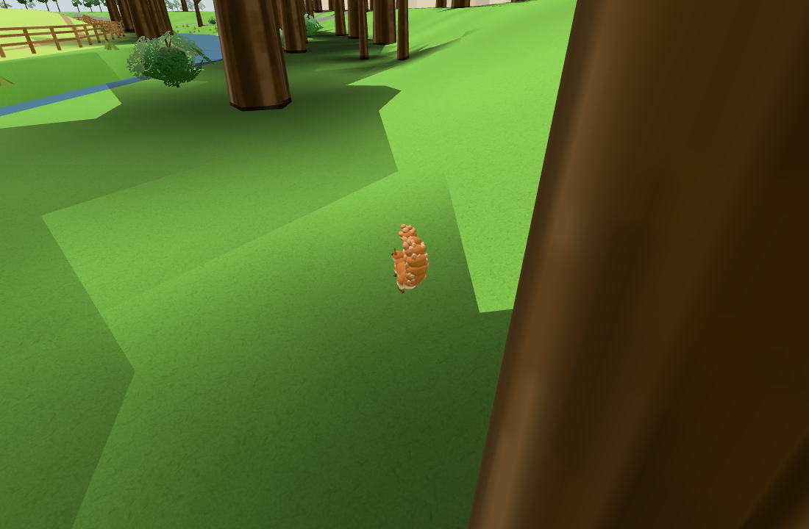
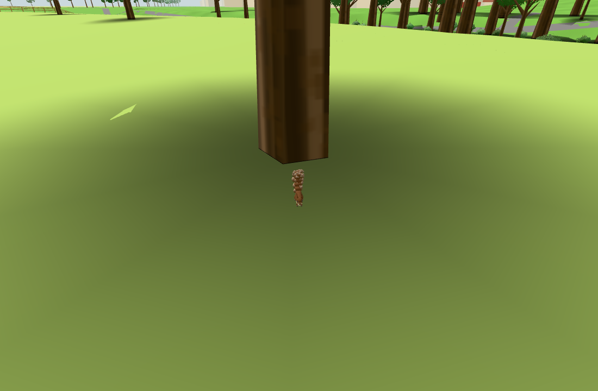

# Ambient squirrels (#237)

Public base: `e4b858ece26d207aacf1c35ee66dde3bb1bc4489`.
Selected original: `578ecc09b02c7355e299fc58d0e0127b622ee85a`.

The original fluffy model, near/far LOD, tail/head morphs, perch/spiral formulas and leap arc are retained.
The public brain is a compact local ambient cycle: perch, leap, down, forage/search, return, up; a nearby
visitor can cause flight. There are four anonymous animals, no objects to find or carry. The original
named population, nuts/glints, held objects, feeding/lures, sound/hearts, stats and all shared services
are excluded. No original screenshots/assets/history were copied.

Local tree data: 259 eligible trees, including the river/paddock and southern grove. Existing treeFeet
is matched to existing crown radii/centres (aoTrees); existing southbackdrop userData supplies y/h/r,
whose actual rendered crown centre is y+h*.7. Metadata is forwarded without changing tree geometry,
materials, seeds, AO/shade or seasonal rules. [Complete surroundings diff](tree-metadata.diff).
The new southern group is separate from the river group. Ground paths sample dry land off roads and
use the actual rendered terrain. Appearance, population and placement are visual guesses.

Checks:
- `node --test tools/squirrelambienttest.mjs`: 2/2 pass. A 600-second deterministic cycle covers perch,
  leap, down, forage, search, return and up on land; nearby visitor flight and spiral endpoints are checked.
  Actual host freezes/hides distant/winter animals and ambient modules reject interaction/service paths.
  [Raw output](node.txt).
- `npm test`: 112 modules audited; import graph, public content/storage/services, plan and app identity
  pass. [Raw output](npm-test.txt).
- `npm run build`: static build `d897aa298411607527a4da64`. [Raw output](build.txt).
- One actual public Chromium/SwiftShader scene, June daylight: all four animals instantiate from real
  crowns. Naturally reached river states include perch/leap/down/forage/search; paddock includes
  perch/down/forage/search. Source app host verifies >100 m hidden, >70 m frozen, seasons 12 hidden/frozen
  and 6 resumed, no targets/extra meshes/shadows. Original local/session sentinels survive and no external
  requests/page errors occur. [Measured result](browser.json), [raw output](browser.txt).
- Same camera shown/hidden: each captured animal adds exactly **1 draw and 3,382 triangles**. River view
  27/26 calls and 362,815/359,433 triangles; paddock 27/26 and 361,323/357,941. Far LOD is 1,396 triangles.
  Animals with the same look share cached near/far geometry; all use one material.
  There are four existing scene lights, with no new lights, textures or shadows.
- `git diff --check` passes. [Source hashes](source-sha256.txt).

Both own screenshots were inspected; squirrel and fluffy tail are visible with surrounding context.
Camera positions/targets, actual tree records and states are in browser.json. Test camera/visitor
positions and brain time steps are controlled; no state or animal position is assigned to create a pose.
The browser advances real brains to a natural ground pause and measures the actual source renderer.
This certifies those local views, not a continuous walk, physical phone, every season or measured FPS.
No extra broad profile or second browser bootstrap was needed.
