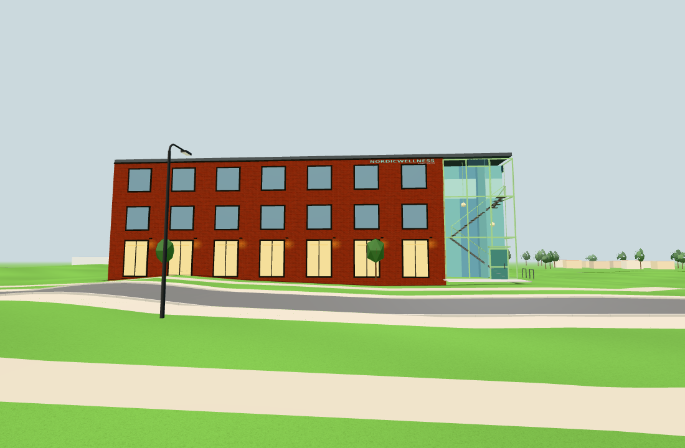
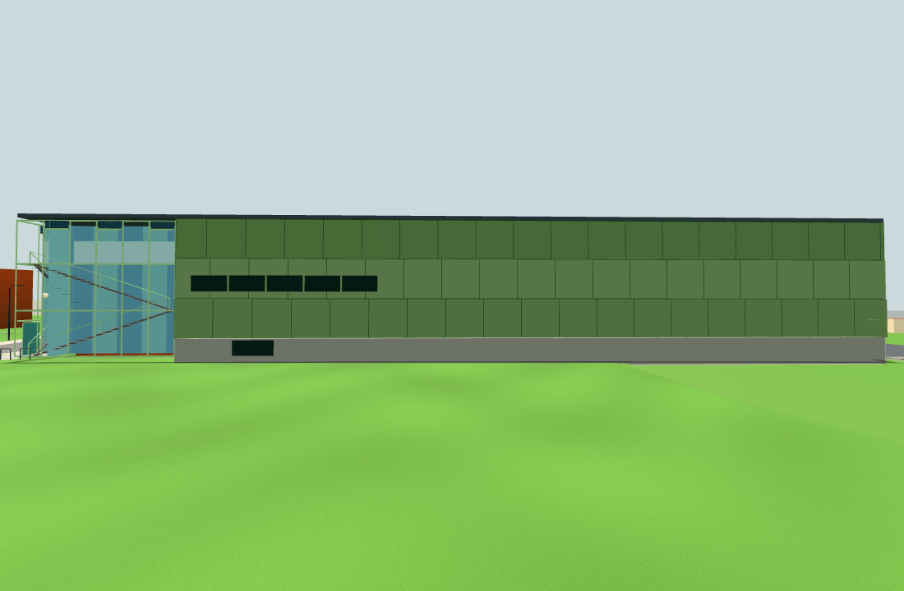
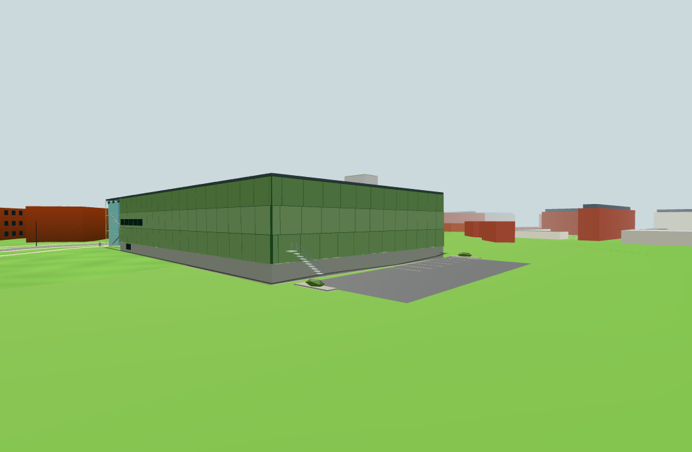

# Nordic Wellness public architecture slice (#240)

Public base: `9e767cda8ac2957344a9f147c5b8ec3d2d400fb3`.
Reviewed originals: front `042cf8f4c52447a70be4e4b5f8fb200aaf83c807`; final hall/glass/entry/parking/sign
`46f7be89a6c8a4b601d9d2158a9097abc606bfaa`. Source-bound original design/verification in #1822–25 was
reused; none of its photos or result images was imported. These are own actual public-app screenshots.

The final model/config and procedural lettering match the reviewed source. Public integration only
passes its existing ground callback and adds the isolated sign to the existing backdrop. Other SITE
records, terrain, buildings, batch partitioning, materials and shadow policy are unchanged.
[Integration diff](integration.diff), [source hashes](source-sha256.txt).

Passing checks:
- Source parity and unchanged surrounding SITE records: [raw output](source-test.txt).
- Eleven component checks: 21 front + 5 hall panes exposed, four stair flights, both globes and entrance
  door exposed, seven wall washes, finite facade/roof/glass geometry, retained eave/roof samples, all
  seven parking stripes above the curved sampled deck. Exact shared flat-ground contribution 2,853
  triangles; geometry SHA-256 `b34f6327b91af0c46b28a9f90a7e44a6a59eb93bd4b450d4810e73e6e31f66a8`.
  [Raw output](geometry.txt). The copied original whole-campus estimate was deliberately removed;
  it is not a public-scene measurement.
- `npm test`: 118 modules audited, public content/storage/services, import graph, plans and app identity
  pass. [Output](npm-test.txt).
- `npm run build`: `ed193840e6bfde0274693437`. [Output](build.txt).
- Actual public app: 26 panes, retained 11 direct batches, correct roof/sign placement, turquoise title
  and smaller white subtitle painted locally; native LOD 179/181/179 m visible/hidden/visible. Each view
  has exactly +1 draw/+2 triangles for the isolated sign. Four existing scene lights; no new light.
  Original local/session sentinels survive; zero external requests/page errors.
  [Result](browser.json), [raw output](browser.txt).

| Actual desktop view | Calls | Triangles | Sign delta |
| --- | ---: | ---: | ---: |
| Front | 24 | 332,360 | +1 / +2 |
| Side | 24 | 332,760 | +1 / +2 |
| Rear | 41 | 381,555 | +1 / +2 |

The recursive desktop east asset has 87,738 triangles, including clocks and the sign. This is the public
scene, not the original's 87,714; the original desktop threshold is not substituted for the public cap.

**Non-green budget check, tracked independently by [#242](https://github.com/solwation/kvarteret-lunden/issues/242):**

| Whole public low-memory east asset | Triangles | Unchanged cap |
| --- | ---: | ---: |
| Before this port, base9e767cd | 44,068 | 41,700 |
| After | 45,885 | 41,700 |

The port adds 1,817; the base already exceeded the documented cap by 2,368. The old flat-ground gym/
Grenhuset contribution was 1,038, new2,853 + sign2. Even removing that whole component cannot solve the
pre-existing excess. Per #136, full traversal includes access, lawns and nested live clock instances;
#205's earlier building-count fix does not explain this new discrepancy. The counter uses the actual
public low-memory surroundings build (Android UA), following the canonical history fixture, rather
than just visible draws. [Complete before/after mesh ledger](lowmem.json), [failing raw output](lowmem.txt).
The cap is preserved; no unrelated scene cuts or arbitrary quality changes were made. Architecture is
reviewable as a Refs slice; final #240 budget acceptance/closure remains pending with the conductor.

All three images were inspected: front/window rhythm/sign/glass stairs, side hall and rear parking
are clear. Cameras use the reviewed original design locations in the actual public app; some are elevated
inspection views, not a continuous walk or a claim that every camera stands on a footpath. Desktop
Chromium/SwiftShader at 1100×720, fixed June daylight. No physical-phone or measured-FPS claim. The
low-memory budget count is a component asset check, not a second visual/device-performance profile.

## Budget acceptance updated by #242 (2026-11-03)

The non-green measurements and raw files above are preserved historical evidence, not a current
blocker. #242 traced every nonzero increase after #205/#203 and the earliest breach (#212), then
obtained conductor review before the one-off revision to **46,222**. Actual World remains **45,885**
in both low-memory formats, retaining precisely the latest accepted **337** headroom. All four near/far
images, geometry, resources and building ledgers are identical before/after; no product geometry or
quality changed. This supplies the budget acceptance for #240; its architecture and images remain valid.
[Reviewed full-SHA ledger](../../references/campus-budget/2026-11-03.json), [#242 verification](../242/README.md).
