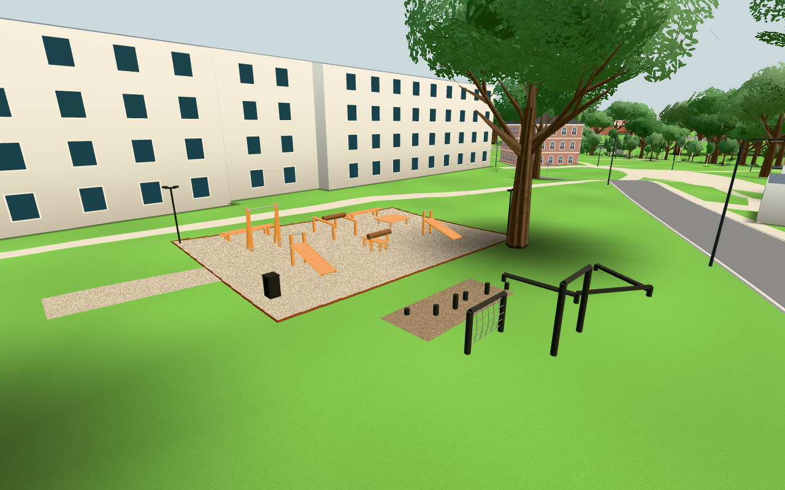
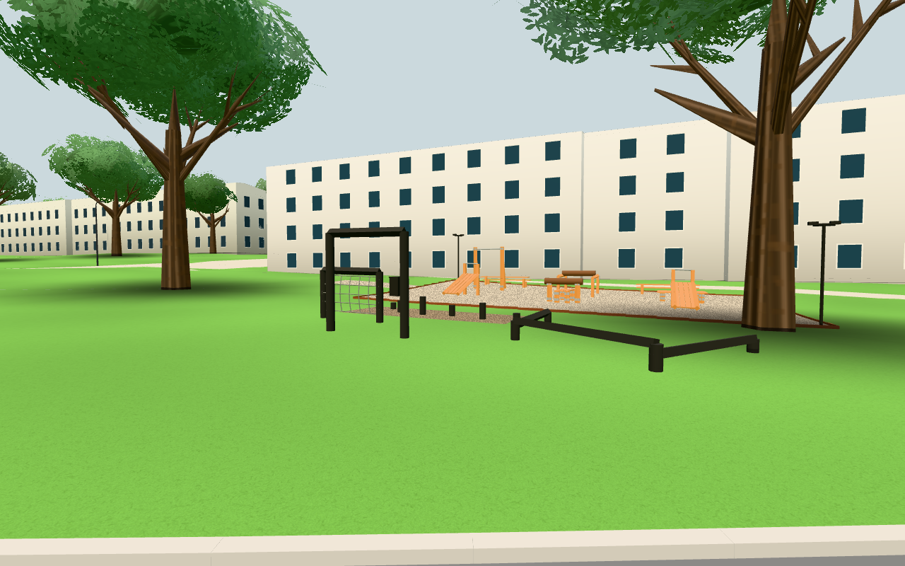

# #243 – passivt utegymutseende

Publik bas `47140cbdfc32fbd2fb75978092fa0787bfc25a7c`. Granskad originalkälla för utseendet:
`e21ca752b49a129f3909019707898f2d7479ddf4` (konstruktorns geometri, outdoorgymdecor och statisk konfiguration).
Enda senare komplettering är fast pressstockshöjd 0,95 m från
`357389701091efaec91a673bd0cc15f11904d7bb`. Alla mått/färger/placeringar är visuella antaganden.

## Avgränsning

Den publika byggaren använder fortsatt omgivningens `renderedTerrainY`; befintlig gym-hook och
farwalks kollisionsregistrering återanvänds. Den gamla modellen har jämförts, inte ersatts av
originalets hela klass/config/main. Fasta statiska material slås samman till fyra batcher.
Publikens plana trästil behålls; ingen original-woodgrain-modul importeras. Det lokala gruset
har en deterministisk 64×64 RGBA-textur (16 KiB före GPU-mipmap), inga nätresurser.
Lyktorna har endast geometri och skapar inga ljus.

Inga övningar, Rest/IK/gx, input/HUD, poäng, biceps, räknare, stockanimation, targets/pickables,
samling/bestiarie, originalfoton/fotografnamn/personliga resurser, tjänster eller lagring importeras.
Själva navigationen, terrängen, säsongslogiken och LOD ändras inte; nya fasta stolpar/bänkar/balkar
registreras i befintlig bucketkollision. Inga kollisionsytor läggs över de höga fria portalöppningarna.

## Kontroller

1. `node tools/outdoorgymtest.mjs` – grön. 4 batcher / 4 404 tri, 4 material, inga ljus,
12 stationsstöd nedstuckna i marken, grus ovan terräng, faktisk byggare och ren fotavtrycksplan
har samma 52 miljöpolygoner. Totalt 58 polygoner/232 segment återfinns i publicens riktiga farSegments.
Stockhöjd och enbart statisk konfiguration kontrolleras. Den tidigare publika byggaren/config
hämtas från publikens bascommit och byggs på exakt samma terrängindata: 3 batcher / 840 tri.
[Komponentresultat](component.json).
2. `npm test` och `npm run build` – gröna. 125 moduler granskade inklusive den nya passiva
importen; bundling, planritningar och same-origin-policy passerar. Byggfingerprint
`70cb3d12d84f2b9618e5ecf0`. [Testlogg](npm-test.txt), [bygglogg](build.txt).
3. En verklig publik källapp, Chromium/SwiftShader, 1280×800, lokal juniklocka. I samma
scen/kamera byts endast gamla/nya gymgruppen för jämförelsen; inga gamla hela main/config
komponeras in. Före 927 calls / 1 061 629 tri, efter 928 calls / 1 065 193 tri: **+1 call / +3 564 tri**.
Markfrigång minst 3,056 cm mot faktisk emitterad terräng. Närmaste behållna trädcentrum ligger
1,071 m utanför huvudgrusets rektangel. Inga nya ljus eller klickmål. Externa requests 0,
pageerrors 0. Originalets två localStorage-sentineller och sessionStorage-sentinel är orörda.
[Appresultat](browser.json), [källhashar](sources.sha256).

Två representativa kameror i samma appturn, ingen bred campus-/telefon-/navigationsmatris.
Ingen input eller responsiv UI ändras. En fysisk telefon har inte provats och ritvärdena är
lokala kameravärden, inte en prestandagaranti för enheter.

## Egna resultatbilder




Båda bilderna har direkt granskats. Vid denna turn saknades `HOLD_GYM_VIEW=1` i den redan
köade kommandoraden efter att hjälparen gjorts valbart hållbar. Därför stängdes browsern efter
gröna assertions innan dirigentens bildinspektion, ett fixturemisstag utan produktändring.
Ingen upprepad bootstrap/profil behövs för att granska de sparade, korrekta bilderna.

## Återkörning

```
npm test
npm run build
node tools/outdoorgymtest.mjs
python3 -m http.server 8918
HOLD_GYM_VIEW=1 CHROME_PATH=/path/to/chrome node tools/outdoorgym-view-check.mjs http://localhost:8918 docs/verification/243
```

Browsern kan köras genom orkesterns befintliga browserlås. Hållen scen släpps med
`touch /tmp/243-release`. Bascommit måste finnas lokalt för gamla publika gymgruppen;
fixturen hämtar inga originalkällor. Den riktiga UI-starten används, därefter stoppas
animationsloopen för samma-kamera-jämförelsen och stillbilderna. Ingen produktionsdata används.
Dirigenten hanterar CI/Pages och faktisk live-fingerprint efter integration.
