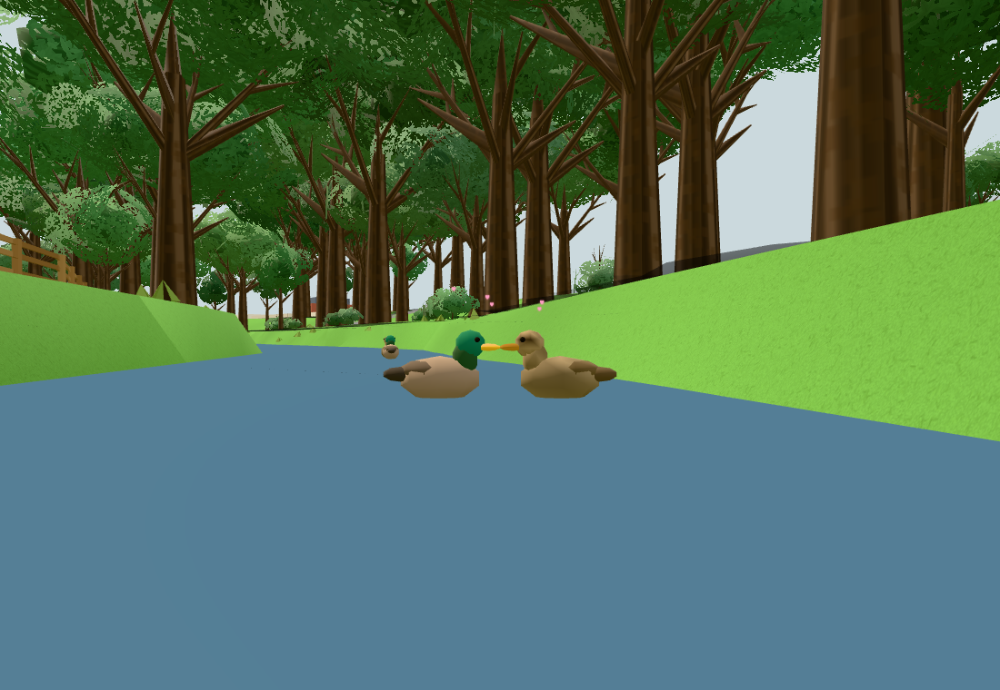
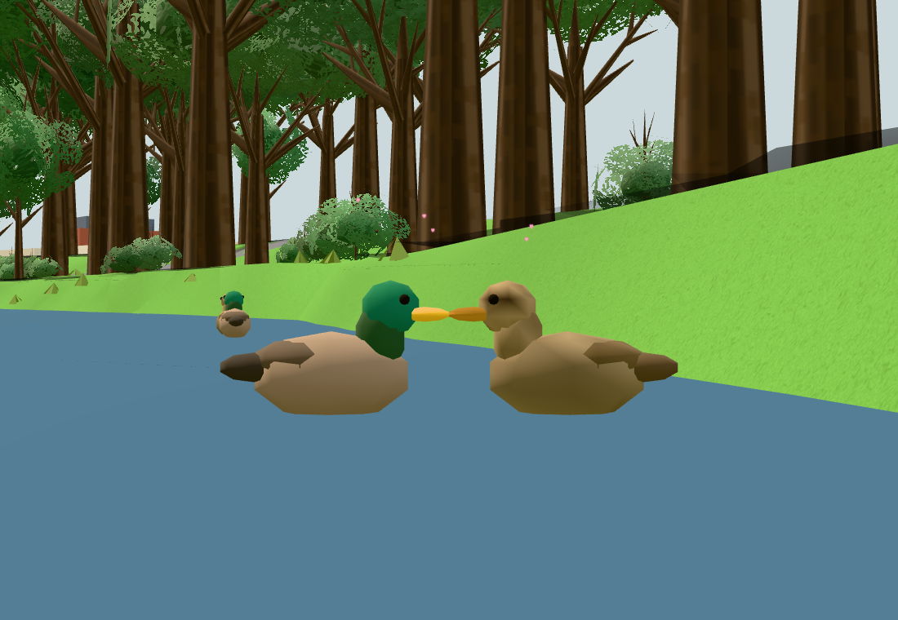
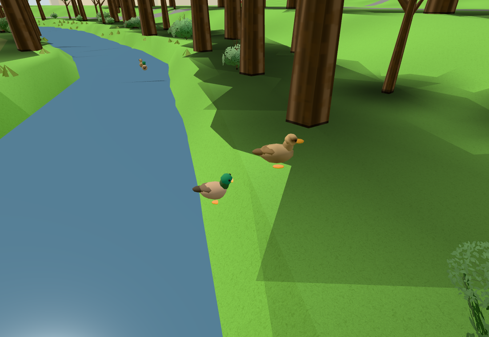

# #244 – generiska ankpar och intern parpuss

Publik bas: `52a8f4a42638a5816444ac356cc1c1b39e6c4865` (#243:s accepterade gym). Konsoliderad
originalkälla: `131b5d9d9c11a5853320d7b36b4bf61409367f39`. Bara neutrala modell-/habitat-/par-/flock-/
pussdelar och ren procedur-Hearts-render har valts. Inga originalbilder eller personliga resurser.
[Källor/anpassningar/bortval](../../upstream.md#generiska-ankpar-större-åstråk-och-intern-parpuss-244).

## Kontroller

1. `node --test tools/duckambienttest.mjs`: **3/3 gröna**. Samma kroppstopologi, två olika
könsfärgningar, fyra kroppar/2 560 tri, offentlig importgräns. Seedade stabila ömsesidiga par,
honledning, tillfällig gruppering och återgång, >45 m observerat årevir, mark-/vattenkontakt och
habitatgränser. Kontakt med riktiga modellnäbbar, en burst, bevarade mål/identiteter, cooldown
samt hidden/far/otillgänglig yta avbryter. [Råresultat](component.txt).
2. `npm test`: **grönt**, 129 moduler granskade, importgraf/arkitektur/same-origin-policy. `npm run build`:
**grönt**, fingerprint `c7bf0ca6c235a44c43b89e5b`. [Test](npm-test.txt), [bygge](build.txt).
3. **En faktisk publik appturn**, Chromium/SwiftShader, 1100×760, lokal juniklocka. Verklig publik
värld/renderer/riverPath/renderedTerrainY och de normala seedade hemmen. Bara ankornas normala
ambient-simulering startas om efter världsbygget. Observatörskameran följer första paret medan
ordinarie uppdateringar stegas med 0,05 s; inga fåglar flyttas, inga mål/chansvärden/pusspar tvingas.
Naturlig möjlighet vid simtid 103,65 s. [Startpositioner och mål](natural-start.json), [appresultat](browser.json).

Näbbspetsarnas horisontella gap är 0 och vertikalgapet 0,246 mm, inom de faktiska frontytornas
sammanlagda 21,63 mm. Kroppscentrum är 1,108 m isär. Efter puss/utdrag återgår samma par till sina
normala mål; senare steg ger verklig förflyttning. Hidden döljer kroppar/effekt. Långt avstånd
döljer OCH fryser båda partnerna. [Återgångens exakta positioner/kamera](return-view.json).

## Faktisk ritkostnad

Samma app/renderkamera med kroppar på/av: 38→34 calls och 429 647→427 087 trianglar, alltså
**4 calls / 2 560 tri** för fyra fåglar. Två delade könsgeometrier/ett material; inga ljus,
kroppstexturer eller skuggor. Den äldre modellen hade samma fyra calls / 2 560 tri men en enda
könsgeometri, så den andra färgade geometrin är en liten extra statisk CPU/GPU-allokering.
[Kroppsbudget och far-gate](body-budget.json).

Den separat korta hjärteffekten: 40→41 calls, 398 079 tri oförändrat och 0→5 punkter.
**+1 call / +5 punkter / 0 tri**. En lazy återanvänd pool, ett material och en 64×64 procedurtextur
(16 KiB pixeldata före GPU-mipmap). Ingen ny pool per puss. Inga ljus/skuggor/klickmål.
Kameravärdena är lokala mätningar, ingen global FPS-/telefonprestandagaranti.

Nät-/lagringsisolering: 0 externa requests, 0 pageerrors. Två original-localStorage-sentineller
(`lunden.drawing`, `lunden.cloud.queue`) och en sessionStorage-sentinel är orörda. Nya ankmoduler
läser/skriver ingen lagring och importerar inga tjänst-/mat-/spelfunktioner. Ingen fysisk telefon
eller bred campusmatris behövs för denna lokala ambient-AI utan input/UI/geometriändring i världen.

## Egna granskade bilder





Översikt och närbild är samma kontaktögonblick; närbilden halverar bara kamerans FOV. Returbilden
använder samma redan gröna returstate med högre kamera för att båda kropparna och markkontakten
ska synas över slänten. Inga fågelpositioner ändrades. Alla tre bilder är direkt granskade och godkända.

## Diagnostik och reproduktion

- Den första rent negativa källregexen matchade även Hearts generiska livslängdsfält `this.life`.
Det är en partikeltid, inte originalets Life-system. Källvakten preciserades; inga produktändringar.
[Första diagnostik](component-first-diagnostic.txt), sedan 3/3 grönt.
- En tidig råmarksdiagnostik hade ingen naturlig pussmöjlighet på den ojämna analytiska samplern.
Det var inte appens föreskrivna markindata. Kontaktvillkoren ändrades inte; den faktiska emitterade
publika terrängen gav naturlig kontakt i appen. Node-terräntestet använder tydligt råsamplern och
verifierar där endast gränser/markhöjder/par/grupp, inte en garanterad naturlig händelsetid.
- Ett kommando i den hållna scenen skickade en arrow-funktion som oinvokerad eval-sträng och gav
`undefined` vid JSON-sparande. Korrigerat genom att anropa uttrycket; samma scen gav sedan grön
kroppsbudget/far-gate. [Fixturediagnostik](command-first-diagnostic.txt). Ingen produktbugg eller omstart.
- Kroppsbudget och returomramning kördes via samma hållna command-loop efter första huvudresultatet.
De exakta operationerna har nu lagts i hjälparens normala replay; ingen ny browserturn gjordes för detta.

```
node --test tools/duckambienttest.mjs
npm test
npm run build
python3 -m http.server 8919
CHROME_PATH=/path/to/chrome node tools/duckambient-check.mjs http://localhost:8919 docs/verification/244
```

Använd orkesterns vanliga browserlås. Hjälparen håller scenen till `touch /tmp/244-release`.
`/tmp/244-command.json` tillåter lokal eval-/stillbildsomramning utan omstart.
[Källmanifest](sources.sha256). Efter appturnen togs endast en extra tom slutrad i duckbrain bort; sista test/byggloggar gäller detta oförändrade runtimeunderlag. Dirigenten hanterar faktisk CI/Pages/live-fingerprint efter integration.
