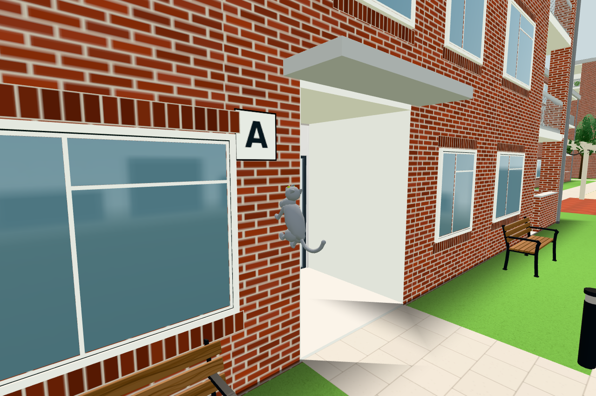
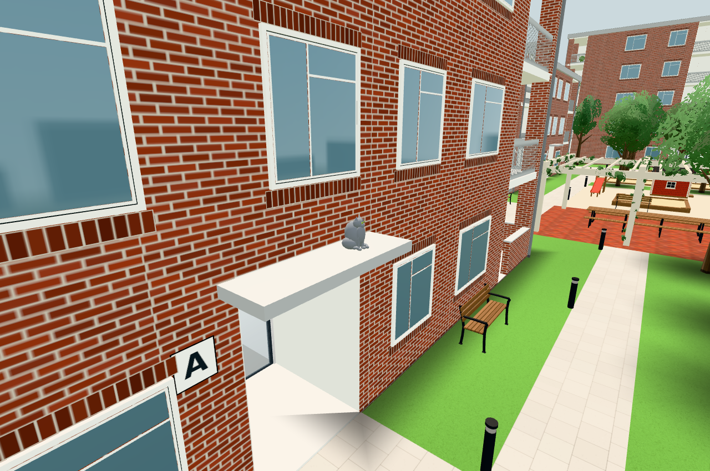
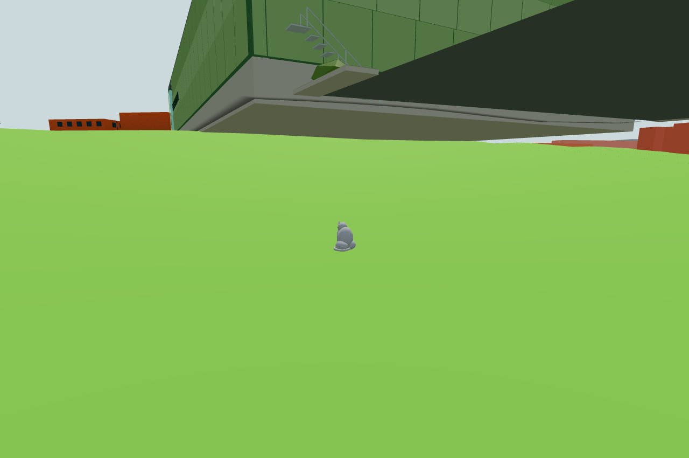
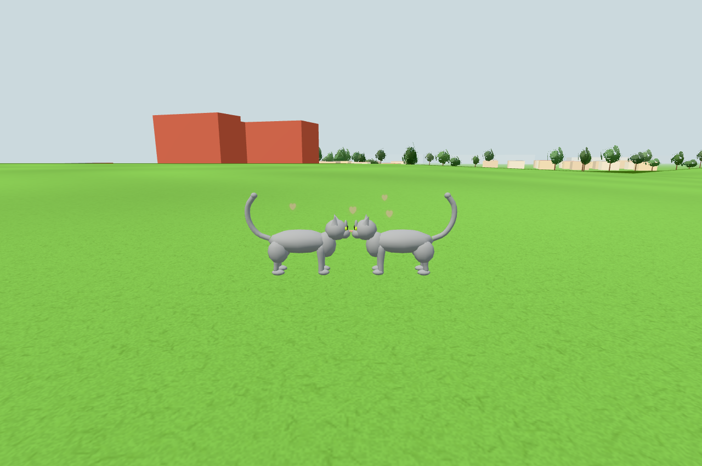

# Public #245 — anonymous exploration and nose contact

Original source: `131b5d9d9c11a5853320d7b36b4bf61409367f39`, selectively extracting the bounded `CatExploration` planner, candidate affordance graph, footprint predicate and internal `CatNuzzle` override. The four public gray models remain anonymous; variation is derived from numeric IDs, not original named character profiles. Model contact is adapted to the public 2,040-triangle puppet. No original photos or result images are imported.

The current public raised Nordic parking quad is intentionally retained in the cat sampler. Original #1850's later lowered parking geometry is outside this delivery; public #249 will port that geometry and its matching generic sampler together. Player boundaries, buildings, terrain geometry and collision remain unchanged here.

## Risk groups

1. `node tools/outdoorcats-check.mjs`: 28 deterministic cat-days, visited extent and home-time distribution, bounded plan/cache work, source footprint/body clearance and vehicle exclusions; actual emitted nose/paw contacts and existing LOD cost. The 12 mm nose-center distance is exactly two 6 mm nose radii, so contact surfaces meet. No 12 mm visible gap is claimed. Its flat-ground model fixture is not terrain evidence.
2. One actual public app bootstrap: fixed finite graph samples against emitted surfaces/barriers; controlled-clock continuous route/climb/social/return steps, representative images, draw delta and original-key/service isolation. Controlled time is explicitly a fixture, not hours of real-time observation.
3. Mandatory `npm test` and `npm run build` public boundary/build checks.

Measurements, exact source hashes and completed app results are recorded below. No global campus or physical-device/FPS claim is made.

## Results and own images

- [component.json](component.json): 28 deterministic plans, minimum visited extents 223/530 m, maximum home rest 19.52%, at most 50 decisions / 900 candidate evaluations in this sample (hard limits 56/1,008), 12 cached plans. Nose-center spacing 12 mm = two 6 mm radii; 5 mm paw/body clearance from the pillar plane. Flat ground here isolates model/timing; actual ground is checked below.
- [surfaces.json](surfaces.json): **6,361** fixed graph samples against 338,550 relevant non-instanced emitted surface triangles, no missing surface/obstacle/water failures; max vertical disagreement 0.0100001 m and max adjacent sampled step 0.136249 m. Prebucketed finite work completed in under a second. Courtyard and north/park trunks were checked separately with explicit trunk radius + 12 cm body radius: final minimum additional clearance 0.047445 m. The candidate's five rejected trunk crossings remain in [rejected-trunks.json](rejected-trunks.json); [trunk-detours.json](trunk-detours.json) records bounded local replacements. The first detour's early approach was additionally kept on the old clear line to avoid a nearby fixed boundary; final source and raw surface pass are authoritative.
- [roof-plan.json](roof-plan.json): actual canopy ray at y=2.99000001 and brick pillar at z=28.79999924. These unchanged architectural measurements remain valid across the later ground-only trunk detours. Final canopy/pillar images use the final graph.
- [travel.json](travel.json): **86,401 one-second actual emitted-model updates**, 5,663.6368 m accumulated root travel, maximum step 0.630995 m, all 18 goals, then home. Saved positions every ten seconds provide a reproducible trace. This accelerated controlled wall clock runs production `OutdoorCats.update`; camera updates keep the traveling model inside its existing draw gate. It is not native real-time waiting and does not imply a 5 km player walk or newly walkable player bounds. Seated intermediate goals and reverse climb are included in the continuous traversal.
- [app.json](app.json): real contact has nose surface gap ~0, root spacing .558 m; after 400 × .1 s all four states are `route`, both social pause/return anchor-point errors are zero, max return step .055 m. The same visible scene measures **15→18 calls, 292,128→296,208 triangles, 0→5 points**: delta **3 calls / 4,080 triangles / 5 points**, i.e. the on/off cost of two already existing 2,040-triangle cat bodies (+2 calls / +4,080 triangles) and one shared five-point pool (+1 call / +5 points). This is not a +3 increase over the old version with the same visible cats: only the heart effect is a new draw at equal cat count. Whole-frame counts are this camera's ordinary public world, not the separate phone campus component ledger. Source inspection confirms zero new lights or non-cat world geometry; no budget cap is changed.
- Original storage-key sentinels unchanged, external requests `[]`, page errors `[]`. No source interactions, services or personal profiles are imported. [npm-test.txt](npm-test.txt) and [build.txt](build.txt) contain the mandatory passing checks.

The current public raised Nordic deck underside is visible in the rear image. This is the already tracked **public #249**, not a new cat surface or original #1850's later lowered parking; the cat stands on the emitted grass, not on a phantom lower parking deck. No architecture fix is included here. Cameras are test framing and do not extend player bounds.

## Source phases and reproducibility

Base `52a8f4a42638a5816444ac356cc1c1b39e6c4865` includes accepted public gym geometry. One app/bootstrap was held throughout. The initial finite surface/roof export used the source candidate; direct all-trunk comparison rejected five local segments. Only the four cat runtime modules with changed graph/clearance were refreshed from same-origin fixture URLs in the held app, preserving its world/renderer; their content equals final source apart from import URL rewriting. No second bootstrap or global search was performed. A first Blob import attempt was rejected by the public CSP and left the original instances intact; the successful same-origin refresh preserves that policy. Final surface/travel/contact/budget results and all four images use the final refreshed constructor, graph and trunk-aware local clearance. Main's corresponding constructor arguments were reviewed in source. The harmless later attribution comment has no emitted/runtime effect.

`tools/outdoorcats-check.mjs` is the pure/model regression. `tools/outdoorcats-view-check.mjs BASE OUT` and `tools/outdoorcats-scene.mjs` contain the final one-app finite probes and capture route; they replace the old #236 fixed-loop fixture. The executed held scene used these same probe bodies with `window.__G` referring to its refreshed final graph. The replay runner is source-reviewed and syntax checked; it is intentionally not bootstrapped again after the accepted held run. The shared `ambienthearts.js` belongs to #244, SHA256 `95c7c4cc722158e948e8b858a578e675755adce89590e1e91fced087a9fbbfb0`; it is excluded from this commit and integrated before it by the conductor. Exact final source/probe hashes are in [sources.json](sources.json).

No broad campus/phone matrix, physical phone performance or FPS claim. Existing low-memory gate is checked in the model component fixture. Images were directly inspected and accepted by the conductor before release; browser/server are stopped at handoff. This delivery is generic environment behavior only; no original images, named cats, gameplay, collection, storage or network layer follows it.
