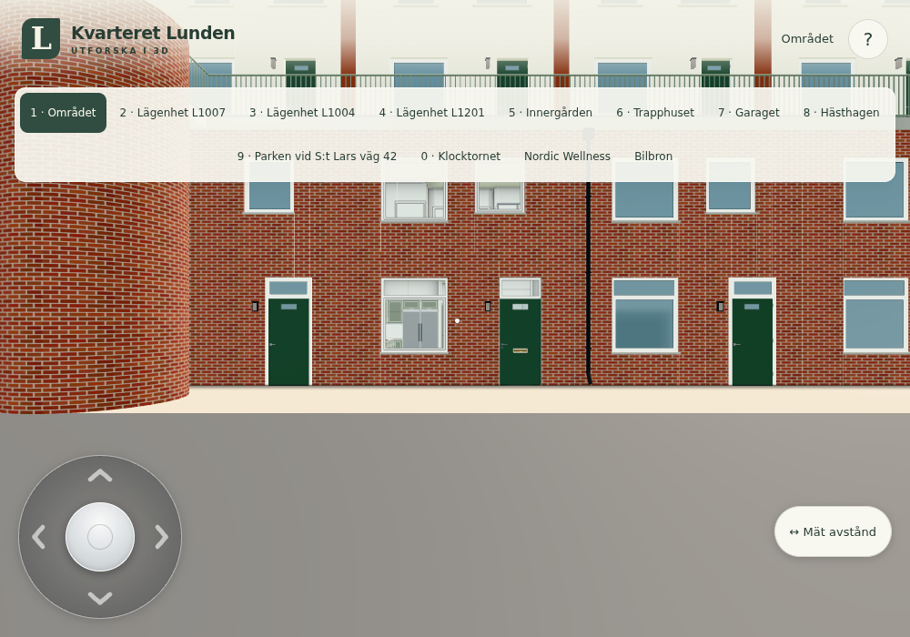
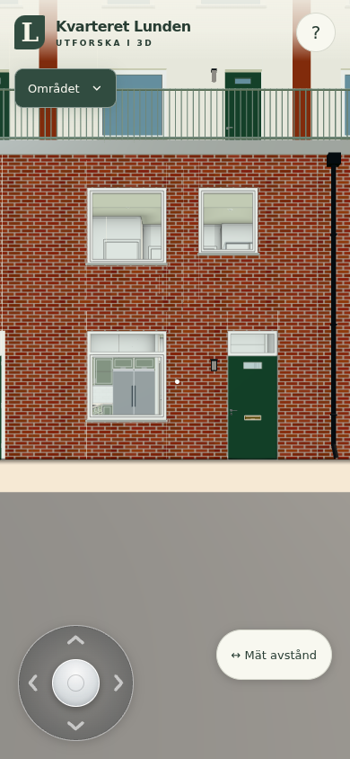

# #246 – exakt tillfällig byggcache

Fryst publik bas: `725dc63a3b5e48b3fa0e2216665be090454e8ea8` (godkänt gym och ankport ingår).
Selektiv originalkälla: `59c6957a25442ef93d06e564b2082aee4a6a5159`.
Bara slutlig numerisk helper och tillämpliga wrapper-/releaseprinciper. Originalets sträng/Map-prototyp,
hela main/config/surroundings och beständig lagring/SW importeras inte.

## Uppmätt utfall

Första aktiva presenterade bilden, sekunder från dokumentets navigationsstart:

| Profil | Besök | Före | Efter | Kortare tid |
|---|---|---:|---:|---:|
| Dator | Kallt | 34,971 | 28,218 | 19,31 % |
| Dator | Andra dokumentet | 33,134 | 26,868 | 18,91 % |
| Emulerad telefon | Kallt | 33,111 | 26,479 | 20,03 % |
| Emulerad telefon | Andra dokumentet | 31,021 | 25,126 | 19,00 % |

Båda kallstarter förbättrades i de parade försöken. **30 % nåddes inte.** Detta är fyra parade
lokala observationer, ingen upprepad statistisk serie eller fysisk Surface-/telefon-/produktionsgaranti.
Inga extra profiler kördes för att förbättra utfallet. Den statiska byggfasen är snabbare, medan
normal kollisionsberedskap och renderer/kvalitet behålls.

Den namngivna fasen ”Bygger huset” fram till ”Bygger trapphus och garage” (innefattar värld och
miljödjur, inte bara byggnad): dator kall 26,194→19,317 s, andra 25,876→19,630 s; telefon
kall 25,668→18,865 s, andra 25,020→18,793 s. Råloggarna har även hela ready/entry/render-return/
presented-tidslinjen, nätresursernas hämtningstider/bytes samt CDP ScriptDuration/TaskDuration,
layout och heap. Parsing är inte separat särmätt från exekvering/native canvas-arbete. Offentlig app
har ingen separat warmup-fas; första ordinarie rendering/texture-upload ingår i spelbarhetsmarkören.

[Jämförelse med räknade procent och hashvärden](comparison.json).
Förebygge `c7bf0ca6c235a44c43b89e5b`, efterbygge `213458517d5b388a469fff26`.
[Bygglogg före](before-build.txt), [efter](after-build.txt).

## Exakt metod

- Samma frysta källbas, startdestination Området, lokal juniklocka och ordinarie kvalitets-/geometrivägar.
Dator 1000×700, DPR 1, touchkapabel desktop (Surface-liknande inputprofil, inte fysisk Surface).
Telefon 390×844, DPR 1, Android-UA/isMobile/hasTouch ger publikens riktiga lowMemory-profil. Samma
profilparametrar används före/efter; inga geometri-, render- eller kollisionsgrindar stängs av.
- Varje profil/variant får en ny Chromium/SwiftShader-browser och context. Kallt besök först,
sedan ny page i **samma** context: HTTP/localStorage är varm men dokument/sessionStorage nytt.
Den föregående sidan stängs. Detta undviker att återupptagen session blir en annan startväg.
- Byggda paket, samma statiska server och verifierad `Cache-Control: public, max-age=600`.
Kall överföring före 1 543 398 / efter 1 544 613 byte (helpern ökar paketet 1 215 byte); andra
besöket 363 byte i båda versionerna, övriga hämtningar från HTTP-cache. Det är inte en beständig
markcache: tabellerna byggs och släpps på nytt i varje dokument.
- Ingen Playwright Clock används i den accepterade mätningen. Bara Date/Date.now fixeras med
NativeDate-subklass; performance/RAF/timers är verkliga. Normal startknapp trycks med native click.
Markören kräver att ordinarie värld/navigation/trapphus/garage är färdiga, knappen är upplåst,
Navigation.update verkligen körts efter starten och en aktiv rendering har returnerat/presenterats
vid nästa riktiga RAF. Loopen stoppas först efter den markören för stabil bild och begränsad kostnad.
- `kvarteretStartup` befintliga setStep/finish och lokala Navigation-/renderer-metoder instrumenteras
endast av fixturen. Appens bygg-/start-/kontaktväg är oförändrad. UI-automations-/presentationsväntan
finns med i totalen och redovisas i rådata, inte bortsubtraherad. Sista telefonscenen hölls tills
bildgranskning; inga nya matriser efter orelaterade ändringar.

[Före råsamling](before/summary.json), [efter råsamling](after/summary.json). Varje profil/besök
har dessutom egen JSON med resurslista/headers/tidslinje/releasefält och egen PNG.
Noll pageerrors och externa requests i samtliga besök. Originalets local-/sessionStorage-sentineller
är oförändrade. Ingen personlig resurs eller produktionsdata/tjänst används.

## Riktad identitet och livslängd

`node --test tools/startupcache246test.mjs`: **2/2 gröna** ([råresultat](component.txt)).

- Float64, grannkoordinat utan avrundning, avsiktlig hashkollision, signed zero, muterade objektkopior,
null/undefined/icke-numerisk scalar, NaN/Infinity, clear, release och senare default-cache avstängd.
- Två isolerade kopior av de verkliga publika modulerna med cache av/på. Faktiska terrainGeometry
registrerar alla tre samplerövergångarna efter verkligt clear: reset av parkingPatch, byte till
emitterade trianglar och senare parkeringspatch. Varje clear har 0 entries före nästa sampel.
Samma sampelreturer före/efter övergångar och samma faktiska emitterade positions-/indexbytehash:
`6209ea1e194ad8092e171c9ecf2daaca0a4106f83acd63c0b992a8d05f295ec1`.
- Dynamisk parkingPatch övertrumfar en redan varm råcache. Riktig WalkSupport ändras från en
uppåtriktad 1 m-yta till en 2 m-yta vid samma koordinat och walkingGroundY följer den direkt. Inga
walkingSupport-/stair-/deckfrågor flyttas in i råcachen eller får ändrad prioritet.

Tre tabeller, högst 32 768 slots vardera. Vid spelmarkören är alla active=false/entries=0;
`finish` har släppt array-/objektreferenser och senare defaultimports kan inte starta nya tabeller.
Efter telefonens kalla bygge noterades ungefär 0,89 M riverhits, 1,11 M terrainhits och 8,56 M drawn-hits.
Detta är byggfasdiagnostik, ingen kontinuerlig runtimecache eller permanent datalagring.

`npm test` och `npm run build`: gröna, 130 moduler granskade ([testlogg](npm-test.txt)).
[Källmanifest](sources.sha256). Inga vidare produktkälländringar efter den uppmätta efterversionen.
Framtida orelaterad #245-integration kräver byte-/hookgranskning, inte automatisk ny mätmatris.

## Egna granskade bilder

| Profil | Före | Efter |
|---|---|---|
| Dator |  |  |
| Telefon |  |  |

Samtliga fyra representativa bilder är direkt granskade/godkända. För var och en av de fyra
profilerade besöksparen är även de sparade PNG-filerna byteidentiska före/efter. Render calls,
trianglar, punkter och linjer är identiska vid dessa fasta startvyer. Detta gäller just dessa
frysta initialbilder och den verifierade terrängen/samplerindatan, inte alla framtida dynamiska
världstillstånd eller generellt pixelidentiska fauna-/klockbilder.

## Fixturdiagnostik och reproduktion

Det första baslinjepreflightförsöket använde Playwright Clock och saknade en navigation performance
entry vid resultatuttag. Inget accepterat föreutfall byggdes på den körningen. Fixturen bytte till
endast NativeDate-fixering före hela accepterade matrisen; samma metod används efter.
[Bevarad diagnostik](baseline-preflight-diagnostic.txt).

Första komponentfixturen ändrade avsiktligt compute-funktionens numeriska retur vid samma key utan
clear (då ska en cache träffa det gamla värdet) och grupperade parkeringsaritmetik annorlunda än
produktionskoden (1 ULP). Korrigerat till clear mellan olika numeriska compute-fall och exakt samma
parentesordning; inga produktändringar krävdes. [Första testdiagnostik](component-first-diagnostic.txt).

```
node --test tools/startupcache246test.mjs
npm test
npm run build
python3 tools/startupcache246-server.py /path/to/frozen-sites
CHROME_PATH=/path/to/chrome node tools/startupcache246-profile.mjs http://localhost:8921/before/ docs/verification/246/before
HOLD_STARTUP=1 CHROME_PATH=/path/to/chrome node tools/startupcache246-profile.mjs http://localhost:8921/after/ docs/verification/246/after
```

Förbered `frozen-sites/before` från en separat ren publik checkout på bas 725dc63a och dess byggda
dist, samt `after` från aktuell dist. Kopiera inte in gamla hela main/config i den nya appen.
Använd det delade browserlåset. `touch /tmp/246-release` släpper sista scenen. Ingen fysisk telefon,
statistisk konfidensserie, bred campus-/husmatris eller allmän telefon-FPS-garanti påstås.
Dirigenten hanterar faktisk CI/Pages/live-fingerprint efter integration; sourceSHA ensamt räcker inte.
