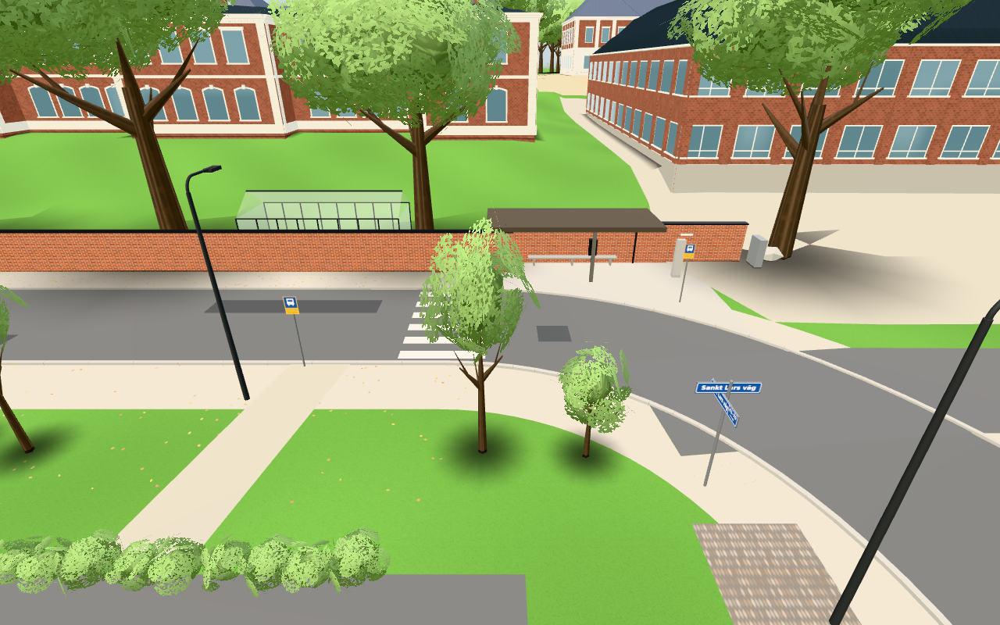
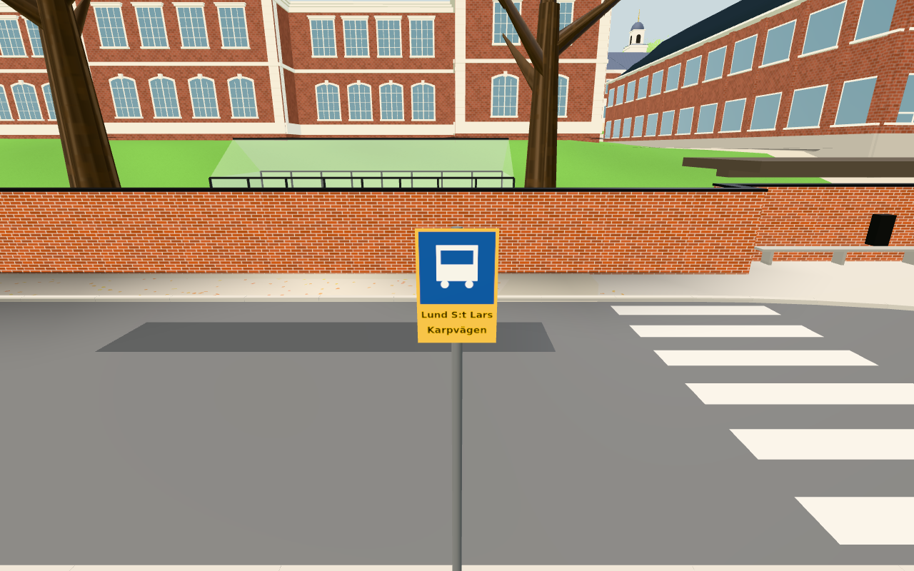
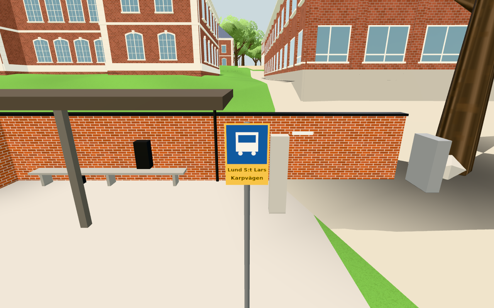

# #247 — vanliga hållplatstavlor och avslutat lokalt vägarbete

Originalkälla: `3d455f4cda94d4ec58b66704f87823000d7a859d` (#1843).
Fryst publik förebas: `a939dd593546690343a7e84b7722d4bcec95238f`.
Endast de två produktfilerna `src/config.js` och `src/street.js` ändras; ingen originalfil
kopieras i sin helhet. Egna resultatbilder från faktisk byggd publik app, 2026-11-04.

## Verifiering

1. `node tools/busstop247-check.mjs`: grön riktad jämförelse med publik förebas.
   Båda stolpplatserna bevaras, fyra tavelfaces delar en procedurtextur och exakt
   namn. Tavlornas 40 mm offset ger 10 mm frigång från 30 mm stolpradie.
   Gator/curbs/övergångsställen/lampor/ljuspooler och andra skyltar behåller exakta
   geometriledgers; separata busStop-plattformen och kollisionsdata är bevarade.
   Refugens två gula pollare har fortfarande 64 trianglar. Optional signal körs
   separat efter testet och tom svart batch är säker, inga ljus skapas.
   Egen flat komponent: 28→24 meshes, 85 772→85 536 trianglar (−4/−236).
   [Rådata](component.json).
2. `npm test` och `npm run build`: gröna; 135 moduler auditerade och byggfingerprint
   `e1fce9166ad54e9a59084329`. Inga persondata, spelmoduler, originallagringsnycklar,
   externa tjänster eller nytt nätbeteende överförs.
3. `CHROME_PATH=... node tools/busstop247-view-check.mjs http://localhost:8931/dist`:
   en faktisk byggd publik scen i Chromium 1208/SwiftShader, 1280×800, sommardag.
   Två verkliga skyltar/fyra faces/exakt namn/1 textur; faktiskt street-group har
   24 meshes/85 536 trianglar. Native KeyD ger 0,8 m med riktig Navigation på
   trottoaren. De tre tidigare arbetspositionerna har ändligt markstöd. Ingen
   JavaScript-exception eller extern begäran; originalets tre lagringsmarkörer
   är exakt orörda. [Rådata och kamerapositioner](browser.json).

Detta är lokal dator-WebGL med mjukvarurendering, inga mätningar av fysisk telefon
eller garanterad FPS. Ingen produktgeometri utöver den avgränsade skylträttelsen ändras.
Alla mått/färger/offset är modellantaganden, inga verkliga standardmått verifieras.
Ingen huslayout ändras, A/B/C/L-motsvarighetskrok är därför inte tillämplig.
Projektet har ingen spelarändringslogg. Källhänvisning/licenser bevaras i importregistret.
Pages-körning och permanent bildkommentar före stängning ägs av dirigenten.

## Granskade bilder

Alla tre original-PNG har öppnats och visuellt granskats: båda tavlorna är läsbara,
texten döljs inte av stolpen och den lokala signalvagnen/varningsstativen är borta.
Översikten bevarar korsning, hållplatsskjul, omgivande skyltar och gatulampor.

Fasindelning vid återupptagning: inventering/källa/plan cirka 3 minuter,
komponent och obligatoriskt test/bygge cirka 2 minuter, en appturn och bildgranskning
cirka 2 minuter, dokumentation/granskning cirka 2 minuter. Inga breda matrisomkörningar.
Manifestet binder produkt/testkällor och bilder till leveransen. Ett första försök att
importera fryst komponent via data-URL behövde rätta bare importupplösning för Three;
endast den berörda komponentkontrollen kördes om, ingen produktändring orsakades.

Published source18370f94b843e8f04329e90b05e19667672ed4dd, actual Pages41795651394 passed test/build/deployment and live fingerprint e1fce9166ad54e9a59084329 was verified before closure. Permanent embedded images were byte-checked in issue comment6625679441. No post-publication browser rerun.
