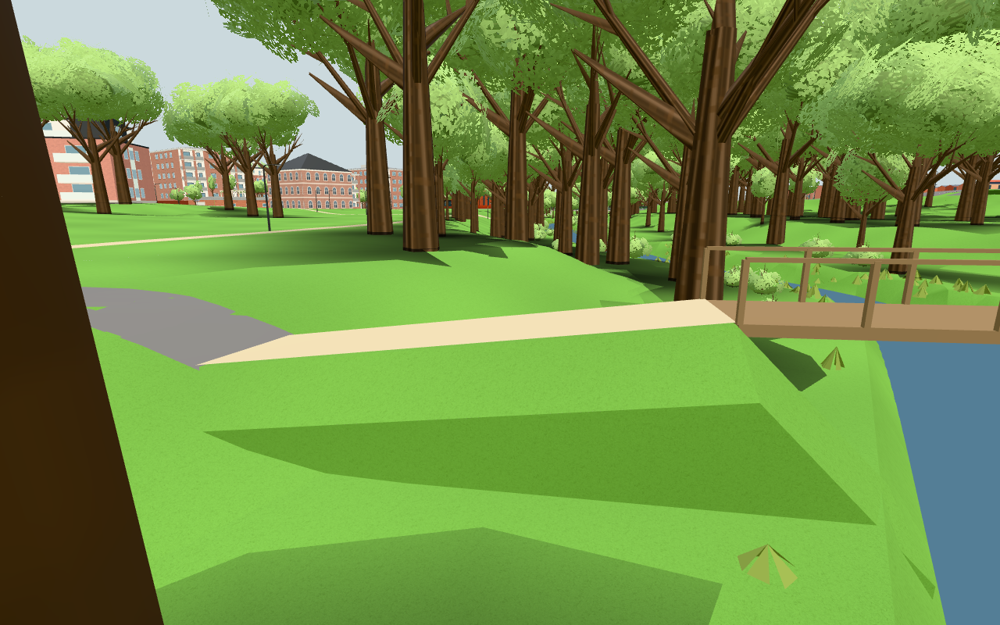
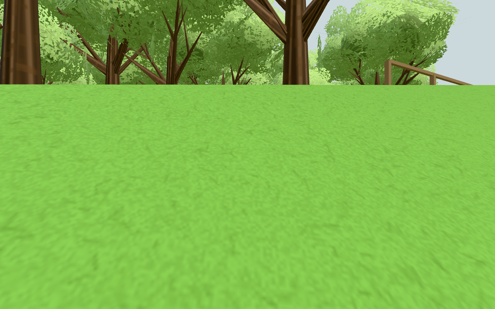

# #248 – solid jordkant vid träbron

Publik bas `a939dd593546690343a7e84b7722d4bcec95238f`; selektiv originalkälla
`a312a31de3158e10031ab0adb3059dff2d27dd24` (original #1849). Bara fyllningsspärren
har anpassats till riktig `Navigation`/`BODY`, inte originalets Player eller spel.

## Orsak och resultat

Den gamla riktiga publika Navigation tappar sitt enda stöd vid träbrons norra
jordfyllning. Start `(-137,195.4)`, sprint österut och dt0,05 reproducerar felet även
med publikens tids-/distansdelsteg. `walkingSupportHeight` är null här: den separata
stödlappen ligger långt bort. Höjden överstiger steghöjden0,45m; groundAt avvisar då
marken och returnerar−Infinity. Befintlig synlig jordkant saknade horisontell spärr.

`blockedByBridgeFill` använder befintlig analytisk `parkFillAt` före den slutliga
stöduppdateringen, även i båda glidalternativen i befintlig localStep. Nåbar ramp
förblir gångbar. Ingen geometri, terräng, vatten, fart, analogregel, steglängd,
material, ljus eller nät-/lagringsfunktion ändras. Ritkostnadens delta är därför noll
(enbart navigation.js ändras i appen), ingen bred renderprofil krävs. A/B/C/L:s
layouter och öppningar berörs inte; motsvarighetskontrollen gäller väg-/GC-broar.

## Verifiering

- [component.txt](component.txt):3/3 grupper använder riktig Navigation/mark/farWalls
  med minimal inomhusvärldsram. Negativ kontroll kopplar bara bort nya spärren och
  tappar stödet/faller under−12m. Ny kod behåller ändligt stöd vid20/60fps och fri
  backning. Båda ramper/hela träbron passeras fram–åter, gång/sprint, vid20/60fps.
  Väg-/GC-syskon passeras fram–åter och spärren är inaktiv där. Exakta fyllningsfall
  kontrolleras också utanför footprint där parkFillAt=null.
- [sprint.json](sprint.json):befintlig faktisk Navigationkontroll bevarar gång1,6,
  utomhus-Shift4,8, inomhus-Shift3,2, full/halv analog gång samt krypning och dörr/vägg.
- npm test:135 moduler/importgraf/publik isolering gröna; npm run build grön,
  contentfingerprint `b3498fd7cd96fe54b9593982`.
- [browser.json](browser.json):en verklig publik värld med renderad mark och gamla
  Navigation från publik bas i samma scen. Före:45×0,05s ger−24,86496m/−Infinity.
  Ny faktisk navigation med nativeW+Shift stannar i60steg på
  `[-135.68000000000026,-5.671248186139704,195.4]`, alla stöd ändliga. NativeS
  backar0,8m med fortsatt ändligt stöd. Inga pageerrors/externa anrop; ursprungliga
  lunden.*-lagringsmarkörer orörda. Ordinarie RAF är pausad och navigation pumpas
  deterministiskt; detta är Chromium på lokal dator, ingen fysisk telefon eller
  faktisk FPS-mätning. Kameran flyttas enbart för platsbilden; stoppbilden använder
  verklig fotposition +1,62m ögonhöjd.

Första browserförsöket stannade på goto-timeout eftersom shellens bakgrundsserver
avslutades när toolcellen stängdes. Servern flyttades till egen levande exec-session;
den saknade appkontrollen kördes därefter utan produktändring. Alla egna browser- och
serverprocesser är stoppade. Ingen omkörning av gröna komponentgrupper behövdes.

## Egna granskade bilder

Platsbilden visar träbron, rampens gånglinje och den solida jordfyllningens sida.

Efterbilden visar verklig ögonhöjd vid den kant som nu stoppar horisontell rörelse;
spelarens fötter behåller ändligt stöd i stället för att falla under marken.
Bilderna är direkt granskade. Ingen originalbild eller personlig resurs importerad.

[sources.json](sources.json) låser app-/kontroll-/bildkällor. Dirigenten publicerar,
bäddar in permanenta bilder före stängning och verifierar faktisk Pages/liveversion.

Published source070436ea23b9ed6e0e10649a361b53c3fa0740fd, actual Pages41796502656 test/build/deployment passed and live7626f9112654d6f22094386e verified before closing. Two pinned embedded images were byte-verified in comment6625805588. The integration preserves247 street/config and only changes Navigation.
