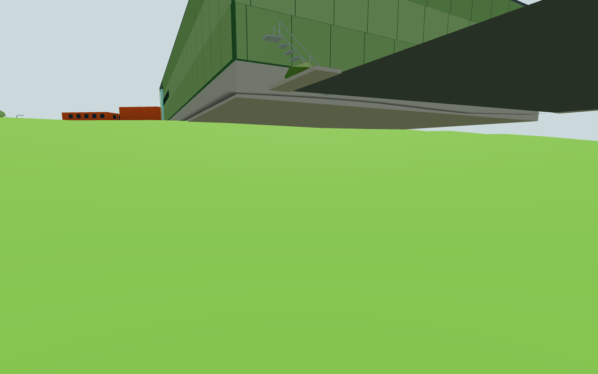
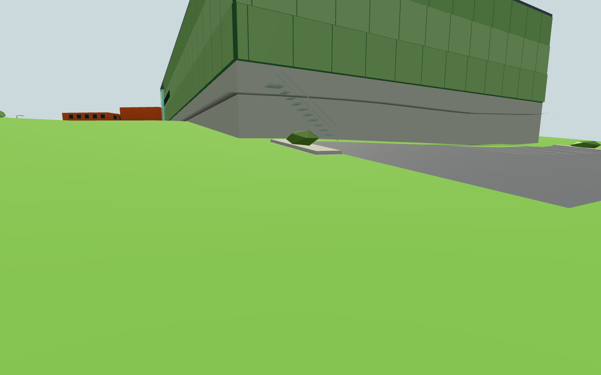
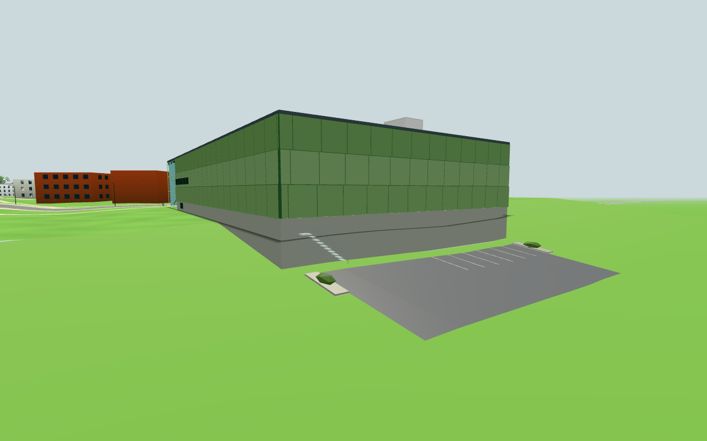

# #249 — Nordic parking meets its drawn northern ground

Selective original source: `edeff125c3645ee3ac0a0feee911713f140d08a5` (original #1850).
Frozen public before source: `a939dd593546690343a7e84b7722d4bcec95238f`.
This is a local contact/retaining-shape assumption, **not surveyed parking, cellar depth
or Peab-verified geometry**. Footprint, front, glazed entrance, floor/eave/roof datums,
stair dimensions, materials and the public isolation boundary remain intact.

## Cause and correction

The rear parking footprint is north of `SITE.backgroundGround.z0`; its visible ground
comes from the existing `edgebackdrop.skirtParts` feathered northern strip. The previous
Nordic builder sampled the extrapolated main terrain function instead of that strip.
The new Nordic-only helper clips asphalt and paint to the existing strip's exact source
triangles/diagonal/step. It changes no global ground or walking rule. The existing grey
foundation extends down to the minimum of intersected source triangles; planters drape
at their corners and both lower stair posts meet the slope independently.

The existing **public** `createAmbientCatGround` delegates only its parking sample to
that same helper. #245's habitat, water/road/barrier/trunk clearance and exploration,
nose-contact, geometry, drawing gates and all other cat modules stay intact. No original
cat gameplay, named profiles, report images, personal content, services, storage or
network integration is copied. Current source module hashes in
[retained-sources.json](retained-sources.json) show A/B/C/L builders, configuration,
shared terrain/edge geometry, navigation and other cat modules unchanged.

## Risk groups

1. `NORDIC_GYM_BEFORE=/tmp/public249-before.mjs node tools/nordicground249-check.mjs`:
   nine contact/isolation groups pass. The frozen old module imports Three from the
   installed package's absolute file URL. 651 sampled asphalt/skirt points agree within
   2.09 µm; all paint vertices within 1.65 µm; 651 cat/asphalt points within 1.96 µm.
   Two actual foot post corner sets meet the sloping mesh within 3.1 mm; the foundation
   reaches the whole sampled north edge. Front/brick and roof geometry bytes are exact;
   453 other hall/entrance/glass/solar geometries are exact. The component adds exactly
   seven triangles: 2 853→2 860, retaining existing three geometry/material lists.
   [Raw results](component.txt). The real `skirtParts` buffers supply the ray targets;
   no comparison to an assumed analytical ground is counted as mesh proof.
2. `node tools/nordicgymtest.mjs`: all eleven retained front/panes/globes/entrance stair/
   door/roof/paint contracts pass. Its expected component count is now the reviewed
   2 860, with no cap increase. [Raw results](retained-architecture.txt).
   `npm test` passes 136 audited modules; `npm run build` passes, build fingerprint
   `3a8d1c1a988e617bf8052ace`. No new lamp, material or fetched texture.
3. One actual public source scene before/after, with only east-backdrop and existing
   cat ground callback replaced, shares the real unchanged ground buffer. The old group
   is removed from its actual nested parent before the new group joins that same parent;
   the passing comparison never draws both versions simultaneously. Source-only
   route rewriting supplies frozen old modules and current after modules under separate
   same-origin URLs; no second scene/bootstrap/terrain rebuild is needed. Own result
   images and actual mesh data are captured, then inspected before publication.

The `#240` exact historical source checker documents that earlier locked import;
current ground geometry is covered by this reviewed #249 source/diff/mesh comparison.
No whole-campus visual sweep, new animal journey simulation or physical-device/FPS
claim is justified. The one scoped whole-east budget check retains #242's existing
46 222 low-memory cap, including nested clocks/sign meshes, without modifying it.

## Reproduction and delivery

A frozen public before module can be produced with `git show a939dd593546690343a7e84b7722d4bcec95238f:src/nordicgym.js`;
rewrite its bare Three import to the installed package URL when the file is outside
this checkout. Run the component command above and the retained architecture command.
Start a source server on port8933 and run
`CHROME_PATH=... node tools/nordicground249-view.mjs http://localhost:8933`.
The app fixture requests lowMemory plus keepgeo to retain CPU color arrays for exact
measurements; this is not a normal mobile-memory benchmark. It uses a desktop viewport
and Chromium/SwiftShader; no physical phone or GPU performance guarantee.

All own screenshots are saved here, with no copied original images. The conductor owns
final combined diff/image review, source attribution, actual Pages/live verification,
permanent embedded image comment and closure. No push/closure is done by the worker.

An initial app fixture removed the nested east-backdrop from the scene root rather
than its actual parent. Image review exposed both old/new groups being drawn together.
Those images/raw data were rejected and preserved privately, never counted as product
evidence. Only that faulty app/image group was rerun with the parent-aware replacement
and an exact world-draw +7-triangle / unchanged-call assertion; green component and
mandatory test/build results were reused. This was a fixture correction, no product bug.

## Actual app result and inspected images

The passing final fixture reproduces **5.168 m** before-error over intended grass
clearance. After: 63 actual asphalt/edge-land samples have maximum error **2.15 µm**;
actual public cat ground callback parity is **2.10 µm**. All four actual asphalt
corner vertices preserve their plan position and 45 mm clearance. Both lower steel
post centres meet the actual grass within **0.2 µm**; finite post cross-sections are
covered by the component check. Foundation maximum sampled gap is **−3.14 mm**,
so there is no open space below the checked rear edge. The edge-land geometry UUID
is identical before/after.

Whole lowMemory east-backdrop, including nested clocks/sign geometry: **45 885→45 892**
triangles, unchanged **12 meshes**, within the unchanged **46 222** cap (330 remaining).
At exactly the same low camera, world draw is **70→70 calls**, **582 842→582 849 triangles**,
with points/lines unchanged. These are scoped local renderer counts, no FPS claim.
The final comparison contains exactly one east-backdrop group at each phase.
[Actual raw data and public storage sentinels](browser.json).

All three final PNGs were opened and visually reviewed. The before-low view exposes
the old hovering parking/planters/stair feet; after-low shows the parking and lowered
stair/planter meeting the slope, with the existing grey foundation reaching grass.
The rear overview shows the intact green hall/roof above the corrected asphalt.
No duplicate old geometry remains in the final after pictures. Controlled cameras
are [−152,2.2,−379] looking at [−155,1.5,−375] for before/after-low and [−143,10,−389]
looking at [−174,6,−357] for the rear overview.

Phase times: source/plan/implementation about 4 minutes, renderer-free verification
about 2 minutes, browser wait/shared-resource preparation about 3 minutes, initial
app/image review plus scoped fixture-correction rerun about 3 minutes, final docs/review
about 2 minutes. Source/build inputs remained unchanged through the fixture correction;
only its affected browser/image check was repeated. Browser and own server were stopped.
