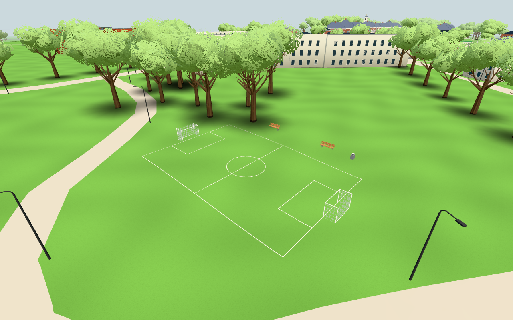
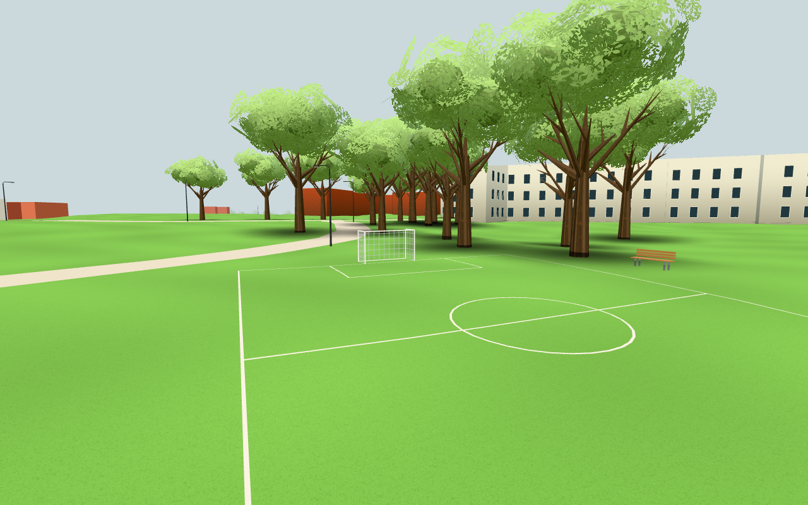
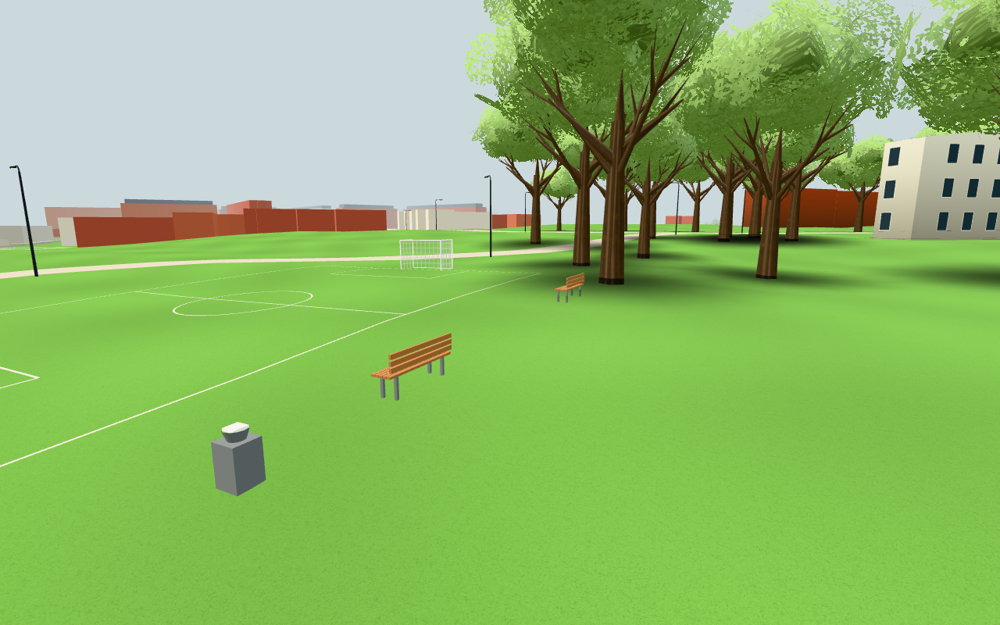

# #250 – fast fotbollsplan som passiv miljö

Publik bas `070436ea23b9ed6e0e10649a361b53c3fa0740fd`, exakt originalkälla
`c10d16ad33e2eea5246127f4c22b80ade3381a6c` (original #1853).

## Avgränsning och anpassning

16×24m-linjer, två mål/nät, två fasta åskådarbänkar och en torr fontän är selektivt
extraherade ur footballmodel/footballgeo. Endast statiska parametrar följer med i
`FOOTBALL_SITE`; rena world/local-transformer flyttas från physics till footballgeo.
Placering(-262,−21), mått, runoff/apron, färger och höjder är modellantaganden,
inte mätningar eller verifierade anläggningsfakta. Källans fasta form/proportioner
bevaras. Befintliga projektlicenser/attribution gäller den selektiva importen.

Borttaget: alla bollar, physics/manager/wire/credit, Rest/Life, pickytor/targets,
sitt-/drickinteraktioner, vattenström/animation, ljud, poäng, lagring och tjänster.
Inga originalbilder, personuppgifter eller privata resurser överförs. Ingen ny main-
eller world-hook. surroundings bygger passiv geometri efter befintlig terräng;
farWalls får11fasta fotavtryck/44segment via befintliga buckets. Inga träd, vägar,
WALK-gränser, underliggande terrängtrianglar eller övriga konfigurationsvärden ändras.

Precis som originalets lokala planstöd använder den lilla field/runoff/apronregionen
renderedTerrainY som gångstöd, efter publikens befintliga walkingSupport-prioritet.
Detta följer den faktiska emitterade ytan; övriga mark/deck/stödfunktioner behålls.
A/B/C/L:s layouter och öppningar berörs inte. Bänkarna är fasta miljömodeller och
fontänen är torr: ingen ny interaktion eller användarfunktion tillkommer.

## Tre riskgrupper

1. [component.json](component.json):ren fast modell på kontrollerat böjt underlag,
  17fotkontakter,11fotavtryck/44segment, två batcher och lokala stödområdesgränser;
  inga targets/lights/balls. [placement.json](placement.json):kontinuerlig2Dfrigång
  mellan runoff/apron och47befintliga väg-/access-/parkstråk; aktuella publika träd
  och byggnadsfootprints från appen finns i[site-location.json](site-location.json).
  Minsta vägkantfrigång är1,559607m, trädcentrumfrigång2,122827m och
  byggnadsfrigång42,861015m. Alla fasta föremål ligger inom stödregionen. Originalets rapport-/resultatbilder
  eller gamla trädlokalisering används inte som publik evidens.
2. [browser.json](browser.json):en riktig publik källaapp i lokal Chromium.744linje-
  vertices följer emitterad terräng med maxfel0,000000345m efter Float32,17fötter
  har exakt kontakt.672gångstödsampel är exakt lika med renderad mark. Fyra riktiga
  Navigation-rundor går planrektangeln gång/sprint vid20/60fps med ändligt stöd;
  maxfot-/markskillnad är0,006002m under snabba steg. Bänk, fontän och målpost stoppar
  verklig Navigation; nativeW rör verklig navigator0,8m. Inga pageerrors/externa anrop,
  ursprungliga lunden.*-lagringsmarkörer orörda. RAF pausas efter första bild och
  Navigation pumpas deterministiskt; det är inte FPS- eller fysisk telefonmätning.
3. npm test:137moduler/importgraf/publik isolering gröna. npm run build grön,
  fingerprint `b15fa315d88679d6b2cbfa7e`. Diff-/beroendegranskning bekräftar att
  inga spel-/moln-/personliga moduler importeras. [sources.json](sources.json) låser
  valda källor/manifest och egna bilder.35valda fasta parametrar är exakt lika med
  originalets låsta källa; befintlig config bevaras byteexakt som prefix. Inga breda campus-/telefonmatriser kördes.

## Kostnad och egna bilder

Verklig emitterad modell:968trianglar+76nätlinjesegment i två batcher. Samma hållna
scen, samma kamera, endast gruppens visible av/på: exakt+2calls/+968tri/+76linjer
för samtliga tre vyer. Inga nya ljus, texturresurser eller uppdateringsloopar.
Översiktsvyns325calls/687579tri är hela den lokala scenen, ingen ny global budget
eller fysisk prestandagaranti. Fontänen och bänkarna ingår i samma fasta mesh.

Alla tre bilder är direkt inspekterade. Browsern och egen server8934 är stoppade.
Dirigenten publicerar och länkar faktisk Pages/liveversion samt bäddar in permanenta
bilder före stängning. Ingen push eller produktionskontroll har gjorts av arbetaren.
