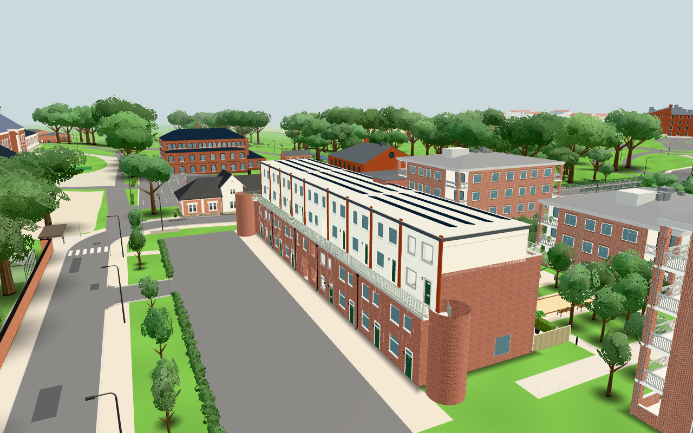
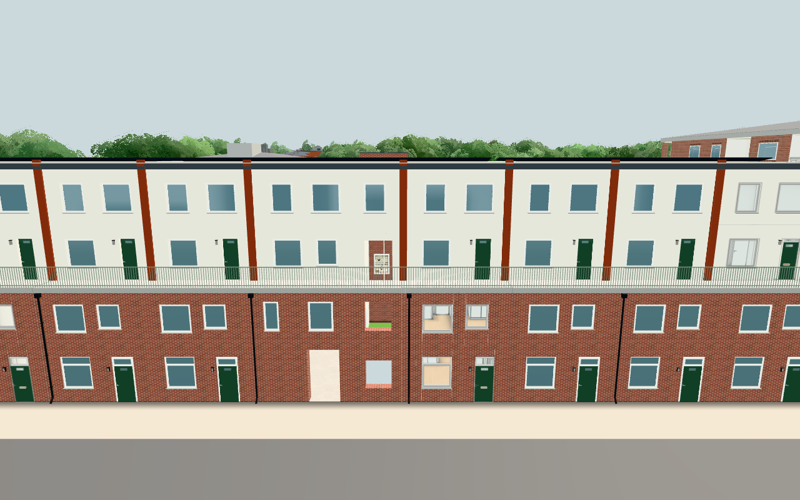

# #253 — isolate the backing behind Hus L's long façade

Original source: `7acb84d948cbb9f41b3fa8e9d60c929213074b02` (original #1852).
Public baseline: `63ba16656d931fc6313ac6129814f1454b88b1b4`.
The only runtime change is the selected `exteriorBackingMaterial` factory, existing
DECAL_OFFSET import and `add(solids, factory(wall))` call. All public geometry-generating
code stays exact. No original image, pair fixture, personal world data, gameplay,
service integration, storage key or whole original module is copied.

The public builder has the same6mm skin/backing separation. The independent material
clone moves only opaque backing depth away, using factor1/units2 from existing defaults.
It retains colour/map/side/roughness/depth-write and fragment compile/cache hooks. The
six other actual scene objects using the incoming wall material remain unchanged.
One local material clone is added; no new geometry, draw, shader feature, texture or light.
Existing attribution and licenses apply. Dimensions remain authored model assumptions.

## Three planned groups

1. `node tools/facadebacking253-check.mjs`: actual public factory isolation and hook
   retention pass. Own public scene ray export has **450** skin/backing pairs on brick
   and render, all6mm apart. With the natural public camera config **near0.06/far700**,
   the independent24bit depth model finds **27 ties** before the bias; afterward the
   minimum depth-code gap is2, with no ties. It uses its own generic distant inspection
   eye/target, not an imported original image or data fixture. [Own pairs](public-pairs.json),
   [component output](component.json). Analytical precision evidence is distinguished
   from physical GPU rendering.
2. `npm test` and `npm run build`:138 audited modules pass, build fingerprint
   **`d8c721a362655d988db2c9ec`**. Public content/network/storage guards remain green.
   Exact factory/source-region comparison, unchanged public geometry-building source
   and A/B/C/shared module hashes are in [source isolation](source-isolation.json).
3. One actual public source app in Chromium1208/SwiftShader,1280×800, June daytime.
   An interceptor serves only the frozen **public** old exterior. Current production
   factory is then applied to its actual backing mesh inside that same held scene;
   no app/terrain/bootstrap repeats. Own before/after screenshots retain the same view.
   All exterior position/normal/geometry UUID hashes stay exact. **886→886 calls,
   967030→967030 triangles,37→37 programs**, points/lines unchanged. All146 real
   pane centres still hit exposed window/door glass,0 failures. Six other wall-material
   users remain unchanged. Zero page errors, external requests and WebSockets; the
   original application's three storage sentinels are exactly unchanged.
   [Full actual ledger, material flags and isolation](browser.json).

The images use a controlled near0.05 precision probe; this is deliberately more
conservative than the public app's unchanged natural0.06. The app's far700 remains.
No native24bit hardware flicker is claimed as reproduced in SwiftShader. These pictures
show preserved geometry/lighting/openings; the depth-layer correction is established
by actual layer samples and the declared projection model. They are not a phone/FPS
benchmark. No whole-campus/device/profile matrix was needed.

A/B/C records use the separate aHouseParts/loggia/CoreHouse bodies, not L's simplified
6mm backing masses or this factory; their dimensions/openings/glass and source files
stay unchanged. Their relevance was source-inspected; no new full A/B/C app sweep is
claimed. The roof, shell, loftgång and original public visited-flat interiors are kept.

## Own reviewed pictures

All three PNGs below were opened and reviewed. The before/after uses eye[−70,23,−20]
toward[−15,8,6],FOV50. The closer result uses[−19,13,−24] toward[−19,8,2],FOV55.

Browser/server8936 stopped. Approximate phases: source/claim/patch2min, mandatory
fast checks1min, one app and own images2min, source/component/docs/review3min.
No expensive verification rerun was needed; the source tool's final console output
was tidied without changing assertions, app paths or evidence. Its first log's
`pairs:146` field accidentally printed pane count; own public-pairs.json contains450
pairs and is authoritative. The corrected tool omits that diagnostic console field.
Publication, pinned accessible images before closure and actual Pages/live results
are recorded below once verified.
