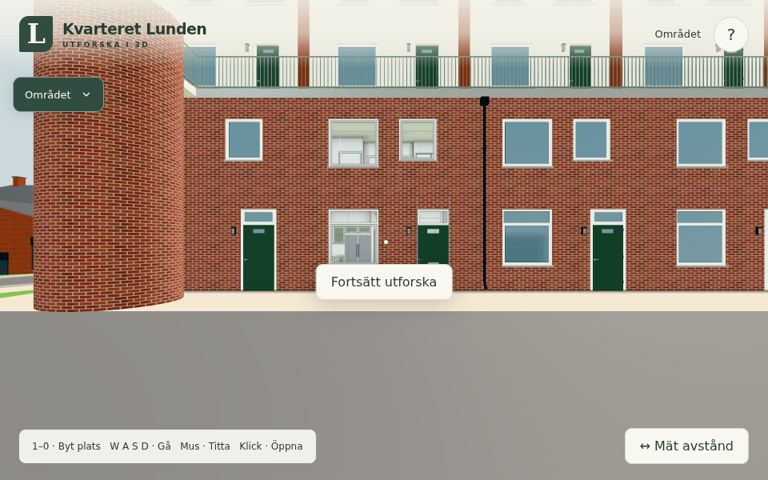

# Förebyggande rättning av normalpackaren (#256)

Selektiv originalkälla: `0f6ecb6a2acbb6c28d912471d3ff3e42d356820b`.
Publik bas: `0a3440f`. Endast normaliseringsraderna och precisionskommentaren i
`src/lowmemory.js` förs över. Icke-nollnormaler får enhetslängd innan Int8×4-konverteringen;
nollnormaler förblir nollor, och delning, opt-outs, positioner, UV, index samt bytebudget behålls.
Inga originalbilder, personliga modeller, spelmoment, lagring eller tjänster har kopierats.

## Faktisk räckvidd

Publicens `freeSceneGeometryCopies` har inget produktionsanrop. Packningen aktiveras
**inte** av denna ändring. Anonyma kattmodeller normaliseras redan av publicens egna
`mergedRig`; deras uppdaterbara geometri berörs inte. Detta är underhåll av den befintliga
hjälpfunktionen, inte en ny publik renderförbättring.

Före/efter-bundling med exakt samma fasta versions-/tidsvärden ger identiska
**1 520 293 byte**, SHA-256 `0371fcd9529cd97fe6070a0665dd596b98d2fe92052083c5736f8e41103d63bd`.
Den ändrade funktionens kod är oanvänd och tas bort av esbuild. Det vanliga byggets
källfingeravtryck ändras ändå till `49c26cc4ecb62a00b3da7628`, eftersom byggrutinen
räknar alla källfiler; det är inte ett påstående om identiska kompletta distributionsfiler.
Ingen uppstarts-/FPS-vinst eller kostnad påstås för public.

## Kontroller

- **6/6 nativeprov** i `tools/normalpackingtest.mjs` och befintliga `tools/lowmemcanarytest.mjs`.
  Skalade små/stora vektorer, nollor och exakta axlar; delade attribut; 4 byte per vertex;
  oförändrade positioner/UV/index; skinn/morf/dynamik/keepCpu/uppladdade attribut och befintlig canary.
  Den egna anonyma kattproducentens obearbetade benprofil ger vid uttryckligt anrop av hjälparen
  **13,831588° → 0,296120°** största riktningsfel, med samma **63 vertices / 252 normalbyte**.
  Det isolerade producentprovet är inte publicens aktuella sammanslagna kattmodell.
  [Förväntade reproduktionsfel före](native-before.txt), [godkända prov efter](native-after.txt).
- **Faktisk publik app**, källversion före/efter och färdigt `dist/`, Chromium 156.0.8078.4/SwiftShader,
  960×600, DPR1, `?lowmem&month=6`, fast tid 2026-06-02 10:00 UTC och seed.
  Samtliga visar **1 392 geometrier, noll byte-normalgeometrier, 549 calls / 888 275 triangles**.
  Källinstrumenteringen registrerar noll anrop till global packning. Ingen page error,
  extern begäran eller ändring av originalets tre lagringsmarkörer förekommer; inga nya
  lagringsnycklar uppstår. Gamla `cloud`-/`sync`-parametrar ignoreras. [Råresultat](browser.json).
- **`npm test` och `npm run build` passerar**: 139 moduler/importkedja, planunderlag,
  nät-/lagrings-/innehållsregler, appidentitet och ikoner samt statiskt publiceringspaket.
  [Testlogg](npm-test.txt), [bygglogg](npm-build.txt).

## Egna resultatbilder

Alla tre PNG-filer är byteidentiska, SHA-256
`1c2fc90f1c8c65ef31580725b4f9381365755b703aa4c473d1522576e917e04e`.
De visar den aktuella publika lågminnesvyn och har granskats visuellt. Ingen synlig
skillnad påstås; ingen jakt på alternativa vyer eller extra prestandasvep har utförts.

Före:



Efter:


Det färdiga byggpaketet:


## Reproduktion och begränsningar

```sh
npm ci
node --test tools/normalpackingtest.mjs tools/lowmemcanarytest.mjs
npm test
npm run build
python3 -m http.server 8977
```

Spara `git show 0a3440f:src/lowmemory.js` utanför checkouten. Sätt `LOWMEM_BEFORE`
till filen och `CHROME_PATH` till full Chromium. Kör browserprovet under projektens
delade browserlås med:

```sh
node tools/normalpackingbrowser.mjs http://localhost:8977 docs/verification/256
```

Körningen använde det befintliga delade `browsertest.sh`-omslaget med femminuterstak;
omslaget meddelade att systemd-minnestaket inte kunde installeras i denna WSL-session.
Ingen fysisk telefon, touchinteraktion, annan navigationsrutt eller native-GPU-prestanda
är verifierad. Inga byggnadsmått, öppningar eller A/B/C/L-layoutdelar ändras.
