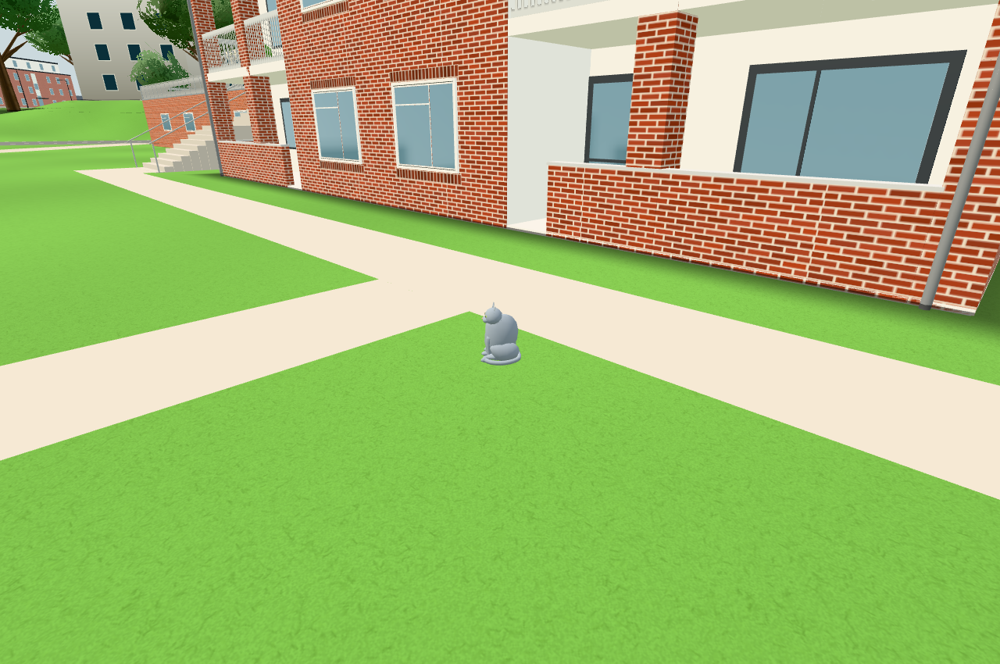
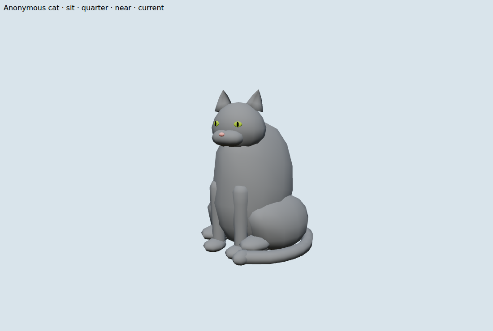
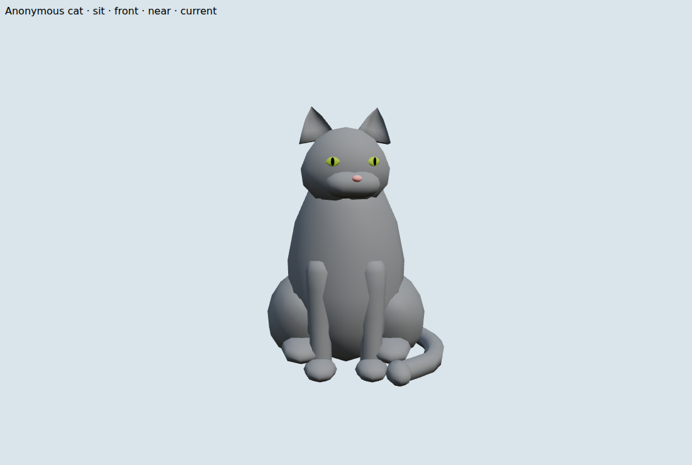
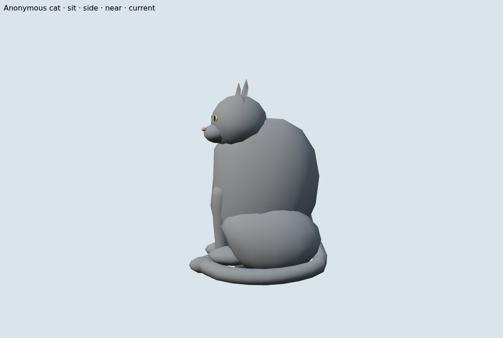

# Public #268 — neutral procedural cat surface

Source: original `8e226fa183ade3ccc1bfb638427bc75e2120d7b6` (#1918), selectively adapted from `src/catmodel.js` and `CAT_SURFACE`. Frozen public baseline: `11d67b945daccf36f90e27cd4420b19b2ec1903f`. No original asset/build/history was copied. Source attribution remains in code; this introduces no external model or license payload. Existing Three.js r170/MIT notices remain in `THIRD_PARTY_LICENSES.txt`.

The generic torso/head/muzzle profiles, flatter eyes, curved ears and slimmer limbs use the public pose pivots and head scale. Hidden bib/blaze geometry remains in the fixed-topology merged rig with collapsed positions; the public palette remains solid. No individual profile, pattern, breed metadata, GLB/loader, original image, interaction, audio, storage or service is imported. `CAT_SURFACE` centralizes the selected shape/tessellation guesses. The first whole/front/side and actual normal scene proposal was reviewed; only the exact source nose anchor was corrected before the conductor's form LOCK. The nose is now at local y −.012, z .07745; existing 6 mm nose-contact radii remain authoritative. No subsequent art pass occurred.

## Actual budgets

| Actual submitted/retained quantity | Public before | Current |
| --- | ---: | ---: |
| Calls per visible cat, every LOD | 1 | 1 |
| Triangles per near, cached sit or cached walk | 2,040 | 2,728 |
| Raw position/normal/color bytes per LOD | 220,320 | 294,624 |
| Unique retained source + 36 pose/rig geometries, all 12 cats | 348 | 56 |
| Unique backing buffers, all 12 cats | 1,356 | 188 |
| Raw retained bytes, all 12 cats | 8,679,360 | 10,672,712 |
| Retained source/render materials + module templates | 133 + 11 | 133 + 11 |
| Textures / external model assets | 0 / 0 | 0 / 0 |

The locked ceiling is 3,060 triangles / 330,480 bytes per actual LOD and 13,019,040 total retained raw bytes. Per-LOD increase is 33.7%; union increase is 23.0%. The union counts each actual backing buffer once, including hidden source parts and all cached/near geometry. CPU source geometry caching reduces duplicate resources; this does not eliminate allocations or claim a GC improvement. Existing tail rebuilds on pose changes and existing mergedRig updates remain. No extra render material, shadow/light, renderer or per-frame geometry path is added. Hidden source bib/blaze slots still count toward actual submitted triangles. Far LOD is a cached pose, not reduced tessellation; near/far costs must not be added for the same cat.

`native-paired.json` measures both sources in the same Node process, 30 warmup +100 update samples with identical clocks/cameras. Normal-camera median/p95 is 0.0229/0.0293→0.0223/0.0612 ms; a controlled single walking near cat is 0.3366/0.6353→0.4437/0.8710 ms. These small CPU samples are noisy local measurements, without GPU, frame rate, phone hardware or end-to-end performance claims. The initial before-art snapshot in `baseline-native.json` is retained; the paired report is the matched comparison.

## Three scoped verification groups

1. `npm test` passes (141 modules audited, import graph and identity/storage boundaries); `npm run build` passes, content fingerprint `4a6967a51967096f4840f56f`. Logs are `test-final.log` and `build-final.log`.
2. `node tools/catshape268-native.mjs` passes resource/finite/budget, original public OUTDOOR_CATS deep equality and byte equality of seven runtime behavior/entry modules. Tests exercise 6.9/7.1 m near transitions, 31.9/32.1 m draw transitions, 17.9/18.1 m phone visibility, hidden/winter suppression and stable near-buffer identity. The unchanged `main.js` retains actual `?nocats` construction suppression. `node tools/outdoorcats-check.mjs` passes 28 day plans/11,769 route samples, all eight loops, twelve cats, exact passive nose-center gap .012 m and climb paw/body clearance .005 m. `node --test tools/normalpackingtest.mjs src/outdoorcatroute.test.mjs` passes 7/7. The old 2,040/4,080 triangle expectations were updated to 2,728/5,456; the normal packing producer fixture now has unit normals, while scaled/zero/tiny-vector coverage and <.4° direction error remain.
3. The real public `OutdoorCats` fixture supplies sit/walk/sleep/wash whole quarter/front/side images plus cached walk. A frozen public build and current build supply one actual normal app scene. `before.json` / `final.json` bind source SHA256 values, all complete model/camera/projection matrices, render counts, intended pixels and resources. Source hashes are checked unchanged during capture. Original storage sentinels remain untouched; zero original-key operations, page errors, external requests or WebSockets occurred. The initial diagnostic far camera was mis-aimed (zero pixels on both sources); only those two views were corrected and replaced via `catshape268-far.mjs`, recorded in `far-corrected.log`. Actual normal scene evidence was already valid and was not repeated.

The normal app has fixed epoch 1793491480, anonymous cat 4 at [−25,−3,61], eye at [−22.5,−1.38,63.5], the existing 65° camera and 1280×850/DPR1 quality. Scene with cats hidden: 248 calls/702,487 tri on both builds; shown: 249 calls/704,527→705,215 tri. The actual cat therefore contributes exactly 1 call/2,040→2,728 tri and 3,145→2,978 visible pixels after occlusion (byte-channel delta threshold >2). Complete matrices match exactly before/after; no scale/FOV enlargement was used in this normal app view. The component far view uses an explicit 18° diagnostic camera and must not be presented as ordinary ground visibility.

## Reviewed images

Actual normal view, before:

Actual normal view, current:

Whole current quarter/front/side:

Other own images: `before-{sit,walk,sleep,wash}-{quarter,front,side}.png`, matching `final-*`, and `before-far.png` / `final-far.png`. The worker opened first proposal sit/front/side/walk-side and both normal app views, then the corrected side/normal and final cached pose. The conductor reviewed the first views and explicitly locked the corrected side and actual normal app view. No new photographic reference or exact real-animal matching is claimed.

## Reproduction and publication limits

Use the identical lockfile-installed dependencies. Freeze a build of the exact public baseline before changing source; the worker stored it outside the checkout at `/home/devcontainers/.local/state/lunden-session-20261112/268-before`. Run `python3 tools/catshape-server.py --before FROZEN_PUBLIC_BUILD --baseline 11d67b945daccf36f90e27cd4420b19b2ec1903f --port 8301`, then `CHROME_PATH=CHROMIUM node tools/catshape268-check.mjs before` and `... final` under the shared browser lock. The corrected fixture now includes the far lookAt directly. The app/component checks close their own browser contexts. No broad World/performance suite or physical device run was needed. Final publication, actual green Pages, pinned HTTP200 image embeds and issue closure remain the integrator's steps; local evidence alone does not claim deployed acceptance.

Root reviewed the combined patch, normal/whole/front/side plus walk/sleep/wash/cached pose images. [Integration mapping](integration.json) proves the exact scoped CAT_SURFACE, all executed cat sources/harnesses and worker evidence after the independent squirrel port; existing squirrel sources remain exact. [Projection review](projection-review.json) proves every corner of all 26 captured world AABBs inside the finite frustum, plus all 8184 actual normal-view vertices using a native reconstruction at the exact captured clock/model/camera/projection. The reconstructed model matrix matches the captured app exactly. Source/input/quality-bound browser, contracts and CPU samples are reused without a broad rerun.
