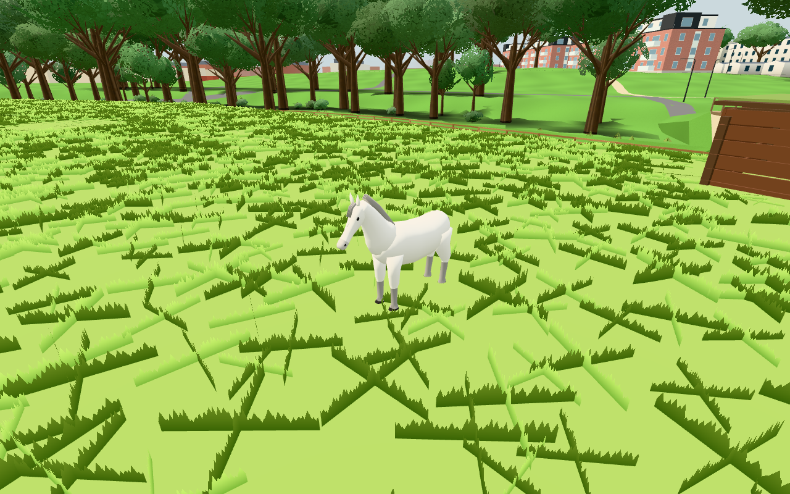
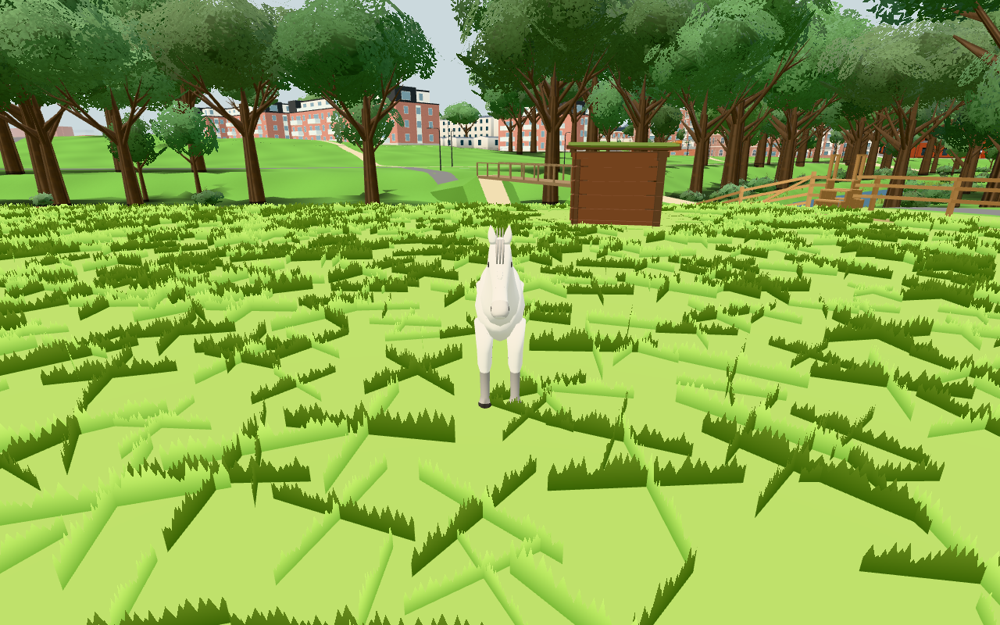
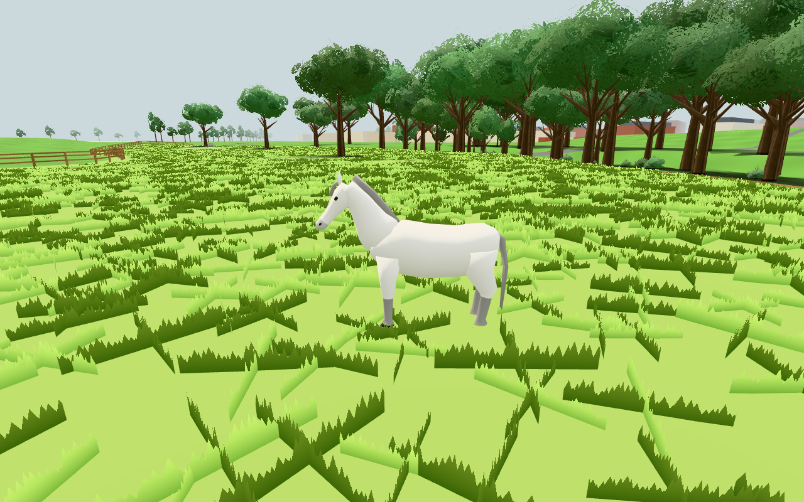
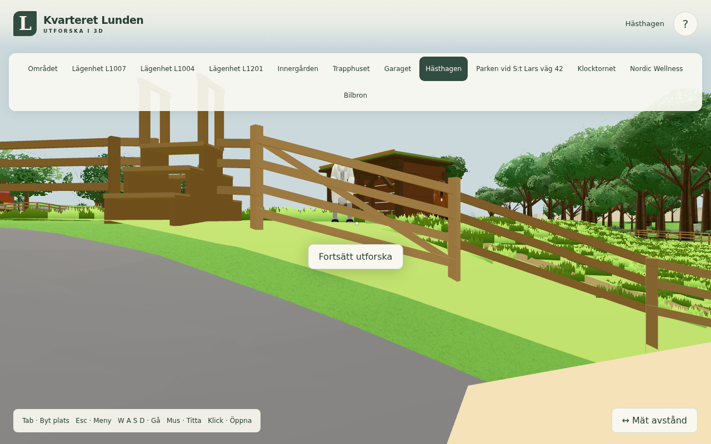
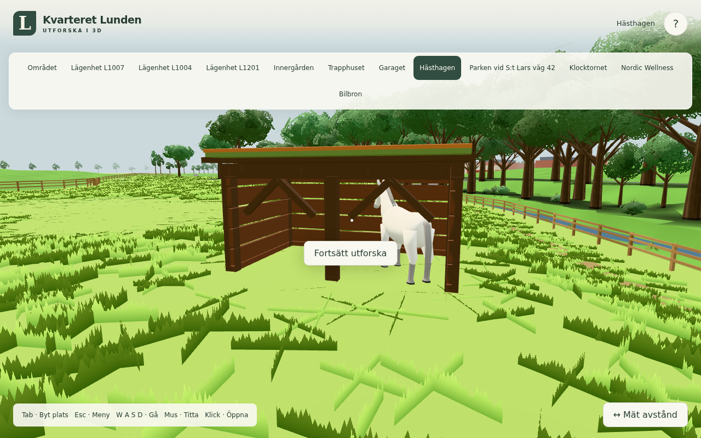
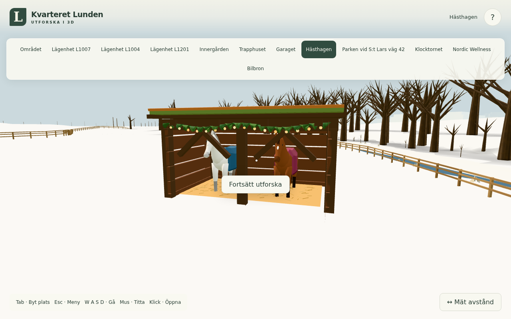

# Neutral ponnyform, public #269

Originalkälla `5d19eaeeaebb31109f5b0167c2b4786b24c04176` (#1919), selektivt
anpassad till publicens egna Soup/ponyGeometry. Public baslinje
`11d67b945daccf36f90e27cd4420b19b2ec1903f`. Root granskade hela/front/sida/normal
och låste första receptet: inga efterföljande form- eller materialpass.

## Granskade resultat

Alla bilder är öppnade. De fria whole/front/side-bilderna visar den första ponnyn
på faktisk hagmark med riktiga shader/ljus; endast verifieringsvyn flyttar den till
(-130,240), ställer neutral pose och döljer UI. Ankomstbilden använder den vanliga
Hästhagen-knappen och behåller grindens partiella ocklusion. Regn är appens
befintliga regninmatning (ingen visuell regnsimulering); vinter startas med `?month=1`.
De byggda skyddsvyerna riktar bara kameran mot befintligt skjul.

Matchade före: [hela](https://raw.githubusercontent.com/solwation/kvarteret-lunden/01a9a8a31855f1ab00432eebe616dc6a371cac7c/docs/verification/269/before-whole.png), [front](https://raw.githubusercontent.com/solwation/kvarteret-lunden/01a9a8a31855f1ab00432eebe616dc6a371cac7c/docs/verification/269/before-front.png),
[sida](https://raw.githubusercontent.com/solwation/kvarteret-lunden/01a9a8a31855f1ab00432eebe616dc6a371cac7c/docs/verification/269/before-side.png), [ankomst](https://raw.githubusercontent.com/solwation/kvarteret-lunden/01a9a8a31855f1ab00432eebe616dc6a371cac7c/docs/verification/269/before-normal.png).
Motsvarande källefter [ankomst](after-normal.png). Hela kameror, poser, skala och
plats är exakt lika före/efter i `before.json`/`after.json`.

## Kostnad och oförändrade kontrakt

| Mått | Public före | Låst efter |
|---|---:|---:|
| Trianglar, delad ponnygeometri | 1080 | 2652 |
| Statiska position/normal/color/aPart/aPivot-byte | 168480 | 413712 |
| Ponnybatch inkl unika instansattribut och matris | 168728 | 413960 |
| Flockdraw / instanser | 1 / 2 | 1 / 2 |
| Faktiskt inskickade flocktrianglar | 2160 | 5304 |
| Hela Paddocks unika kvarhållna ArrayBuffers | 2029083 B | 2274315 B |
| Hela Paddocks geometrier / material | 6 / 6 | 6 / 6 |
| Befintlig gräsmasktextur | 1 × 8991 B | 1 × 8991 B |
| Externa resurser / nya texturer / nya ljus | 0 / 0 / 0 | 0 / 0 / 0 |

Lås före formarbete: ≤3000tri, ≤505440B (3× rågeometri), en flockdraw,
samma attribut/part/pivots. Efter är2,456× rågeometri; ingen minnes-/FPS-vinst
påstås. Inventeringen räknar varje ArrayBuffer en gång, även delad täckesmatris,
alla hagmeshar, instansattribut, gräsmaskens Float32-data och R8-bild. Det är
kvarhållna typedarrays, inte uppmätt total browser/GPU-minnesförbrukning.

Hela produktkoden från `ponyMaterial` till filslutet är byteidentisk med public före:
shader, två anonyma färger/mark, animationer, pivots, gång/bete, gräs/72h-lagring,
regn/vinter/täcken, far/hidden och frånvaro består. Hovens befintliga nedre omslag
är oförändrat (framben cirka−0,0181m, bakben0); det gamla riggmåttet ändrades inte.
Ingen kod bygger geometri per bildruta. Ingen CPU-loop ändras, därför ingen ny
varmprofil eller bred World-prestandakedja. SwiftShader är inte fysisk hårdvara/telefon-FPS.

## Kontroller och källbindning

1. `npm test` och `npm run build` gröna. Byggfingeravtryck i `consumers.json`.
2. `node tools/pony-surface-invariants.mjs` grönt: fulla ändliga attribut/enhetsnormaler,
   identiska part-/pivotmängder, verkliga dry/rain/winter/summer-instansmatriser,
   markkontakt/innanför staket, skydd/täcken/gräs, far/hidden och passiv raycast.
   15912 fulla deformerade vertexprojektioner per stand/graze/walk-pose är ändliga.
   `invariants.json` redovisar budget, hela resursinventeringen och shader/beteendehash.
3. Browserjobben kördes seriellt under originalets `tools/browsertest.sh` och dess
   gemensamma lås, på egen8302. Källjämförelse samt byggd riktig ankomst/regn/vinter:
   en draw/5304tri och2987/9899/12124 verkliga ponny-pixlar, mätta genom att dölja
   endast ponnybatchen mellan två frysta renderingar. Hela kameramatriser och
   verkliga instansmatriser är ändliga; originalets faktiska `lunden.paddockGrass` och separat `lunden-save`-kanarie består, noll externa
   requests och WebSockets. Bara publicens egen gräsnyckel skrivs.

Källhashar finns i `before.json`, `after.json`, `consumers.json` samt slutmanifestet.
Källbildernas paddock.js skiljer sig från slutkällan bara genom rättad triangeltext
i filhuvudskommentaren; `invariants.json.imageReuse` bevisar exakt detta, utan att
upprepa gröna formbilder. Övrig slutkälla återfinns i den byggda konsumentkörningen.

Fixturrättelser: första fria kameran stod bakom grinden och en inline UI-stil
blockerades av CSP; korrigerat till fri hagpunkt och separat samma-origin CSS.
En ursprunglig testgräns för hov0 var för strikt mot befintliga frambensändar;
jämförelsen kräver nu det verkliga oförändrade föreomslaget. Fyra tillfälliga
linsgeometriers UUID förbrukar16 globala slumpvärden före gräsfröet. Den frysta
före-fixturen förbrukar samma16 värden så gräs/bakgrund matchas, utan att ändra
föregeometri eller produktens slump/beteende. `image-comparison.json` visar att
alla pixeländringar ligger inom ponnyns projicerade område i varje matchat par;
gräs och annan bakgrund är pixelidentiska utanför dessa gränser. Ursprungliga
dåliga bildförsök ersattes.

Detta är lokal verifiering. Root äger rebasegranskning, faktisk Pages-publicering,
SHA-pinnade HTTP200-resultatbilder, issuekommentar och stängning. Förebilder är
jämförelsebevis och kan gallras först efter den avslutsgrinden.

Root granskade hela produkt-/fixturdiffen och öppnade hel/front/sida/normal samt byggd ankomst/regn/vinter. [Integrationsmappningen](integration.json) bevisar alla körda källor/17 bevisfiler exakta, PONY_SURFACE exakt vald originalkälla och hela tidigare config orörd; tidigare katt-/ekorrportar och båda befintliga dokument bevaras. Två rena append-konflikter löstes med exakt main-prefix och exakt workerbilaga. Käll-/input-/kvalitetsbundna gröna bild-/konsumentprov återbrukas, utan extra formpass eller bred browser-/prestandakedja.

Efter HTTP200/bildtyp för alla 11 pinnade bilder och inbäddade resultat i [ärendekommentaren](https://github.com/solwation/kvarteret-lunden/issues/269#issuecomment-6822974208) gallras alla 4 egna förebilder från main. De finns kvar i publicerad revision `01a9a8a31855f1ab00432eebe616dc6a371cac7c`; länkar är pinnade och [bildmappningen](hosted.json) bevaras. Resultatbilder följer 30-dagarspolicyn. Ingen produkt- eller kontrollkod ändras i gallringen.
