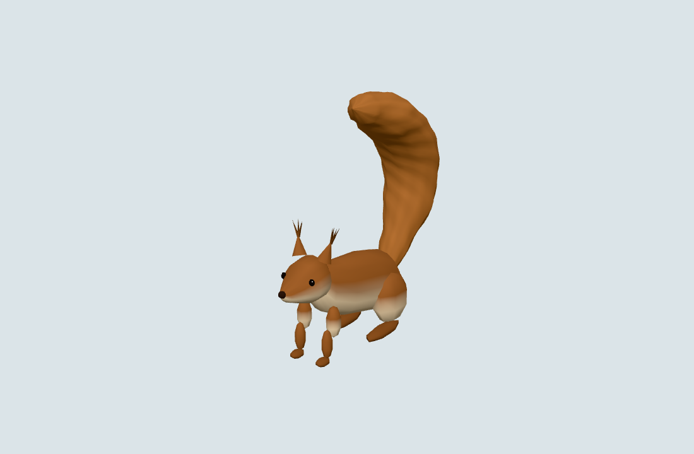
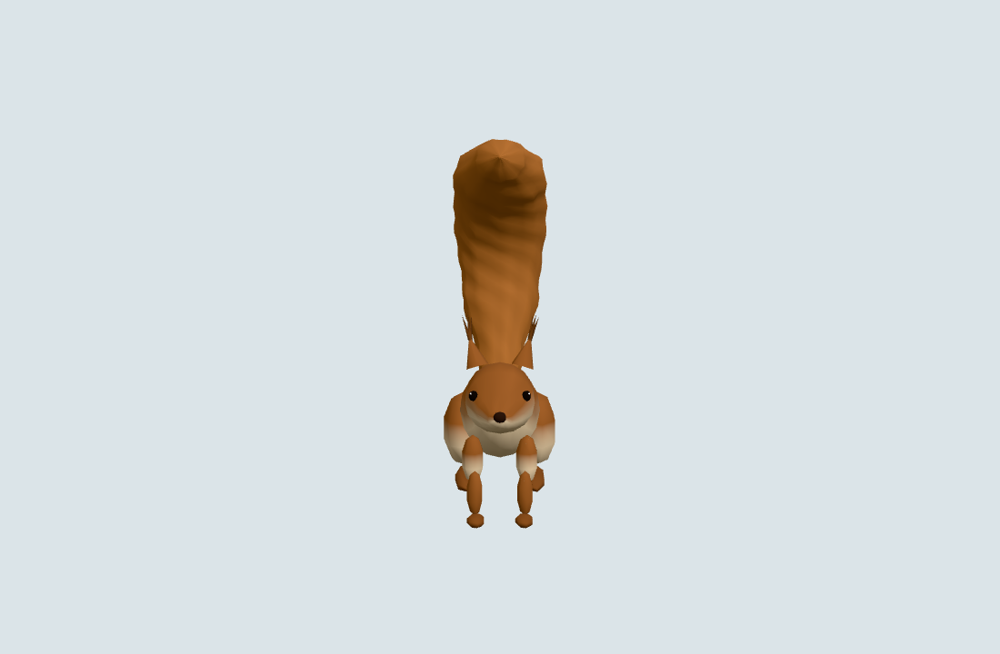
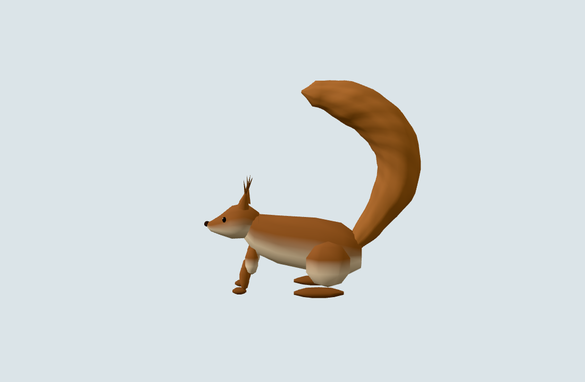
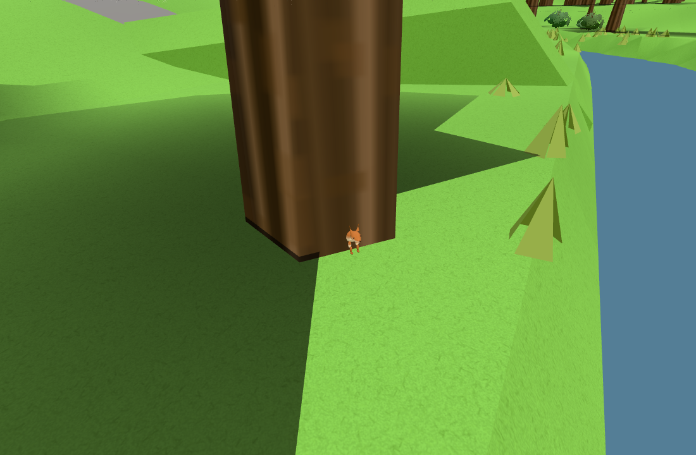
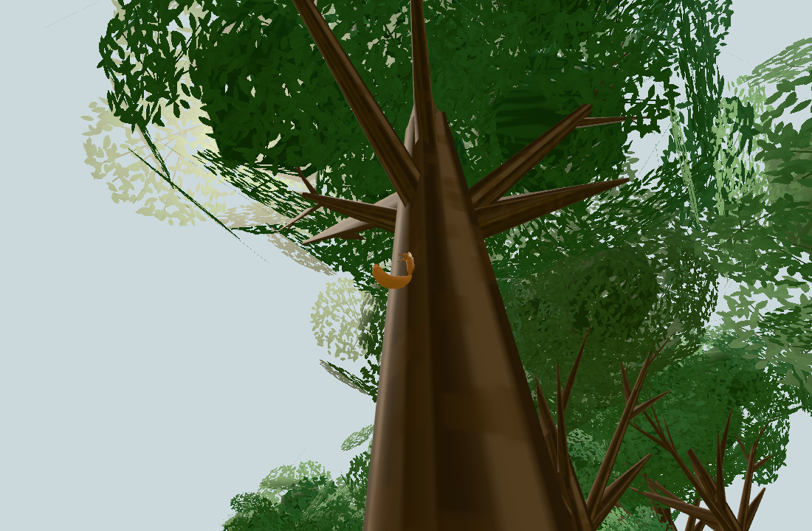

# Public #271: sammanhängande ekorrform

Exakt originalkälla: `c6ac53418862497c131efba43097d806b3af95e1` (#1920).
Publik förebas: `11d67b945daccf36f90e27cd4420b19b2ec1903f`.
Root granskade hela/frontal/sidoformen och de faktiska mark-/klättringsbilderna;
formen är låst utan ytterligare detaljpass.

Importen omfattar bara neutrala loft-/färg-/svansrecept och de tre befintliga
morpherna samt den centrala `SQUIRREL_SURFACE`. Export/anpassade kommentarer och
borttagna oanvända rigglokaler/riggmarkörer ändrar inga vertices. Inga riggar,
GLB/loader, personnamn/metadata, nötter, interaktioner, ljud, originalnycklar,
tjänster, originalbilder eller originalhistorik följer med. Befintliga publika
fyra anonyma djur, färger, tre cachade utseenden, mark-/trädankare och rörelseregler
är bevarade. [Källmappningen](source-identity.json) binder exakt vald originalkod,
centrala data samt byteidentiska tidigare config/controller/brain/habitat.

| Faktisk kostnad | Före | Efter |
| --- | ---: | ---: |
| Nära: trianglar per djur | 3 382 | 3 062 |
| Fjärr: trianglar per djur | 1 396 | 1 228 |
| Nära: råbuffertar per utseende | 369 888 B | 223 788 B |
| Fjärr: råbuffertar per utseende | 167 028 B | 101 652 B |
| Alla tre utseenden, båda LOD: unik backing-bufferunion | 1 610 748 B | 976 320 B |
| Kvarhållna geometrier / backing buffers | 6 / 60 | 6 / 60 |
| Draws per synligt djur | 1 | 1 |
| Position-/normalmorpher per LOD | 3 / 3 | 3 / 3 |

Unionen minskar 39,4 procent. Detta är råa geometribuffertar, inte totalminne,
VRAM eller en FPS-mätning. Befintligt delat material behålls, utan nya texturer,
ljus, skuggor eller externa assets. Oförändrad controller har samma bildruteloop;
ingen CPU-/GC-/mobilvinst påstås. Frysta gamla jämförelsegeometrier är testägda,
disponeras och ingår inte i produktionsunionen.

Tre avgränsade kontrollgrupper:

1. Obligatoriska `npm test` och `npm run build` passerar.
2. `node tools/squirrelsurface271-native.mjs`: verkliga produktionsfabriker,
   samtliga tre cachade utseenden/båda LOD, alla finita attribut/index/morpher,
   cacheidentitet och exakt bibehållen lägsta stödhöjd för kroppen och alla
   morpher. [Före](before-native.json), [efter inklusive källhashar](after-native.json).
   De befintliga två `node --test tools/squirrelambienttest.mjs` passerar med
   verklig controller och oförändrade regler för kronhopp/mark/klättring/flykt.
3. `tools/squirrelsurface271-check.mjs http://127.0.0.1:8304 docs/verification/271`:
   en enda verklig publik källapp, fryst lokal tid/slump. Den gamla geometri-
   fabriken laddas från den exakta publika basen; endast geometri växlas på samma
   verkliga djur. Naturligt nådd markpaus vid ån/hagen och uppklättring, aldrig
   tilldelad brainposition/state. Kontroller av hela finita modell-/kamera-/view-/
   projektionsmatriser, alla morphdeformerade vertices inom projektionen och
   faktiskt avsedda pixlar efter ocklusion, en targetdraw och matchade poser.
   [Browserdata](browser.json) visar mark vid ån 622→546 pixlar, hage 829→732,
   klättring 1 479→1 251; varje mål 3 382→3 062 trianglar och en draw.
   Nära15m/fjärr-LOD, hidden, vinter och avståndsfrys passerar, liksom fyra djur,
   en mesh vardera/inga targets, noll externa requests/WebSockets/browserfel,
   inga operationer på originalets lagringsnycklar och oförändrade sentineler.

Kontrollerad besökarkamera och naturliga brainsteg, Chromium/SwiftShader desktop;
ingen kontinuerlig vandring, fysisk mobil eller bred World-profil. Neutrala hela
front/sida/quarterbilder använder appens riktiga geometri/material i separat
ljussatt diagnostik; de ersätter inte de riktiga scenbilderna nedan.

Bildfixturens första `hidden`-attribut dolde inte CSS-styrda fortsättknappen;
de bilderna underkändes och togs om med endast elementens CSSOM-display.
Ett inline-style-försök stoppades av befintlig CSP före mätning; CSP ändrades inte.
Hagens fulla projicerade kropp är delvis ockluderad av ett riktigt träd trots
positiva målpixlar. Det paret behålls i råkontrollen men används inte som
representativa resultatbilder. Ett striktare femstråleförsök hittade ingen kamera
vid samma paus och underkändes; det återställdes till exakt den gröna fixturen.
Ingen produktkod ändrades för dessa bildbegränsningar och ingen bred omkörning gjordes.

[Slutmanifestet](manifest.json) binder alla använda produkt-/kontrollkällor, rådata och tio egna bilder. Oberoende read-only granskning bekräftade källselektion, exakt fotrecept och hela buffertunionen.
