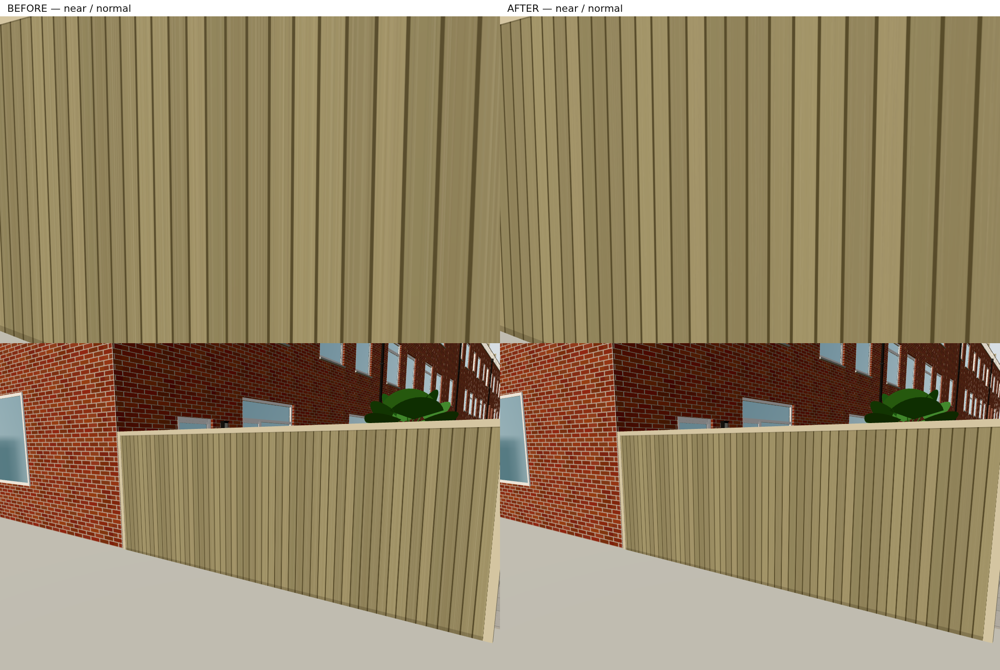
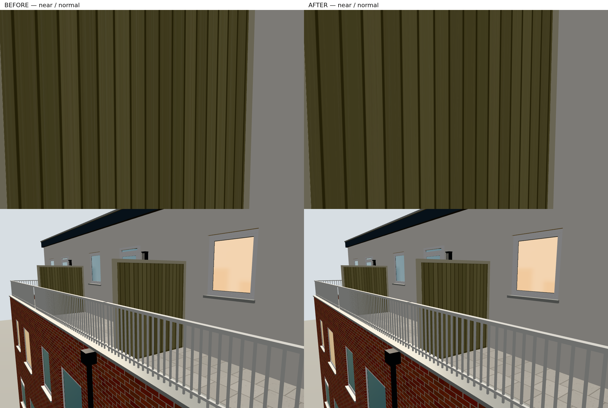

# Målade skärmväggar — publik #297

Publik produktkälla `c5e11071f51537d12a95cebf4748f669ebc89592` jämförd med `1bcd30b6d34e11524838d16c1c7dc094725f5c6d`.
Selektiv granskad originalkälla `a95e1719379f73593c0b6e7ffeb8bfd3d9626484` (#2075). Exakta produkt-/fixtur-/plankällhashar och valda originalhashar finns i [source.json](source.json); [preservation.json](preservation.json) binder de bytebevarade delarna. Originalets bilder, planer, personlig inredning, tjänster, gameplay och historik har inte importerats. Befintlig attribution/licens gäller; ingen ny extern konstresurs eller beroende används.

## Egna matchade produktionsbilder

Båda arken har öppnats och granskats. Varje panel visar hela den nativa 1100×720-bilden, skala 1×1, utan beskärning eller ändrade proportioner. Bilderna är nytagna i detta publika repo; inga originalbilder återanvänds. Inlinefavicon och lokala Three-importer används.

Fixturen använder publik `buildExterior`, den egna publika planen/fönsterdata och faktiskt `World.M.fence`, som exponeras endast av browserns testroute. Inget test-API läggs till i produkten. Den verkliga sammanslagna skärmväggsgeometrin används på marken och takterrasserna; ingen separat exempelvägg eller ersättningsmaterial skapas. Kameror/ljus är lika före/efter: en fast sol och hemisphere, NeutralToneMapping, MSAA, DPR1 och Chromium/SwiftShader.

## Tre kontrollgrupper

1. `node --test tools/screenwallsurfacetest.mjs`: **3/3 PASS**. Deterministisk gemensam karta, de befintliga fyra-pixelfogarnas registrering/mjuka kanter/repeatkontinuitet; plan ram/stolpmask i båda väggorienteringarna och en upphöjd vägg; begränsade böjda fibrer. Källkontroll: hela configen exakt lika när endast `SCREEN_WALL_SURFACE`-blocket tas bort, hela World exakt lika när endast materialhooken återställs, `screenwall.js` från `/** Box x0` exakt lika och hela `exterior.js` orörd. Publicens seed214/RNG-ordning och egen palett behålls. Hjälparen är originalidentisk förutom ärendekommentaren; Node-testet är byteidentiskt.
2. `npm test` **PASS**: 154 moduler, importgraf, två arkitekturplaner, publicens befintliga nät-/lagrings-/innehållsgrindar och appidentitet. `npm run build` **PASS**, byggfingeravtryck `b65bd9f5e31e053abe5df1c2`. `git diff --check` **PASS**. Slutligt dokumentpaket granskas också med samma snabba innehållsgrind.
3. En egen `tools/screenwallsurface297browser.cjs` via värdens befintliga minnesbegränsade browserwrapper: **PASS**. Fyra faktiska publika produktionsvyer, ingen full World. Noll sid-/konsolfel, externa anrop eller Storage-anrop. Originalnamnens lokala/sessionella lagringssentineller är orörda. Browsermaximum 1465MiB av 4 GiB. [browser.json](browser.json) innehåller kameror, kollisionssegment, terrassdata, kartor och renderantal.

Alla emitterade exteriormeshpositioner, normaler, UV och index har identisk före/efterhash `1c1ee93e114d1a0d0ab9fcad69c51ac22c096276f855f9b23af0b5c3b5412e6e`. Publika kollisionssegment och terrassdata är identiska. Skärmväggsbatchen behåller 684 trianglar. Hus A/B/C saknar konsumenter av den här byggaren; ingen byggnadsgeometri eller navigering ändras. Per-vy budget är identisk före/efter:

| Vy | Ritanrop | Trianglar |
|---|---:|---:|
| groundNear | 22 | 36665 |
| groundNormal | 36 | 76615 |
| roofNear | 28 | 68823 |
| roofNormal | 28 | 68823 |

Den befintliga färgtexturen förblir 256×512. En extra cachad linjär RGBA8-karta 256×512 används gemensamt för bump.R och roughness.G: **524288 basbyte / 699052 byte med alla mipnivåer**, ner till 1×1. Fixturens uppladdade texturer 9→10. Inga extra geometrier, draw, pass, ljus eller uppladdningar per bildruta; Standard-shaderns vanliga bump-/roughnesssampling ökar fragmentarbetet. Det är inga totalminnes- eller FPS-siffror.

Målade fibrer är lågmälda och mjukt böjda/förgrenade. Befintlig greige/cream-palett, grundram, brädindelning och positioner består. Fogarnas maximala skuggningsrelief≈0,595mm, matthet≈0,844–0,856 på brädor, 0,96 i fogar och 0,85 på ram, kvantiserat till 8 bit. Det är visuella antaganden, ingen verifierad byggspecifikation eller vertexförskjutning. Originalets opaqueRects importeras inte; publicens eget kollisionssystem består.

Begränsningar: avgränsad komponent med styrd belysning, ingen fullWorld-, vinter-, fysisk telefon- eller FPS-kontroll. Befintlig säsongskod är orörd. Root ansvarar för integration, bildpublicering/ärendekommentar och faktisk Pages-success.

Återskapa med repoets Three 0.170.0 i `node_modules`, egen HTTP-server på 8200 och värdens browserwrapper: `node tools/screenwallsurface297browser.cjs http://localhost:8200 docs/verification/297`. Föreversionens moduler hämtas från publik Git-bas, utan originalrepo eller externa resurser vid körningen.

## Publicering

Kod/bilder `8d9254ae4e5440d2d754fb785a8f01a75cacd77e`; faktiska run-ID [44272621180] success på exakt revision. Alla bilder HTTP200 och inbäddade före stängning: https://github.com/solwation/kvarteret-lunden/issues/297#issuecomment-6973997508. Slutkvittot ändrar inte appkällan; dess separata Pages-run följs av dirigenten.
