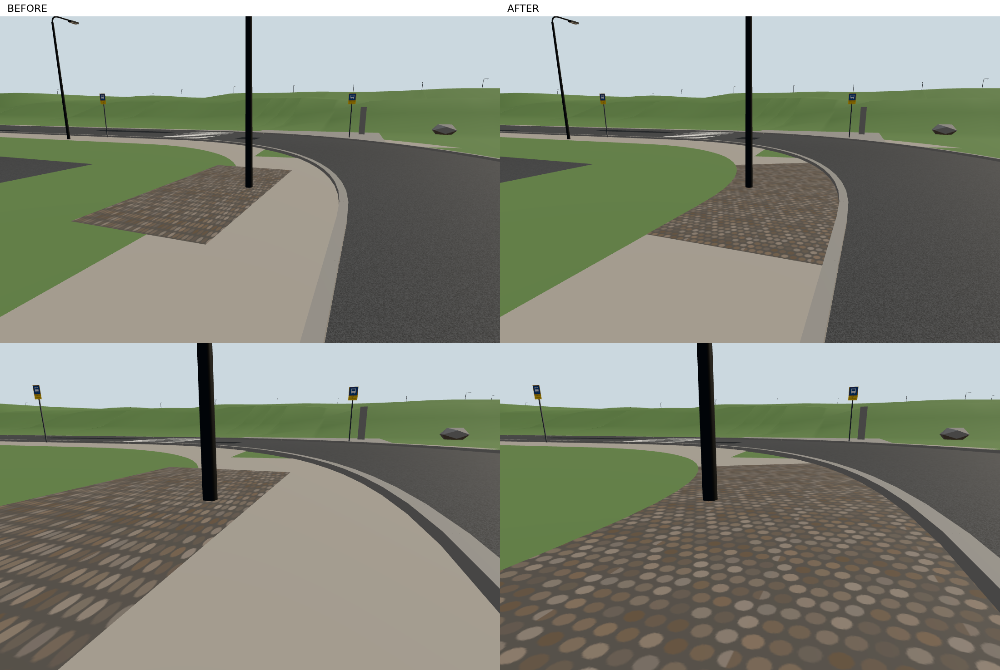
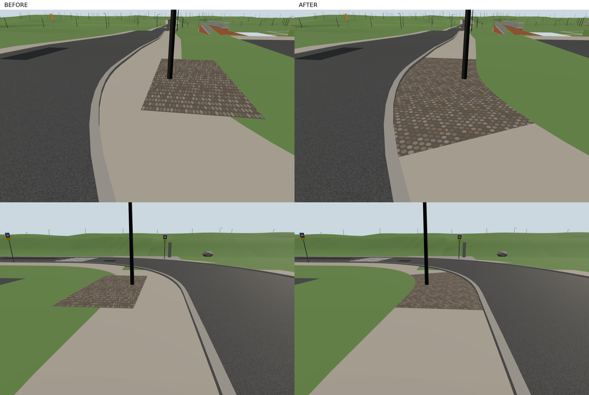

# Connected cobbled corner — public #299

Reviewed published original source: `71c55134018fb02942322c7f5d4f731cf88a3185` (original#2077). Own public baseline: `2da9c290adbd3d6eb76b564bea0a7b8954b2a766`.

Selectively transferred only the neutral street geometry helper, import, material texture period and corner hook, plus the named cobbles config. Every other public street byte is preserved by exact replacement; whole config is byte-identical after restoring that one block. Public-specific road lamps and other builders remain. No original image, personal furniture, avatar/gameplay, storage, service, Cloudflare or original history imported. Attribution/license retained. Anchors,0.8m texture period and12mm lift are visual guesses, not measured construction.

## Three check groups

1. Three targeted Node tests pass: both sampled pavement boundaries, positive winding, no road spill, identical supporting pavement triangles, deterministic sloping ground and metric UVs. Syntax and exact selective preservation pass. See node.txt/preservation.json.
2. Existing npm test and npm run build pass; own build `c4b79a0f63c72d13113d5c6e`. Logs saved. Browser isolates original storage names with sentinels: zero Storage calls, all sentinels unchanged and zero external requests/errors in both phases.
3. One own actual public surroundingsParts consumer through yield0.15 plus actual buildStreet; identical cameras/light/MSAA/NeutralToneMapping/DPR1, four views. Both newly captured paired sheets opened and inspected. All noncorner mesh/instance attribute hashes equal,31 ground/walk queries identical, corner exactly12mm above support (4mm above existing8mm pavement). Two full1100×720 cells per row retained without cropping/rescaling; sheets2200×1476. No original screenshots reused.

The wrapper’s first invocation omitted `node` and exited before browser launch; corrected invocation ran the one browser. Peak2573MiB /4GiB. Product and checks were not broadened after green.

## Cost and limits

The same34 component meshes/materials/textures remain. Corner2→17triangles,140→1632 attribute/index bytes: **+15triangles/+1492B** CPU geometry and corresponding GPU upload, excluding overhead. Whole component369991→370006triangles,27274778→27276270B. Draws remain14/14/25/14 across normal/near/north/south, textures4/4/9/9. Existing128² color canvas unchanged; same light/pass/shadow flags and no new per-frame work. More surface area is intentionally covered. Source-bound exact hashes in source.json; details in browser.json.

Fixture stops before buildings/trees/fullWorld, excludes weather renderer and does not exercise a full navigation route. Numeric walking queries check preserved support, not a physical phone/FPS/full-app claim. A/B/C/L builders remain unchanged; this is a single local street corner.

## Publicering

Kod/bilder `992e1eddeba5a7f06b4c65d40e134f622a53b5ee`; faktiska run-ID [44276875609] success på exakt revision. Alla bilder HTTP200 och inbäddade före stängning: https://github.com/solwation/kvarteret-lunden/issues/299#issuecomment-6974596853. Slutkvittot ändrar inte appkällan; dess separata Pages-run följs av dirigenten.
