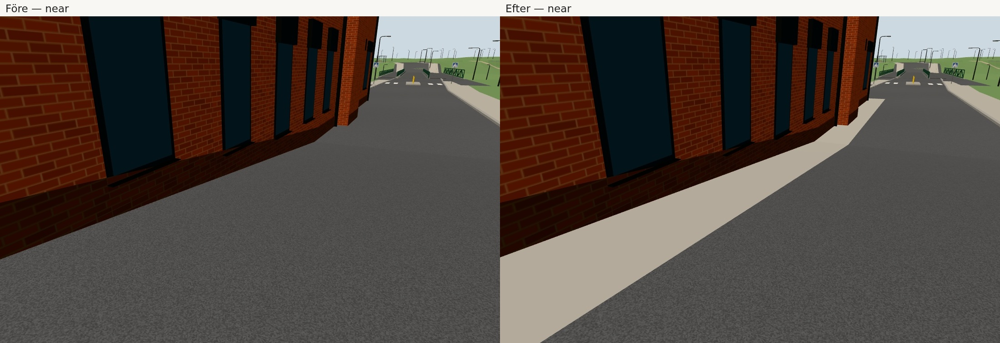
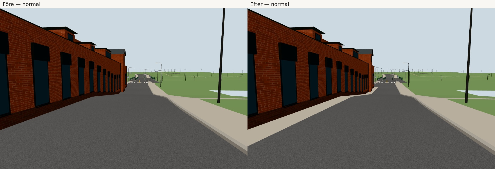
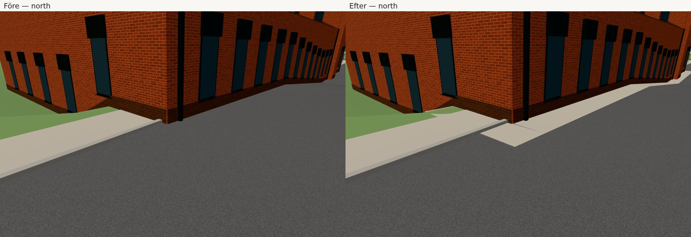
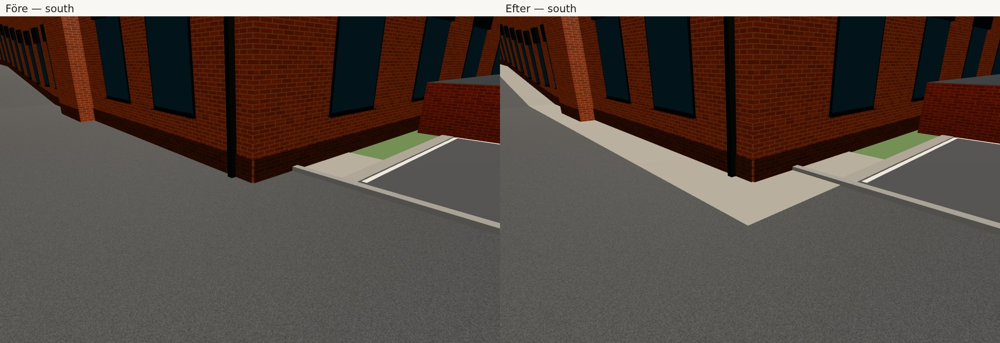
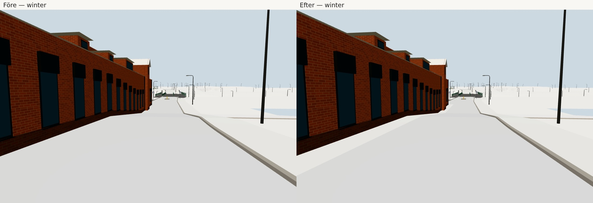

# Fasadtrottoar vid Realgymnasiet — public #300

Granskad accepterad originalkälla: 3c5d527608439a40c3c68f0221cc1549eca220fc (original #2078). Publik jämförelsebas: 992e1eddeba5a7f06b4c65d40e134f622a53b5ee. [selection.json](selection.json) anger hela granskade källfilers hash, det exakt överförda hjälparblockets hash, publika källhashar, bevarande och egna bildhashar. [browser.json](browser.json) binder slutliga konsumenter och fixture. Inga originalbilder har kopierats.

## Exakt urval och avgränsning

Endast roads.js:facadeWalkGeometries (byteidentiskt neutralt block med ursprungsattribution), ett nytt facadeWalks-block med publickommentar och samma neutrala parametrar samt helperimport/spridning i publicens befintliga walkingPaving. Tidigare roads.js/config.js/surroundings.js är exakt bevarade efter reversering av just dessa tillägg. Hela publika realgym20/sitebackdrop/farwalk/street/riverbridge/walksupport är byteidentiska mot basen.

Publicens egen SITE.east-post source 130681301, fasadkant 3→4, styr placeringen. En smal remsa följer (28.4,19.19)→(28,58.28) utanför fasaden; båda gavlarna ansluter till befintlig trottoar. Bredd 1.1 m, lift 0.028 m och 1.1 m-långa returer 3 m inåt är **guess**, aldrig uppmätta mått. Inga hus/vägar flyttas. Bara lokal Sankt Lars-asfalt täcks avsiktligt där gamla trottoaren ligger bakom fasaden; vehicleTrim behåller andra körvägar fria. Inget nytt kantstens-/kollisionssteg: 2 cm övergång till gammal 0.008 m-trottoar, befintliga entréer och gavelanslutningar kvar.

Publicens sydliga pavementjoin, bankrefinement, bridge approaches, gåstödsindex och egna material/husvarianter är orörda. walkingSupport är begränsat till sydområdet z 143–192 och ändras inte av remsan vid z 19–58. A/B/C/L och HepCat har ingen ny facadeWalks-post eller ändrad byggargeometri. Ingen originalconfig i övrigt, originalhistorik, foto/rapportbild, personlig resurs/inredning, gameplay, lagring, tjänst eller Cloudflare överförs.

## Tre kontrollgrupper

1. [Tre riktade Nodeprov](node.txt): kontinuerlig bredd/remsegeometri, båda returer och kontakt med gammal trottoar, finita lokala markhöjder, faktisk farWalls/surfaceY/tooSteep, fri gångyta och inga andra lokala körvägar. Befintlig pathaudit före/efter är byteidentisk. Den enumererar inte facadeWalks; separata nya geometri-/gångprov granskar avsiktlig lokal asfalttäckning. Exakt källbevarande i selection.json.
2. [npm test](npm-test.txt): **156 moduler godkända**, inklusive publicens innehålls-, lagrings- och nätgränser. [npm run build](build.txt): **fcf9a0ba382b4010a052bbad**, metadata i [build.json](build.json).
3. **En egen publik browserkörning**, utan omtag. Faktiska surroundingsParts förbi första yield efter 0.46, med east-backdrop redan bifogad och source 130681301 assertad, samt riktig buildStreet. Rätt hus visas tillsammans med remsan i fem egna matchade vyer: nära, normal, nordände, sydände och snö. 77 faktiska gångstöds-/väggprov före/efter identiska. 0 externa anrop, 0 konsol-/sidfel, 0 Storage-metodanrop; ursprungsnycklars sentinels och båda stores byteidentiska. Ny WebSocket blockerad. Inlinefavicon från början.

Konsumentfixture: Chromium/SwiftShader, 1100×720, DPR1, MSAA, NeutralToneMapping, samma kameror/ljus före/efter. Full World/bootstrap/egna hus A/B/C/L, full sydbackdrop, avatar och väderrenderer ingår inte. Gångstödsproven är faktiska funktioner längs remsan, inte en genomspelning med full Navigation eller en mobilprestandamätning.

## Faktisk kostnad

**+56064 attributbyte = +1752 hörn/+584 trianglar**, ungefär 54.75 KiB vardera bibehållna CPU-attribut och GPU-uppladdning; drivrutin/transienter oräknade. Inga nya texturer/texturbyte, material, meshes, draw calls, ljus eller pass. 80 faktiska komponentmeshes före/efter; endast pavinggeometrins hash ändras. Alla andra meshbuffertar, vägdata och byggnadsdata identiska. Wrapperpeak 807 MiB av 4 GiB.

| Vy | Draws före→efter | Trianglar före→efter | Residenta texturer |
|---|---:|---:|---:|
| near | 36→36 | 141784→142368 | 13→13 |
| normal | 39→39 | 270907→271491 | 14→14 |
| north | 35→35 | 286169→286753 | 14→14 |
| south | 25→25 | 314398→314982 | 14→14 |
| winter | 39→39 | 270907→271491 | 14→14 |

## Granskade egna bilder

Alla fem slutliga bildpar öppnade och granskade. Huset och sammanhängande nya remsan syns; båda ändarna möter den tidigare trottoaren. Samma snömaterial gäller. Varje bild är 2200×756 med två oförminskade 1100×720-celler och 36 px etikettfält; inget beskuret/pressat innehåll. Bilder kommer från den här publika körningen och skiljer sig från originalets rendering.

Endast ovan beskrivna komponent/rutt är browserverifierad. Måtten är uppskattningar; ingen uppmätt trottoarhöjd eller exakt verklig gatubredd påstås. Egna processer/server/browserlås stoppade. Dirigenten hanterar publicering, CI/Pages och revisionsbundna HTTP-bilder i ärendet före stängning.

## Publicering

Kod/bilder `0fb7a202dbbecd2f785a70ddb0f1fd137a538d85`; faktiska run-ID [44278244226] success på exakt revision. Alla bilder HTTP200 och inbäddade före stängning: https://github.com/solwation/kvarteret-lunden/issues/300#issuecomment-6974778892. Slutkvittot ändrar inte appkällan; dess separata Pages-run följs av dirigenten.
