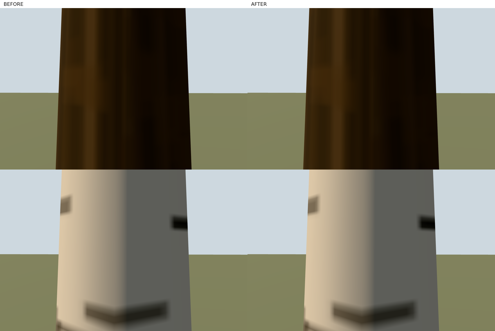
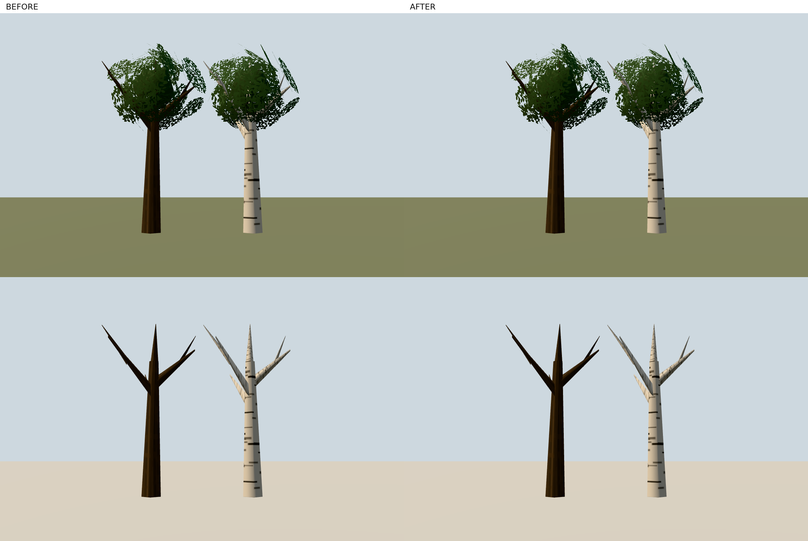
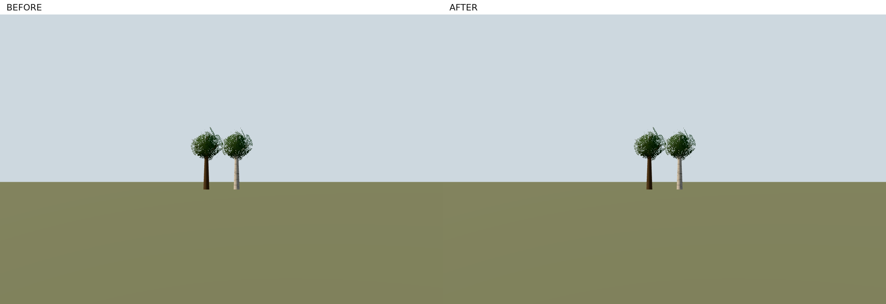

# Public #302: bark och björkyta

Publik bas `014f5c680bdb17595ff329dc7425cef193b3d21a`, granskad originalkälla
`957303341e153cc4bae3993a1e773f07a79dcd17`. Detta är egna publikbilder och en egen
körning med publicens moduler, inte återanvända originalbilder. [Exakta urval/källhashar](selection.json)
och [browserdata med bundna produkt-/fixturehashar](browser.json).

Bark får grund ljusrelief och svagt varierad matthet. Björkens mörka lenticeller får
endast annan finish, inga djupa hål. Färgerna är oförändrade; relief/finish är guess,
inte uppmätta material. I helvyn är skillnaden knappt synlig. De tre arken är öppnade
och granskade; ingen uppförstärkning av effekten har gjorts.

Varje panel är 1100×720, DPR1, utan beskärning eller ändrat bildförhållande; endast en
36 px rubrikrad läggs till. Native efterbilder finns också för respektive vy.
Kontrollerad komponentmiljö: verkliga instansade stam-/lövgeometrier och material,
nativ dither/depth, faktisk `registerTrees`/`applySeason`, två träd, golv och fast
sol/hemisfär. NeutralToneMapping, MSAA, Chromium/SwiftShader. Golvets vinterfärg är
fixturekontext; ingen full områdes-/snö-/väderbyggare körs.

Tre kontrollgrupper:

1. `node --test tools/barksurfacetest.mjs tools/lodtest.mjs`: 10/10. Determinism,
   registrering/privat RNG, kvantiserad höjd/roughness, cache/UV/mips/native vertex,
   fjärr-/depthkostnad samt befintlig LOD och säsong. Syntax och `git diff --check`
   passerar. `python3 tools/barksurface302preservation.py /path/to/reviewed-source`
   visar exakt återställning av publicens config/foliage efter borttagning av endast
   den namngivna ändringen. Hela seasons/lod/surroundings/courtyard/southbackdrop/
   siteinstancebatch/vertexcompile är byteoförändrade; helper/test matchar accepterad källa.
2. `npm test` och `npm run build`: passerar, inklusive befintliga publika innehålls-
   och beroendegränser. Ingen ny publik lagring eller nätanslutning.
3. En egen före/efter-browser, `tools/barksurface302browser.cjs` med
   `tools/barksurface302.html`, via befintlig minnesbegränsad wrapper. Fem matchade
   vyer; noll konsol-/sidfel, externa anrop eller Storageanrop; sju originalnamns
   sentineller i vardera local/sessionStorage oförändrade. Kameror, färgcanvasbytes,
   geometribytes, samtliga instansmatriser/färger och LOD-/säsongsstatus är lika.
   Vinter döljer faktiska lövbatcher; LOD-vyn har två när- och två fjärrstammar.
   Körningens peak 696 MiB under 4 GiB-gränsen.

| Vy | Draws före/efter | Trianglar före/efter |
| --- | --- | --- |
| Bark nära | 2/2 | 48/48 |
| Björk nära | 2/2 | 48/48 |
| Normal sommar | 4/4 | 214/214 |
| LOD-zon | 6/6 | 314/314 |
| Vinter | 3/3 | 94/94 |

Två nya delade RGBA8-texturer 64×128: vardera 32768 basbytes/43692 nominella mipbytes,
totalt 65536/87384 B. CPU-data totalt ytterligare 65536 B plus förar-/objektoverhead.
R är höjd, G absolut roughness; samma textur används för bump/roughness och när-LOD.
Ordinarie och LOD-material delar cacheobjekt. Exakt omvända datarader/flipY=false
registrerar märken med befintliga färgcanvasens flipY=true och repeat(1,2).
Barkens kvantiserade höjdspann ger 1,176 mm shadingvariation, björkens 0,147 mm;
inget förskjuter geometri. Roughness är cirka 0,902–0,988 respektive 0,839–0,914.

Sommarvyn har 3→5 residenta texturer; första bark-/björkvisning laddar upp respektive
nya karta. Version1 kvar; ingen per-frame needsUpdate/uppladdning. Fjärrstam och depth
har fortsatt inga kartor. Samma geometri, instanser, draws, ljus och pass; extra
fragmentprov för native bump/roughness är den löpande kostnaden. Standardvertexvägen
förblir tillåten för befintlig statisk instanskompaktering.

Ingen helvärlds-/fysisk telefon-/FPS-/separat skuggrenderingsmätning påstås.
Detta verifierar den faktiska material-/geometri-/säsongs-/LOD-kedjan isolerat,
inte alla trädplaceringar eller alla väder/ljus. Inga personliga resurser eller
originalets lagring/tjänster införs. Root integrerar, publicerar och verifierar Pages.

Dirigenten har granskat selektiv diff och alla tre egna bildark. Överlämningens produkt-, test- och fixturebytes är exakt bevarade; befintligt källbundet grönt underlag återanvänds utan rutinomkörning.
