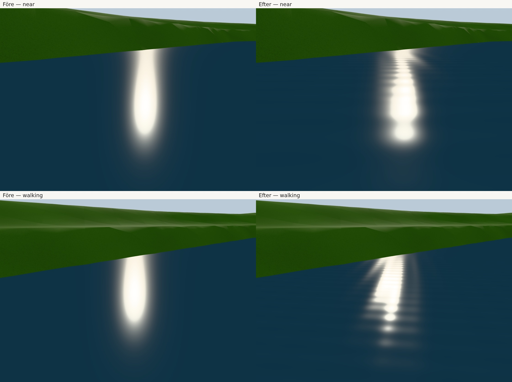
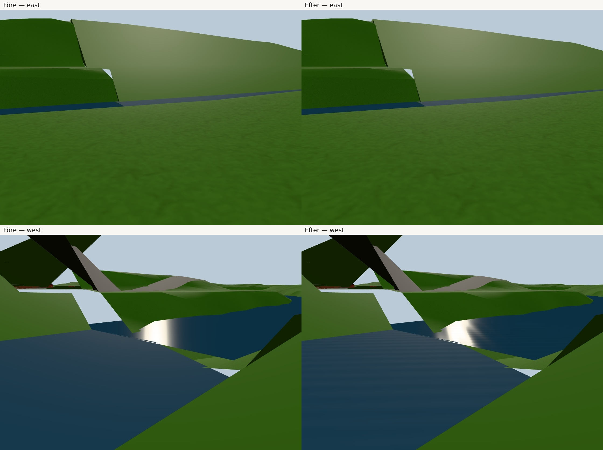
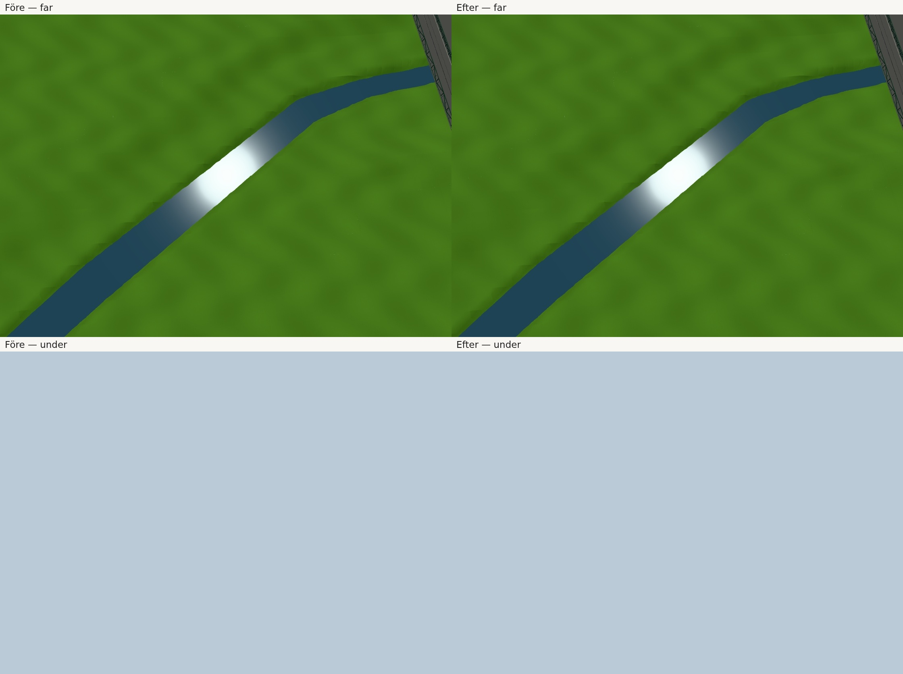

# Stationära ljuskrusningar — public #303

Publik baseline: e78b683bc3e8e01ba41f8211854deeadc7800056.
Accepterad publicerad originalkälla: c02d687594fd8c00ad1088f401c5ebd30d7222c2.
[Urval och bevarande](selection.json), [egna browserresultat med exakta renderkällhashar](browser.json),
[shaderkostnad](shader-cost.json), [öppnade bilders hash/mått](images.json).

Endast neutral byteidentisk riversurface.js, det egna namngivna RIVER_SURFACE-blocket
(samma värden, publik kommentar) och två imports/materialwrappers överförs.
Ingen originalconfig i övrigt, historik, personlig resurs/inredning/bild, spel-/simkod
eller tjänst kopieras. Publika gamla configbytes och 155 andra src-moduler är exakta;
båda konsumenter är exakta efter att enbart tillagda importer/wrappers reverserats.
Licens och attribution behålls.

## Omfattning och vattenmask

Actual buildRiverBridges innehåller lokala vattenbandet och dess båda förlängningar.
Actual buildEdgeBackdrop sammanfogar de två EDGE_BACKDROP.rivers i edge-land tillsammans
med land, fält, stigar och andra diken/vattenytor. Endast linjär vattenfärg på de två
faktiska vattenplanen får masken (Float32-tolerans0,002m): 1824 vattenvertex,
48141 torra/icke matchande vertex oförändrade och 63 andra vattenfärgade vertex utanför
rätt nivå undantagna. Båda fortsättningarna ingår; äldre färglös vinter använder exakt
native shader/cache key.

Krusningsvärden är konstnärliga antaganden, inga uppmätta vågor/flöden: huvudperioder
cirka0,67/0,44m, lutningsbidrag0,035/0,02 och maximal summerad lutning0,055.
Ingen displacement. Avtoning12–45m och fragmentfotavtryck0,035–0,12m.
Effekten är stationär, utan tidsuniform, uppdateringscallback eller extraloop.
Publicens huvudvatten förblir FrontSide (side0), edge-land DoubleSide (side2).
Originalets tvåsidiga simyta importeras inte. Huvudvattnets roughness/metalness0,15/0,2
respektive fjärrlandets1/0 och deras äldre matthetsskillnad bevaras.
Färger/opacitet1/transparent=false/depthWrite, nivåer/fall/botten/stränder, navigering,
fisk/drift, snow och alla geometry/UV/cast/receive-data är oförändrade.

## Tre kontrollgrupper

1. [Riktade Node-resultat](node.txt): 10/10, tre nya determinism/ändliga/begränsade
normaler/fade/cache/shader/vinterfall samt sju befintliga publika vattenfall-/strand-/
bro-/ramp-/bankåterhämtningsfall. Node-syntax för helper/konsumenter/HTML-modul/runner.
Exakt källbevarande och accepterad helperhash enligt selection.json.
2. npm test passerar158moduler och npm run build ger4bd2b7b439c0300c9b6108b0,
inklusive publicens person-/service-/lagringsgränser.
[Resultat](npm-test.txt), [byggresultat](build.txt).
3. En godkänd egen Chromium/SwiftShader-körning av actual buildRiverBridges,
full buildEdgeBackdrop och actual surroundings-terrain genom yield0.05, med samma
public grassMaterial som World.M.grass. 1120×800,DPR1,MSAA,NeutralToneMapping,
inlinefavicon och en diagnostisk dagsljusriktning per matchad vy.
Inga app-ljus ändras. Noll console/page/shaderfel, noll externa nätanrop,
noll Storagecalls och tre orörda originalnamnrymdssentineller i båda faserna.

Den första fixturstarten stoppades före bilder eftersom originalfixturens grass:null
inte uppfyller publicens flat-materialkontrakt. Endast fixturen rättades till publicens
riktiga grassMaterial(); inga produkt-/Node-/källprov påverkades eller togs om.
Bara slutliga källbundna bilder/JSON sparas. Browserföreläget serverar exakt de två gamla
konsumenterna från publik baseline; configens gamla bytes är bevarade och det nya
blocket är då oanvänt. Verifieringsfixtur/runner är selektivt anpassade från publicerade originalkällan c02d687594fd8c00ad1088f401c5ebd30d7222c2
(byteidentisk med arbetarrevisionen som först citerades, #332); inga originalbilder används.

## Faktisk budget och kontinuitet

Nio produktionsmeshes, med dold terrängmaster och synliga celler. Alla attribut/indexhashar,
bounds, materialegenskaper och vatten/strand/ground-queries är identiska.
Summerade per-mesh attribut/indexbytes: 26390136 före och efter; råsumman inkluderar
terrängmaster/celler och påstår inte unik GPU-allokering. Nya geometri-/attribut-/
texturbytes:0. Samma2 befintliga texturer, inga nya ljus/pass/draws/uniformer/maps/samplers
eller per-frameuppladdningar. Shaderkostnad och programökning är däremot verkliga.

En vec4 world-position/mask-varying och vertexvärldstransform, plus färg-/höjdklassificering
för edge-land. Aktiva fragment gör 2sin+2cos, 2fwidth (fyra derivator), 2smoothstep,
kameradistans, vektoroperationer och normalnormalisering. Mask/fade omger full
krusningsmatematik; faktisk predikering/kompilatorkostnad är inte tidsmätt.
Injicerad shaderkälla före chunkexpansion: huvud +100vertex/+703fragmentbytes,
edge +370/+703, färglös vinter +0/+0. Detta är källbytes, inte GPU-binärstorlek.
Ett extra cacheprogram i dessa vyer; drivrutinens binär-/cacheminne är okänt.
Ingen FPS-/mobil-/gratis-GPU-utfästelse. Wrapperpeak735MiB av4GiB.

| Vy | Draws före→efter | Trianglar (samma) | Program före→efter |
|---|---:|---:|---:|
| near | 8→8 | 161701 | 5→6 |
| walking | 6→6 | 154189 | 5→6 |
| far | 8→8 | 161701 | 5→6 |
| under | 6→6 | 154189 | 5→6 |
| east | 4→4 | 95492 | 5→6 |
| west | 8→8 | 161701 | 5→6 |
| winter | 2→2 | 20224 | 6→7 |

Nedåtrays i båda faktiska överlapp träffar lokal och fortsatt vattenyta. Befintlig
höjdskillnad från oberoende tessellering är cirka0,000055m, medan värld-XZ och
CPU-lutningsfas matchar exakt. Verifieringsrender av actual Standard-normal på1×1mål
ger identiska RGBA8-prober över respektive skarv: uppströms[128,127,255,255],
nedströms[127,127,255,255]. Kvantiserade GPU-prober, inga fullprecisionsmätningar.
Tillfälliga debugmaterial/mål avvecklas och ingår inte i produktbudgetens framecounters.

Fjärrbilden och färglös edge-vinter är pixelidentiska före/efter. Nära bilden upprepas
pixelidentiskt efter andra vyer/säsonger/debugprober och cirka744ms. Native undersidan
är fortsatt bortklippt från denna vinkel och bilden visar enbart bakgrund; detta är
bevarandekontroll av FrontSide, ingen undervattensvy eller nytt simstöd.

## Egna granskade bildpar

Tre ark öppnade och granskade. Varje ark2240×1672, två rader med två oförändrade
1120×800-celler och36px etikettband. Ingen beskärning/aspektförvrängning.
Nära/gång visar små ljuskrusningar; skarvparen visar fortsatt fas och bevarad äldre
matthet/terräng. Avstånd/undersida är avsiktligt oförändrade. Identisk vinter ligger
som separat framehash i browser.json, utan redundant sparad bild.

Gränser: komponentkontroll, ingen full World/bootstrap/navigationsrunda/väder/dimma/
fisk-/driftinstansiering. Befintligt approachGround matas med publicens groundY/renderedTerrainY;
trimApproach använder byggarens native default, ingen ombyggnad av hela southBackdrop.
Äldre terräng-/kontextoregelbundenheter vid skarvar och äldre matthetsskillnad är kvar.
Inga globala enhets-/FPS-/flödessimulerings-/surveyanspråk. Egna processer/lås stoppade
efter körningen. Publicering, riktiga Pages-resultat och HTTP-bilder sköts av integratorn.

## Integrationsgranskning

Dirigenten har öppnat samtliga tre egna slutark och granskat selektiv diff, bevarande och budget. Alla testade produkt-/fixturebytes utom fristående configtillägg är byteidentiska; accepterad config behåller bark/sol och får endast RIVER_SURFACE. Delade dokument är exakt tidigare accepterade bytes plus portens namngivna tillägg. Befintligt grönt källbundet underlag återanvänds utan nya breda tester/browseromtag.

## Publicering

Kod/bilder `f2100b24c2b4e87762933448c4c100cd25f95748`; faktiska run-ID [44284669385] success på exakt revision. Alla bilder HTTP200 och inbäddade före stängning: https://github.com/solwation/kvarteret-lunden/issues/303#issuecomment-6975712062. Slutkvittot ändrar inte appkällan; dess separata Pages-run följs av dirigenten.
