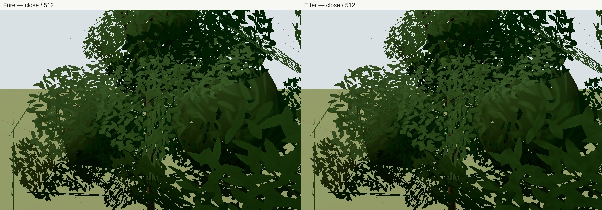
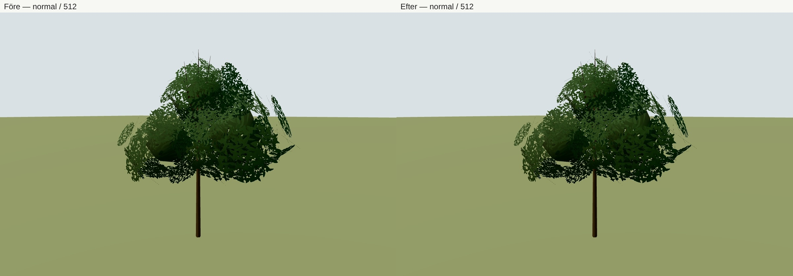
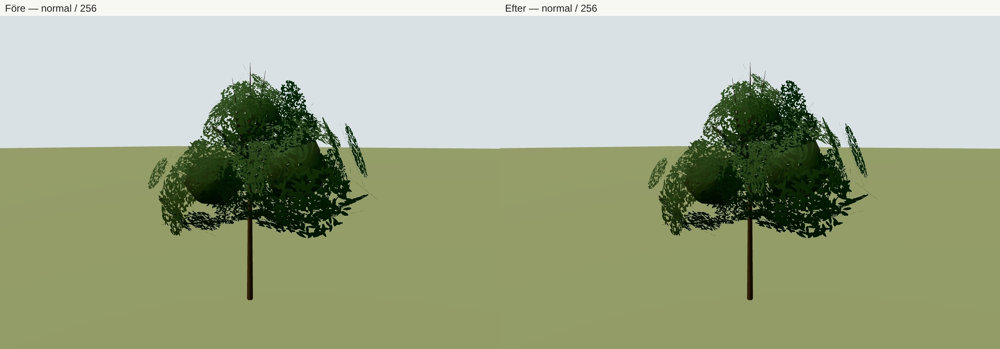
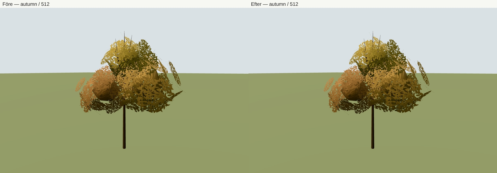
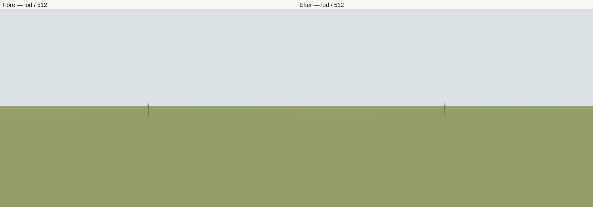

# Public #305: lövens nyanser och sidonerver

Publik bas `553aa04c938cee20a630022dd4735dabc0385346`, granskad originalkälla `fa04a0ef0b1163d23832efe8a6a7b97bad07f3ac`
(accepterad `a2b5b1939ced3e0bca8ecf042c32d7783f34067d`, stängd `4b7ef7f`,
[original #2085](https://github.com/solwation/lunden-3d-apartment/issues/2085)).
Egna publikbilder från en egen körning med publicens moduler; inga originalbilder återanvänds.
[Browserdata med alfa-/RNG-/mip-/geometrihashar och källhashar](browser.json).

Varje blad i den befintliga lövatlasen får mjuk lokal toning och två–tre par diskreta
sidonerver. Effekten syns främst nära; i vanlig närvy blir lövfyllnaden diskret mindre jämn.
Lövform, kvistar, mittnerv, kärnhål, instansfärger, säsonger, bark och LOD är oförändrade.

Varje panel är 1200×800, DPR1, native aspekt; bara en rubrikrad läggs till.
Kontrollerad komponentmiljö: verkliga `leafAtlasParts`/`leafMaterial`/`lobeGeometry`/
`lodLeafMaterial`, `InstanceLod`, `registerTrees`/`applySeason`, tre lövklot och stam,
Chromium/SwiftShader. Ingen helvärld, FPS eller fysisk telefon mäts.

Kontroller:

1. `node --test tools/leafrgbtest.mjs`: 3/3. Begränsade toningsstopp utan alfa/slump,
   sidonerver med klipp/`source-atop` och 2–3 par, samt exakt återställning av publicens
   `src/foliage.js` mot basen när enbart de fyra namngivna raderna tas bort; config/lod/
   seasons/barksurface byteoförändrade. `src/leafrgb.js` är byteidentisk med originalet.
2. `npm test` och `npm run build`: passerar (innehålls-, lagrings- och nätverksgränser).
3. `node tools/leafrgb305browser.cjs` med `tools/leafrgb305.html`, före/efter i 512 och 256,
   tre körningar vardera: alla alfabytes, transparenta kantpixlars RGB (0 avvikande),
   mipalfa, 8961 RNG-värden, yieldsteg, cache, geometri-, material-, textur-, stam-, instans-,
   säsongs- och LOD-kontrakt exakt lika. Samma draws/trianglar/texturer per vy.
   Noll sid-/konsolfel och noll externa anrop.

Kostnad: inga nya GPU-kartor, geometri, draws, sampling, ljus eller per-framearbete
(1 048 576/262 144 texturbytes oförändrade). Engångs-CPU för atlasen här: 512 cirka
25–29 → 48–55 ms, 256 cirka 16–19 → 45–56 ms; största yieldsteg efter ≤ 9,2 ms.
Tillfälligt en extra canvas av atlasens storlek under genereringen. Ingen enhetsgaranti.
