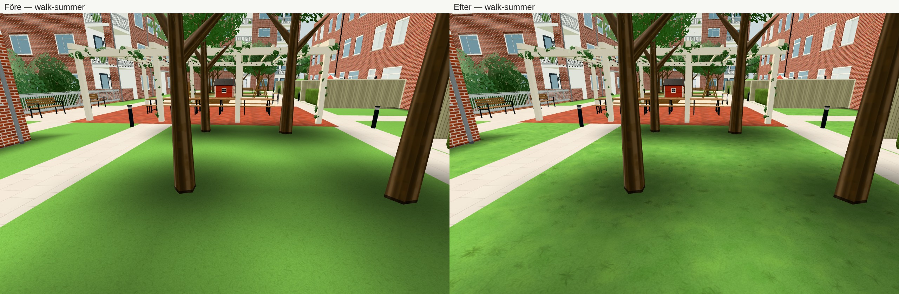
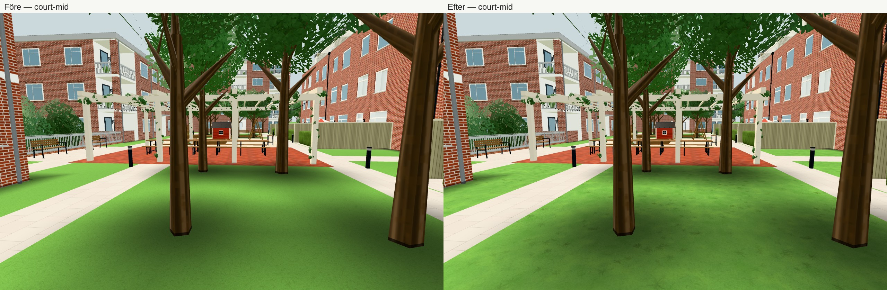
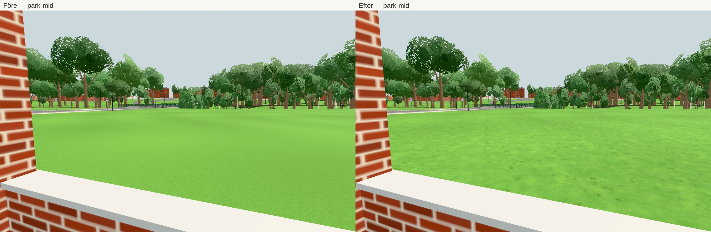
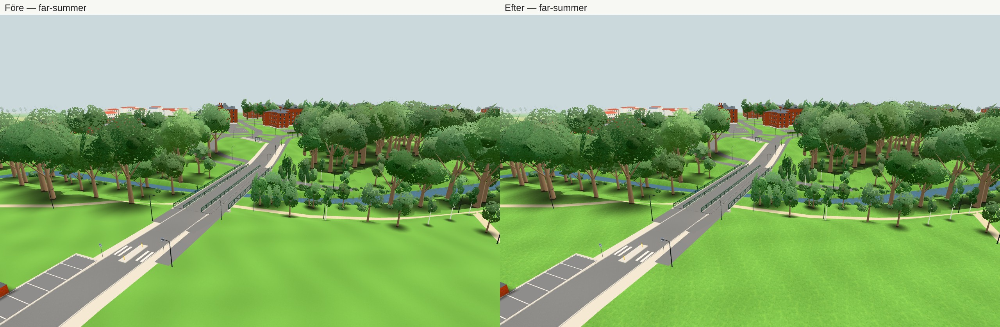
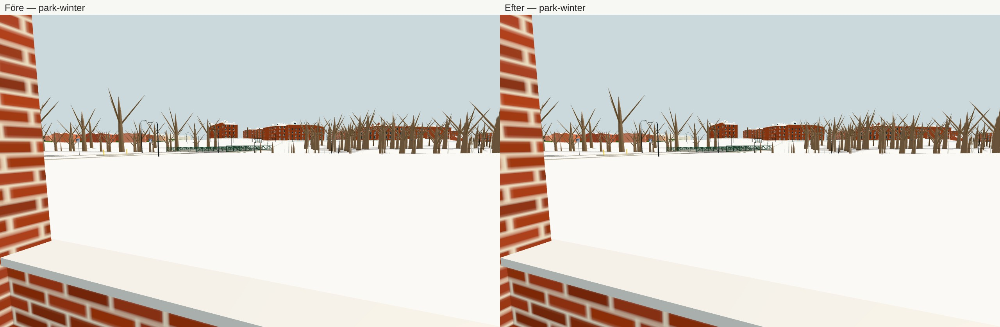

# Public #306: fläckigare gräs med tuvor och mindre upprepning

Publik bas `e262834`, granskade originalkällor `3ad5cc703dc87e825bd39072b16bad33acc1671e`
([original #2086](https://github.com/solwation/lunden-3d-apartment/issues/2086)) och `1c3c899bb49ceff207756912baa4d2ec55f035dc`
([original #2091](https://github.com/solwation/lunden-3d-apartment/issues/2091)).
Egna publikbilder från en egen körning av den riktiga publika appen; inga originalbilder återanvänds.
[Browserdata med mått, bildhashar och källhashar](browser.json).

Den delade gräskartan får mjuka torrare/frodigare fläckar och 22 små tuvor, och gräsmaterialet läser
samma karta en andra gång, vriden och skalad, och växlar mjukt mellan uppslagen i världsfläckar på några
meter, så att 1,6 m-mönstret inte löper obrutet på 10–20 m håll. Kartans linjära medel återställs, så
`grassMeanColor()` och fjärrmarken behåller sin färg. Under snö (ingen karta) kompileras blandningen bort.

Varje bild: före vänster, efter höger, native 1280×800 per halva (DPR 1, SwiftShader).

## Kontroller

- `node --test tools/grassdetailtest.mjs` (originalets test, byteidentiskt): 6/6 – sömlöst fält,
  linjärt medel inom 0,1 %, synlig fläckighet, deterministiska tuvor med eget frö, blandning ~50/50 med
  mjuk kant, upprepningskorrelation per ruta < 0,6 (före > 0,99).
- `npm test` och `npm run build`: PASS.
- `node tools/grass306browser.cjs http://localhost:8306 docs/verification/306` (riktig app, före = bas-`src/grass.js`):
  oförändrade draws/trianglar/texturer/geometrier i alla fem vyer, inga fler program, `grassMeanColor()`
  identisk (0.09319, 0.23944, 0.04383), kartans 8×8-blockspridning 0,42 → 4,16, söm 23,7 mot inre 24,3,
  vinterbild pixelidentisk, noll fel/shaderfel/externa anrop; lagringssentineller orörda och samma nycklar före/efter.

## Kostnad

Samma 256 px-karta, UV, geometri, material, programnyckel och draws (t.ex. gångvy 222 draws, 68 texturer
före och efter). Engångsgenerering ~20–35 ms → ~27–47 ms i SwiftShader. Per gräsfragment ett extra
(anisotropt) texturuppslag och ~15 ALU-operationer; inget under snö.

## Ej tillämpligt / gränser

Originalets flodbädd-variant (`bed`, #1945) finns inte i publicen; blandningen ersätter endast
`<map_fragment>` i publicens `grassMaterial`. Publicens egna `paddock.js`-gräs (instansade strån) använder
inte den delade kartan och påverkas inte. Fläckstyrka och blandning är konstnärliga *gissningar* från originalet.
