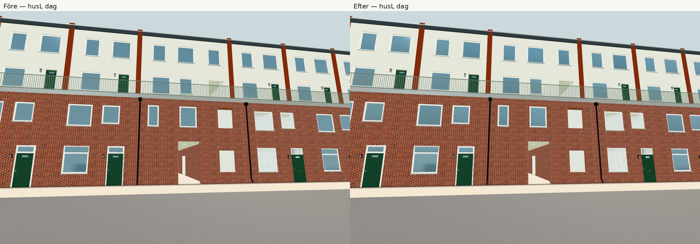
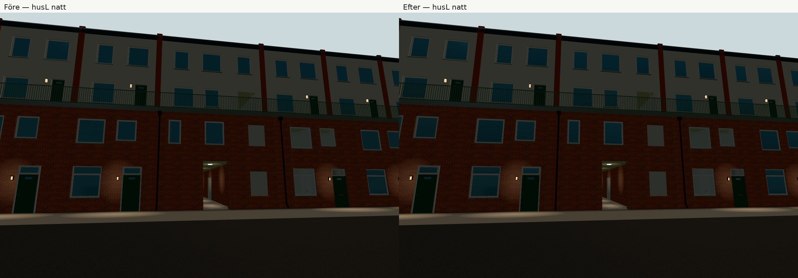
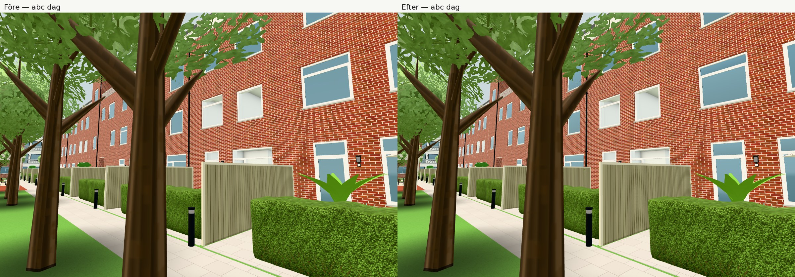
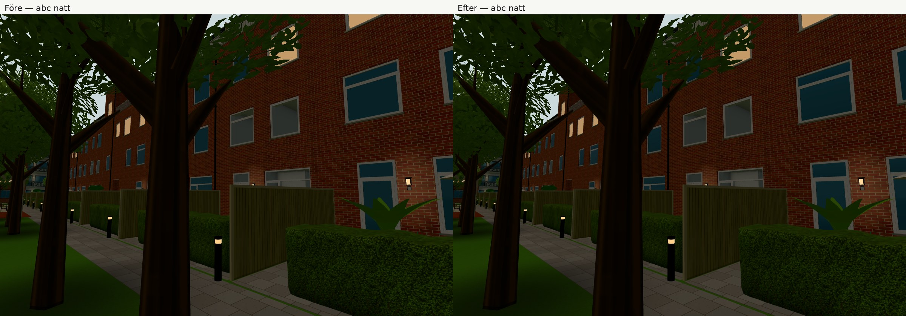
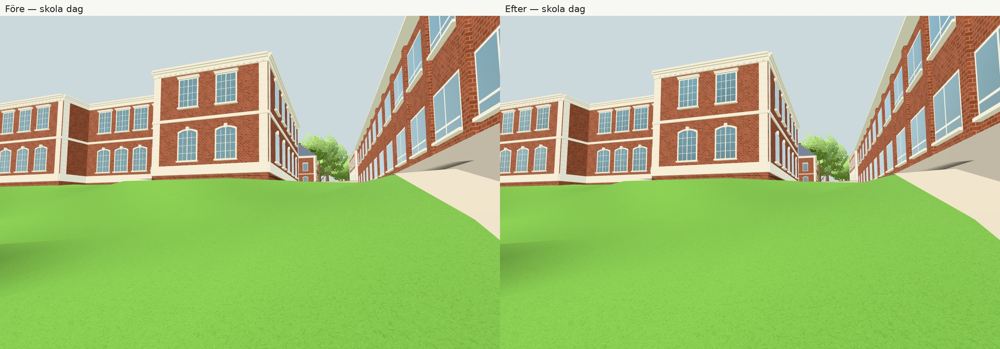
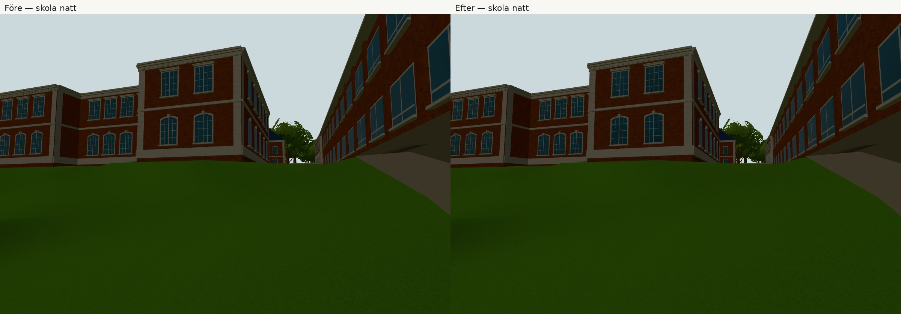

# Public #307: fönsterglasets rutvisa himmelsreflex

Publik bas `e2628344aa758b21bc8f3cf9f71dedd04196e1fb`, granskad originalkälla `47d8827e694d7b62983db3b6943c44f054dd0bb0`
(publicerat resultat `3e33c99`, [original #2087](https://github.com/solwation/lunden-3d-apartment/issues/2087)).
Egna publikbilder från en egen körning av den riktiga publika appen; inga originalbilder återanvänds.
[Browserdata med glasmeshar, gränser och per-vy-budget](browser.json).

Ogenomskinligt fasadglas får en fast, lugn variation per ruta (ljushet ±14 %, blå/varm ton ±6 %),
en mjuk vertikal gradient (ljusare upptill) och på fondglaset en svag himmelston upptill. Färgen
bakas en gång i en vertexfärg innan batcherna slås ihop; ingen textur, uniform, draw eller
per-framearbete. Värdena är *guess* (`GLASS_PANES` i `src/config.js`).

Varje panel är 1200×800, DPR1, native aspekt (canvasläsning efter en renderad bildruta);
bara en rubrikrad läggs till (sammansatt med PIL efter körningen). Chromium/SwiftShader,
fast klocka 2026-06-15 12:00 lokal tid. Publicen har ingen dygnscykel (`main.js` sätter
`windowLights.update(12, 0)` en gång); "natt" anropar samma `windowLights.update(22.5, 1)` som
originalets nattväg (envMap → `reflectionNight`, tända rutor) och dämpar scenens ljus till 8 %
enbart för en läsbar jämförelse. Effekten är avsiktligt lugn: dag 22–39 tusen pixlar
ändrade med högst 15–16 nivåer, natt några hundra till 1 756 pixlar med högst 5 nivåer.

Kontroller:

1. `node --test tools/glasspanestest.mjs`: 3/3. Deterministisk, begränsad färg, en färg per
   ruta både för enskilda rutor och sammanslagna batcher, oförändrade positioner/antal, samt
   att varje konsument målar rutorna före sammanslagningen. `src/glasspanes.js` är
   byteidentisk med originalet.
2. `npm test` och `npm run build`: passerar (innehålls-, lagrings- och nätverksgränser).
3. `node tools/glasspanes307browser.cjs http://localhost:8307 <ut>`: före (basens sex berörda
   moduler) och efter i samma app. Alla tio glasmeshar (`neighborGlass`, `neighborEntryGlass`,
   `neighborLitGlass`, `siteNeighborGlass`, west/east/north/south-glass, `east-schoolGlass`,
   `west-karpGlass`) har efter vertexfärg, samma vertexantal och oförändrade gränser; ingen mesh
   med `vertexColors` saknar färg. Genomsiktligt glas (`bus-stop-glass`, `park-door-glass`,
   `park-side-glass`) är orört och opakt glas förblir opakt. 1 361 meshar före/efter;
   per vy exakt samma draws (43–538), trianglar, texturer (72–76) och program (56–63).
   Lagringssentinel bevarad, noll sid-/konsolfel och noll externa anrop.

Kostnad: inga nya draws, texturer, program, ljus eller per-framearbete. Glasbatcherna som
saknade färg får ett färgattribut: cirka 42 500 vertexar × 12 B ≈ 0,5 MB extra
geometriminne (east-glass och north-glass hade redan färg). Engångs-CPU vid bygget,
uppmätt i Node för 58 000 vertexar: cirka 12–16 ms. Ingen fysisk enhet eller FPS mätt.
