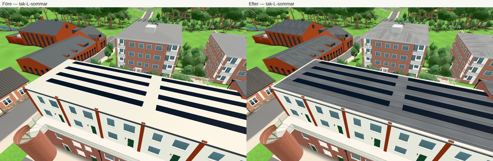
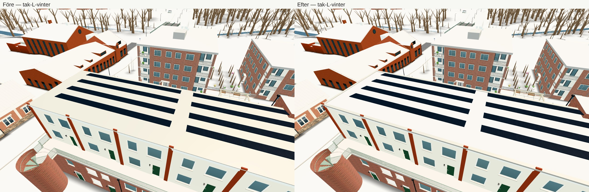
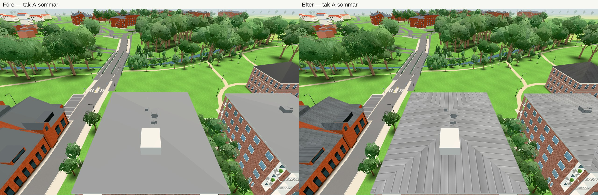
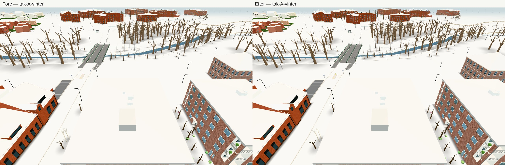
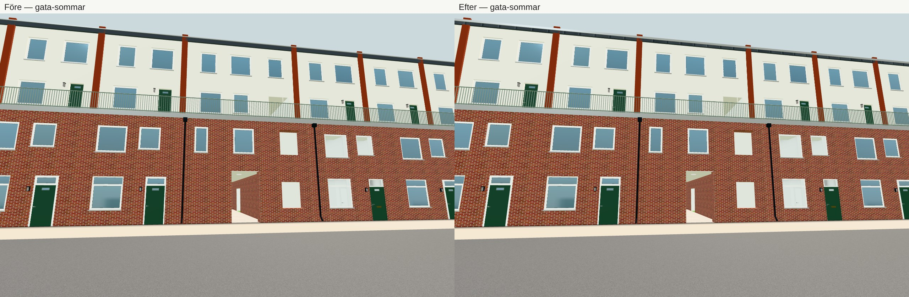

# Public #308: takens falsar, papplister och vädrade matthet samt Hus L:s takkantslist

Publik bas `345bce1`, granskad originalkälla `0c5f4a5` ([original #2088](https://github.com/solwation/lunden-3d-apartment/issues/2088))
och `9da798a` ([original #2093](https://github.com/solwation/lunden-3d-apartment/issues/2093)). Egna publikbilder från en egen
körning av den riktiga publika appen; inga originalbilder återanvänds. [Browserdata med takmeshar och per-vy-budget](browser.json).

En delad neutralgrå 128 px-karta (`src/roofsurface.js`, `ROOF_SURFACE` i `src/config.js`) multiplicerar varje takfärg:
en upphöjd fals/papplist per remsa, svagt olika remsor, lågfrekvent vädrad matthet och svaga regnstrimmor längs fallinjen.
UV:erna bakas längs varje takytas egen fallinje innan batcherna slås ihop (platta tak: remsor längs x, *guess*).
Materialfärgen delas med kartans linjära medel, så takens medelfärg och fjärrvyer är oförändrade; snön byter fortfarande
bort kartan. Hus L:s ljusa plåtavtäckning var en 5 cm platta över hela taket och dolde publicens egen papptaksfärg
(`0x4b5157`); den är nu en 0,3 m list längs takkanten som viker 0,1 m ned över uppbyggnaden (`rectRing`,
`VERTICAL.roof.cappingWidth/cappingDrop`, *guess*). Gångyta, solpaneler, terrassernas täckplåt och listens färg är oförändrade.

Varje panel är 1280×800, DPR1, native aspekt (canvasläsning efter en renderad bildruta), sammansatt sida vid sida
med en rubrikrad. Chromium/SwiftShader, fast klocka 2026-06-15, `?nocats`, säsong via `applySeason`.

Kontroller:

1. `node --test tools/roofsurfacetest.mjs`: 5/5. Deterministisk liten karta med fals/läpp, diskret vädring som
   kaklar sömlöst, oförändrad medelfärg för alla publika takfärger; UV:er längs fallinjen utan att röra positioner/index;
   snö byter bort och återställer kartan; varje publik takkonsument får karta och UV före sammanslagning; takbyggarna
   (`hipRoof`, `roof`, `roofSpec`, `boxGeo`, `tiltedPanelGeo`, `husLLayout`) och orörda moduler är oförändrade mot basen;
   `rectRing` tiler kanten utan överlapp och pappen syns på över 85 % av Hus L:s tak; papplådan, gångytan och
   solpanelernas höjd är oförändrade.
2. `npm test` och `npm run build`: passerar (innehålls-, lagrings- och nätverksgränser).
3. `node tools/roofsurface308browser.cjs http://localhost:8308 docs/verification/308`: före (basens sex berörda moduler)
   och efter i samma app. Alla tio takmeshar har efter kartan `roof-surface` och UV. 1 349 meshar före/efter; per vy
   exakt samma draws (93–533), texturer (65–74; skolans gamla falsbild ersätts av den delade kartan) och program (52–59).
   Trianglar: +36 (Hus L:s fyra kantlådor i stället för en platta) i vinter- och gatuvyn, identiska i A-vyerna; den
   första sommarvyn direkt efter laddning skiljer sig med −11 268, vilket är laddningstiming (samma kamera i vintervyn: +36).
   Lagringssentinel bevarad, bara publika nycklar, noll sid-/konsolfel och noll externa anrop.

Kostnad: inga nya draws, program, ljus eller per-framearbete. En 128×128 RGBA-canvastextur (≈ 64 kB + mipmaps) i stället
för skolans 64×64-falsbild; ett UV-attribut på takbatcherna som saknade det (≈ 32 000 vertexar × 8 B ≈ 0,25 MB).
Engångs-CPU: kartan cirka 11 ms i browsern (SwiftShader-maskin), UV-bakningen några ms. +36 trianglar på Hus L.
Ingen fysisk enhet eller FPS mätt.

Begränsningar: kanthöjder och listbredd är *guess* (ingen sektion i Peab-materialet). Hus L:s tak ser ovanifrån mörkare
ut än före eftersom den ljusa helplattan försvann; själva färgerna (papp `0x4b5157`, ljus plåt) är publicens egna.
