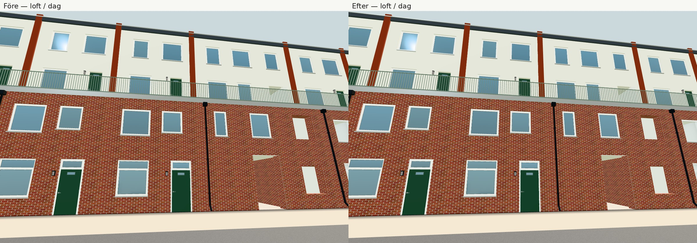
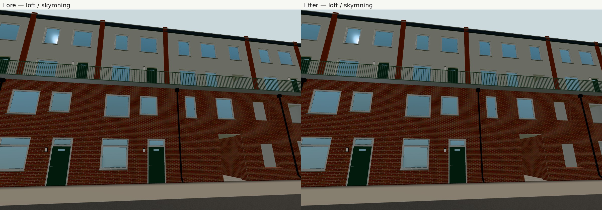
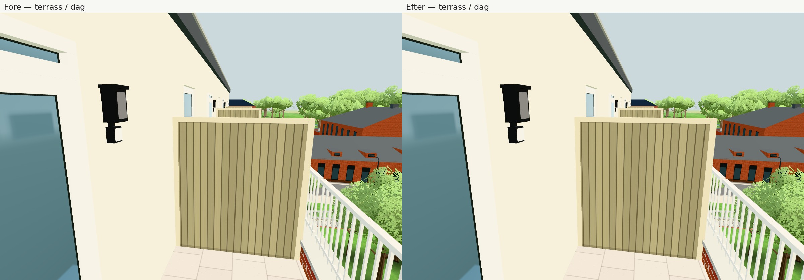
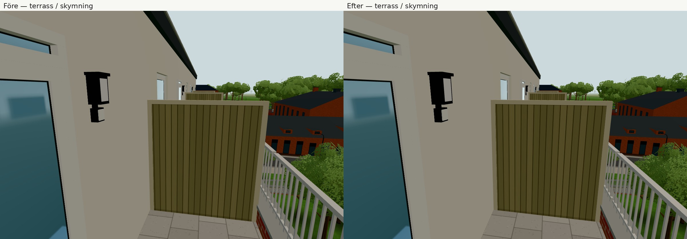
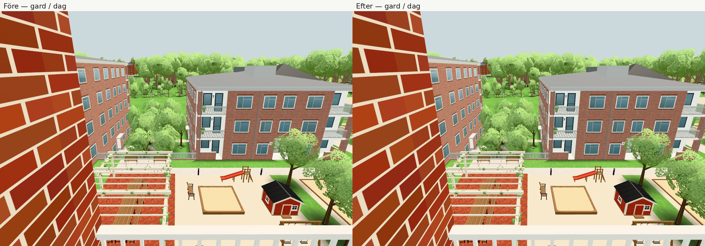
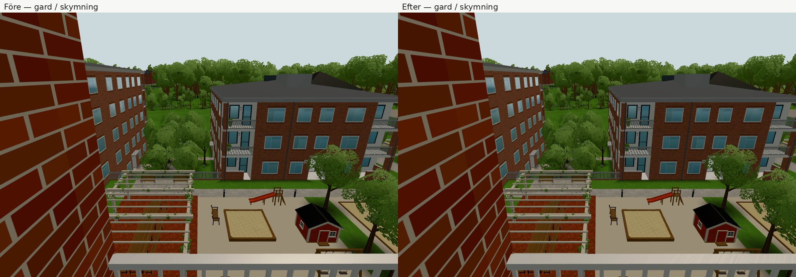
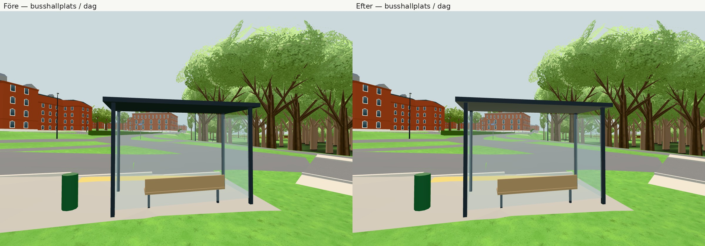
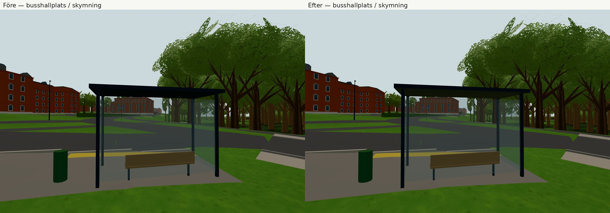

# Public #309: matt metall på räcken utomhus

Publik bas `345bce1ac6a776836eef86754398e137def29b1e`, granskad originalkälla
`da83c3a9610a284441ed8eac812d94df368f8525`
([original #2089](https://github.com/solwation/lunden-3d-apartment/issues/2089)).
Egna publikbilder från en egen körning i den riktiga publika appen; inga originalbilder återanvänds.
[Browserdata med räckesmeshar, gränser, kameror, draws och program](browser.json).

Räckena utomhus får en matt, lätt borstad pulverlackerad yta: fina borstlinjer och mjuk
molnighet i grovheten (avtonade under pixelstorlek), något mattare på avstånd och ett diskret
kantljus som följer himmels-/omgivningsljuset och därför dämpas i skymning. Omfattar Hus L:s
loftgång (`loftRails`), takterrassernas räcken (`terraceRails`), garagetakets räcken och
spjälor (`boxRails`, `boxSlats`), loggiornas räcken (`loggiaRails`) och busskurens stål
(`bus-stop-furniture`; trä och papperskorg lämnas av mättnadsmasken). Färger, metallgrad,
geometri, sammanslagning, skuggor och LOD är oförändrade.

Varje panel är 1200×800, DPR1, native aspekt; bara en rubrikrad läggs till. Publicen saknar
dygnscykel: "skymning" dämpar alla scenljus till 22 % av dagvärdet. Effekten är avsiktligt
lågmäld; pixelskillnaderna (> 3/255) ligger enbart inom räckenas områden (t.ex. loftgång
rad 198–332, terrass x ≥ 908, busskur x 349–1028). Chromium/SwiftShader; ingen FPS eller
fysisk telefon mäts.

Kontroller:

1. `node --test tools/railmetaltest.mjs`: 3/3. Patchen appliceras på three 0.170:s riktiga
   standard-/physical-källor efter rätt chunkar, vertexshadern får bara en varying (positioner
   oförändrade, `hasNativeVertexCompile` gäller), inga uniforms/tid/slump, inga andra importer än
   config/vertexcompile (originalets `lampwash.js` behövs inte), samma programnyckel och kvarvarande
   grovhet för busskurens blandade batch, samt att varje publik konsument använder patchen med
   oförändrade färger/metallgrad och samma antal geometripushar. `src/railmetal.js` är byteidentisk
   med originalet.
2. `npm test` och `npm run build`: passerar.
3. `VIEWS=… node tools/railmetal309browser.cjs http://localhost:8309 <katalog>` (vyer i
   `browser.json`), före = basens fyra berörda moduler: 1361 meshar före/efter, 16 patchade
   material, alla räckesmeshar identiska i hörn, index, attribut, färg, karta, metallgrad, skuggor
   och världsgränser; samma kamera i båda faser; texturer och draws lika (403/419/129/38),
   trianglar lika utom busskursvyn (490 046 → 490 042, levande scen; toleransen ±1 draw och 0,01 %
   trianglar dokumenteras i verktyget). Noll sid-/konsolfel, noll externa anrop, localStorage-sentinel kvar.

Kostnad: ingen textur, geometri, draw, uniform, ljus eller per-framearbete. Två extra
shaderprogram (56 → 58 m.fl.: patchade varianter med/utan karta/vertexfärger), något fler
fragmentinstruktioner på räckespixlar (två hashbrus och derivator). Laddtid här cirka 26–27 s
både före och efter.

Begränsningar: värdena i `RAIL_METAL` är *guess* från utseendet hos lackerade stålräcken, inget
uppmätt. Den svagt mörkare lackskiftningen syns främst nära.
