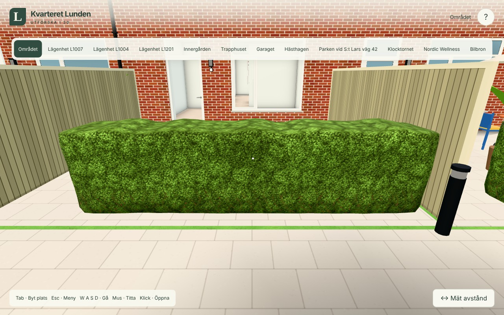
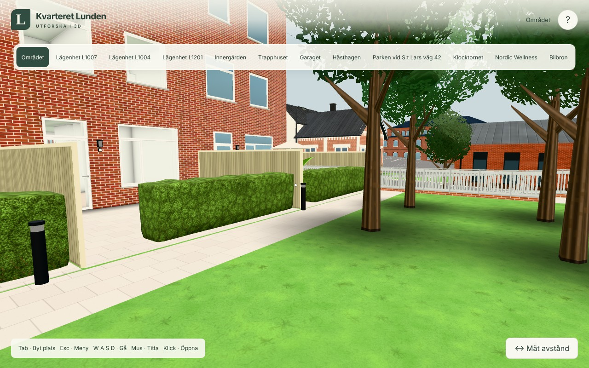
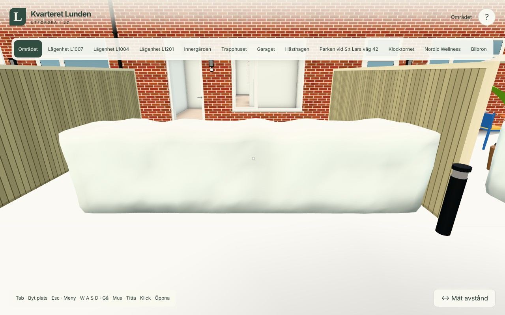
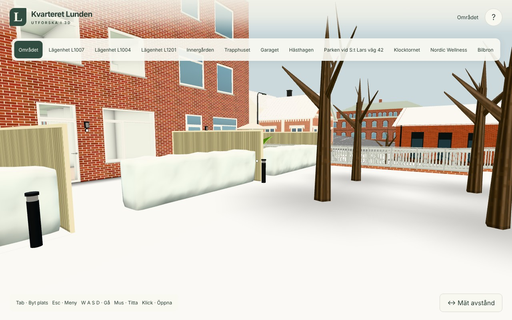
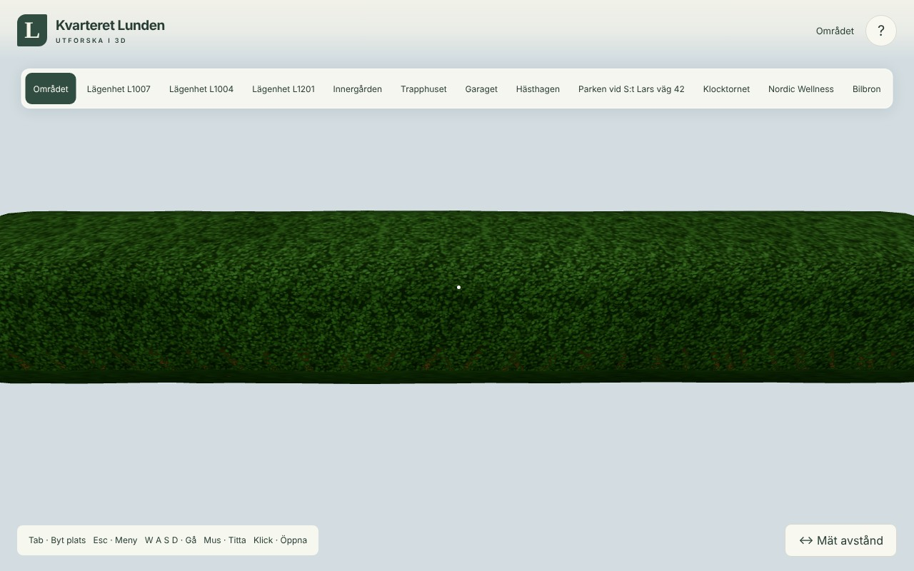
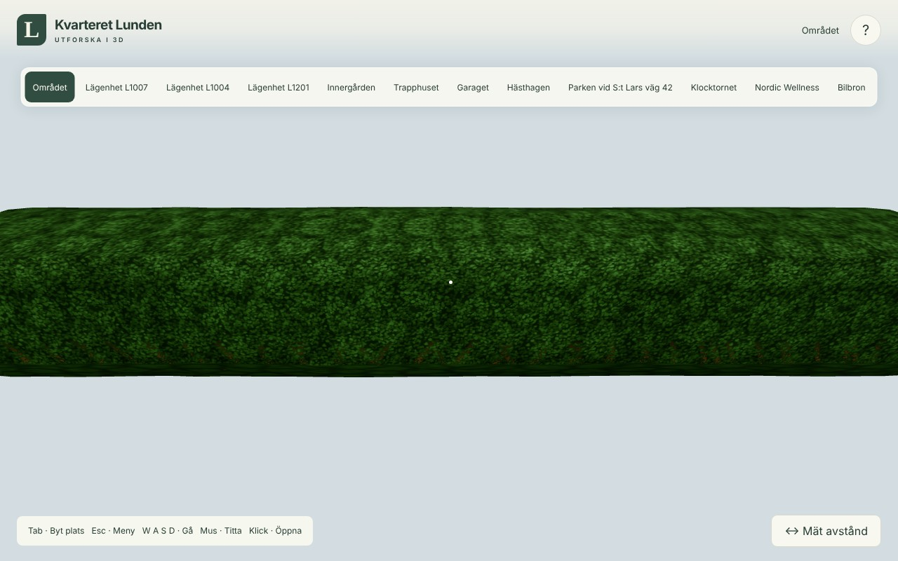

# Public #310: bladklungor på klippta häckar

Publik bas `59c0acef3a775e1d608d66dc61ee9e5bce7b9c68`, granskad originalkälla
`b1c509f51bdd2aabd3a9339d4f238ac022094a74`
([original #2094](https://github.com/solwation/lunden-3d-apartment/issues/2094)).
Egna publikbilder från en egen körning i den riktiga publika appen (`tools/hedgeclump310browser.cjs`,
SwiftShader, 1280 × 800, native aspekt); inga originalbilder återanvänds.
[Browserdata med häckmeshar, programnycklar, draws och källhashar](browser.json).

Häckarna vid Hus L:s uteplatser (`patiohedge.js`, en produktionskonsument via `world.js`) får fragmentbaserade
bladklungor (`src/hedgeclump.js`, `HEDGE_CLUMP` i `src/config.js`, alla *guess*): rundade klungor med mjuka
mörka skrevor, mörkare inre i nedre 40 %, ljusare klungkronor och en svagt ljusare topp (nu en mjuk övergång
efter lutningen i stället för ett hårt steg vid den rundade kanten). Detaljen tonar tillbaka till den gamla
tonen på 16–34 m och när en klunga blir under ~2 px. I vinterläget saknar häckarna lövkarta och förblir slät snö.

| Vy | Före | Efter |
|---|---|---|
| Uteplatshäck nära, sommar |  |  |
| Uteplatshäckar, gångvy, sommar |  |  |
| Uteplatshäck nära, vinter (oförändrad snö) |  |  |
| Uteplatshäckar, gångvy, vinter |  |  |
| Entrébuxbom, komponent (byggaren används inte i publicens scen) |  |  |

## Kontroller

- `node --test tools/hedgeclumptest.mjs` 5/5: deterministiskt, kontinuerligt klungfält; skrevornas andel och mörker;
  medelnormaliserad ton, mörkare nära marken, topp +3–12 %; shaderkonstanter från config utan texturuppslag;
  `hedgeBody` deterministisk inom sitt fotavtryck med ljusare topp; klungor bara på material som ber om dem,
  egen programnyckel, stjälkar kvar.
- Engångsjämförelse av `hedgeBody` mot bas `59c0ace` (buxbom 9,4 m, uteplats 6,1 m): position, normal, uv, hedgeLow
  och index identiska; vertexfärg skiljer högst 0,071/0,067 (den mjuka toppövergången).
- Browser, före (basens `hedgeform.js`/`boxwood.js`/`patiohedge.js`) mot efter: alla åtta uteplatshäckmeshar har samma
  vertexantal och positionshash; programnyckel `hedge-form-1143` → `hedge-form-2094`; draws/trianglar/texturer/
  program/ljus identiska per vy (sommar nära 203 draws, 520 464 trianglar, 54 texturer, 52 program; gångvy 381 /
  765 176; vinter 456 / 670 060 och 379 / 716 780, 55 program). Buxbomskomponenten: 1 draw, 1 390 vertexar före och efter.
  Inga sid-/shaderfel, noll externa anrop, lagringen oförändrad.
- `npm test` och `npm run build`.

## Kostnad och gränser

En 3 × 3 Worley-slinga per häckfragment (inget texturuppslag), en uniform; inget CPU-arbete per bildruta, inga nya
draws, texturer, ljus eller program (nyckeln byter bara namn). Klungorna är färg och normal, ingen siluettändring.
Ej tillämpligt: originalets `lampwash.js`-kedjning av programnyckeln och parkeringshäckarna (finns inte här som
`hedgeform`-konsumenter). Entrébuxbommen får ändringen i byggaren men syns inte i publicens scen.
