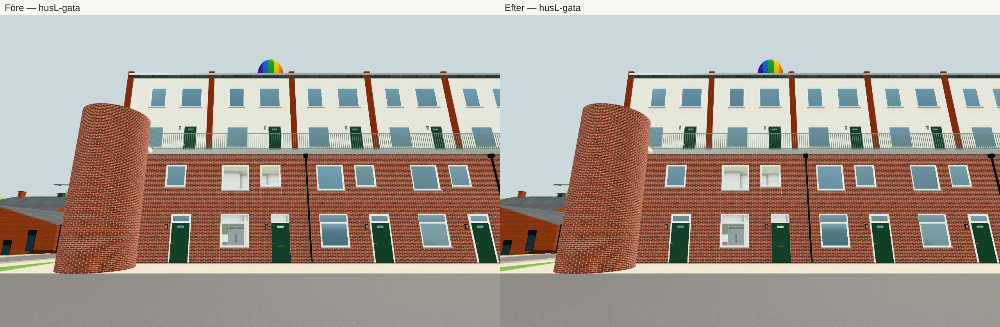
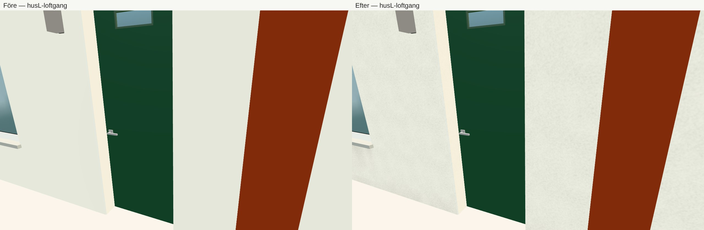
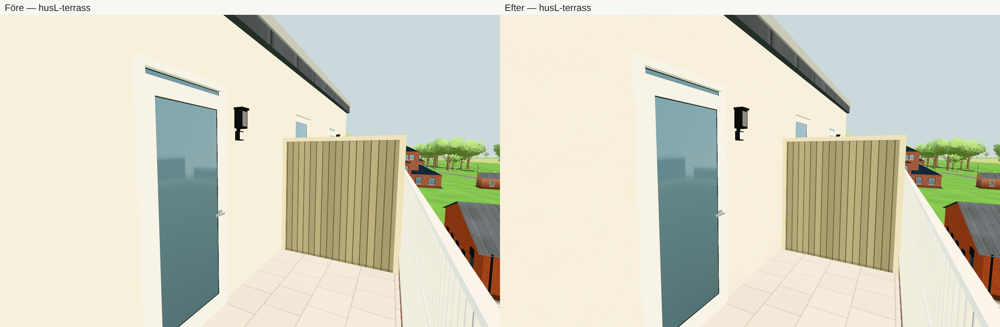
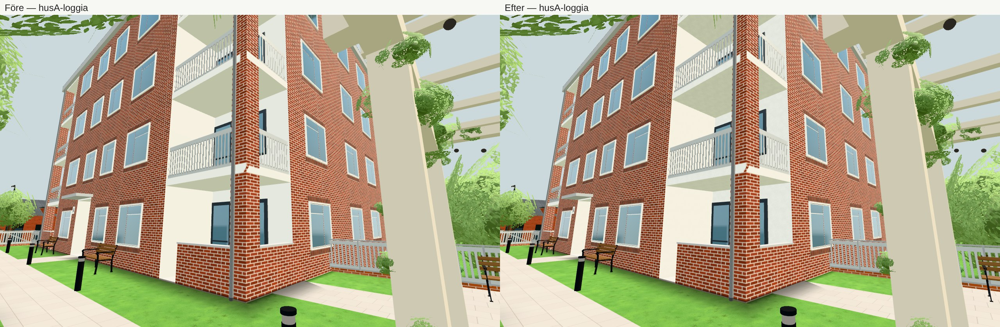
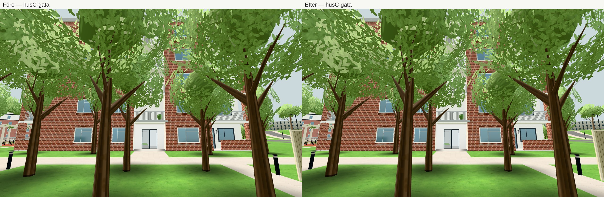

# Public #311: fin putsstruktur och svaga smutsstrimmor på putsfasaderna

Publik bas `d3981b4`, granskad originalkälla `8fed7ec` ([original #2095](https://github.com/solwation/lunden-3d-apartment/issues/2095)).
Egna publikbilder från en egen körning av den riktiga publika appen; inga originalbilder återanvänds.
[Browserdata med putsmeshar, medelton och per-vy-budget](browser.json).

En delad 128 px packad linjär karta över 0,5 m vägg (`src/rendersurface.js`, byteidentisk, `RENDER_SURFACE` i
`src/config.js`, *guess*) ger fin sandkornighet och glesa porer som bump (R) och svag råhetsvariation (G), plus en svag
sRGB-gråkarta för albedo. Materialfärgen delas med albedokartans linjära medel och råheten med kartans medel-G, så
fasadernas medelton står kvar. UV projiceras i världen per yta före sammanslagning; Å-husens fönsterramar i samma mesh
ligger på den neutrala texeln. Smuts: svaga vertexfärgade remsor 2–4 mm (Å-husen 1 cm) framför väggen i samma mesh
(inga nya draws) under varje putsad smygs fönsterbleck (Hus L) och loggiafönster (A/B/C) samt ett svagt stänkband
0,3 m över loftgångens, terrassens och loggiornas golv.

Varje panel är 1280×800, DPR1, native aspekt (canvasläsning efter en renderad bildruta), sammansatt sida vid sida med
en rubrikrad. Chromium/SwiftShader, fast klocka 2026-07-15 kl 13, `?nocats`. Originalets fem vyer (samma koordinater)
utom Hus C, där originalets punkt i publiken bara visar tegel; vyn flyttades till Hus C:s östfasad.

## Kontroller

1. `node --test tools/rendersurfacetest.mjs`: 6/6 (originalets test, bas `d3981b4`). Kartorna deterministiska, små, fina,
   sömlösa, neutral texel = medel; materialfärg × albedomedel = gamla färgen, råhetsmedel kvar; världs-UV per ytplan,
   positioner/index orörda; remsorna vänder utåt, ligger framför väggen, tonar ut helt och är svaga; medeltonen för en
   vägg med fönster, strimma och stänkband ändras < 2 %; konsumenterna bakar UV före merge, inga remsor på tegel;
   `complement`, `quadZ/X/Y`, `boxGeo`, `quad`, `loggiaOpenings`, `glazing`, `cornerLoggias`, `aHouseParts` oförändrade
   mot publik bas.
2. `npm test` och `npm run build`: gröna.
3. `node tools/rendersurface311browser.cjs http://localhost:8311 docs/verification/311`: före (bas-modulerna) och efter.
   Samma antal meshar; draws lika i alla fem vyer (541/230/105/99/106); putsmesharnas ursprungliga trianglar kvar
   (Hus L 918 + 4386 remstrianglar, Å-husen 14028 + 14372); areaviktad vertexfärg Hus L 0,9958, Å-husen 0,9981;
   bildens medel-RGB per vy ändras högst 0,3 % (krav ±2 %); +2 texturer (128 px), +2 shaderprogram; noll sidfel,
   externa anrop och lagringsändringar. Kartan byggs på 9–22 ms vid start.

## Hus som kontrollerats

- Hus L: all puts (`renders` i `exterior.js`: gatans våning 3–4 bakom loftgången, den indragna gårdsvåningen,
  gavlarnas våning 4) — åtgärdat. Tegel får inga remsor.
- Hus A, B, C: putsade loggia-/nischväggar och bjälklag (`loggias` i `surroundings.js`, gemensam implementation) —
  åtgärdat för alla tre. Deras trapphus har ingen putsfasad — ej tillämpligt.

## Kostnad och gränser

- +18,8k trianglar (remsorna) i två befintliga meshar, +2 små texturer (2 × 64 KiB), inga nya draws, ingen per-frame-kod.
- Glas (#307), tak/takkantslist (#308), öppningar och publicens färger är oförändrade.
- Strimmorna är avsiktligt svaga; i skugga på norrsidan och på gatuavstånd syns främst kornet nära.
- Övrig ljus puts (skolan/campus, fonder) ingår inte, som i originalet.

Publicering: Pages success på `24ce7e7`; inbäddade bild-URL:er HTTP 200 före stängning.
