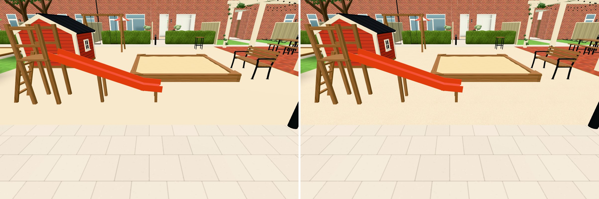
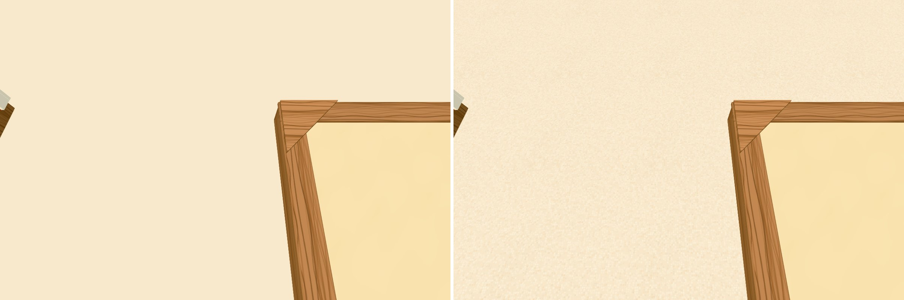
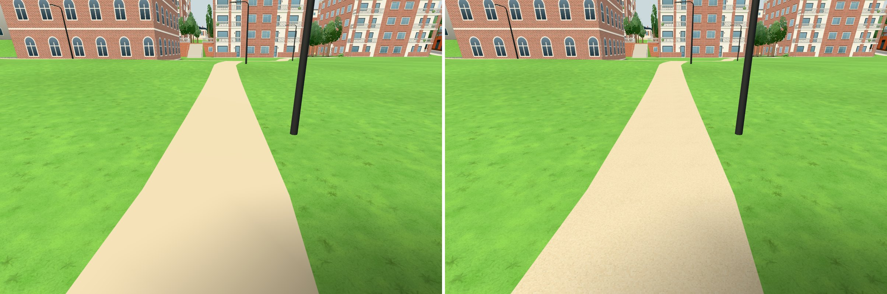
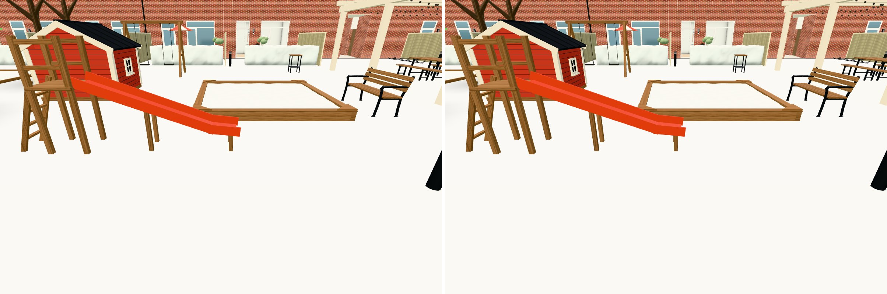

# Public #312: grusytor med små stenar

Publik bas `59c0ace`, granskad originalkälla `b0581f3528fb38df5e2a7ac029736678234b4661`
([original #2096](https://github.com/solwation/lunden-3d-apartment/issues/2096)).
Egna publikbilder från en egen körning i den riktiga publika appen (`tools/gravel312browser.cjs`, 1200×800, SwiftShader);
före = basens `courtyard.js`/`riverpark.js` serverade i stället för de nya. Inga originalbilder återanvänds.
[Browserdata med grusmeshar, gränser, kameror, draws och program](browser.json).

Gårdens grus och parkens grusgångar delar en deterministisk 512 px-karta per 0,9 m (`src/gravelsurface.js`,
`GRAVEL_SURFACE`): små stenar i varierande storlek, ljushet och svag varm/kall ton över mörkare finmaterial, mjuka
tonfläckar och en relief/grovhetskarta. Kartans linjära medel normaliseras och materialfärgen delas med det, så
medelfärgen (0xcfc6b2 resp. 0xb5ac90) är oförändrad på håll. Boulebanan ligger kvar i sandbatchen (inte överförd).

Före vänster / efter höger:

Kontroller
- `node --test tools/gravelsurfacetest.mjs`: 4/4 – deterministisk karta, linjärt medel = 0,6 ±0,002, synlig stenspridning
  utan klippning, grovhet inom 0,78–0,97, sömlös wrap, färg ÷ medel bevarar båda publika gruskulörerna, delade texturer,
  meter-UV utan positionsändring, snö tar bort karta/relief/grovhet och återställer dem, konsumentrader (boulen kvar i sand).
- `npm test` och `npm run build`: gröna.
- Browser: noll sid-/shaderfel och noll externa anrop; lagring bevarad (`lunden.sentinel`); samma meshantal, grusmeshar med
  samma vertexantal, skuggor och gränser (gården 12 vertices, parkens gångar 6690); samma kamera; draws och trianglar
  identiska i alla fyra vyer (242/58/591/238 draws).
- Kostnad: två delade 512² RGBA-DataTextures (1 MiB vardera + mipmaps; +2 texturer i vyerna), engångsgenerering vid start,
  ett extra shaderprogram (gruset); inga nya draws, ljus, trianglar eller per-framearbete.

Begränsningar: skolgårdens bakgrundsytor och utegymmets grus behåller platt färg (som i originalet). Stenarna syns främst
nära; på 10+ m håll är ytan medvetet nästan oförändrad.
