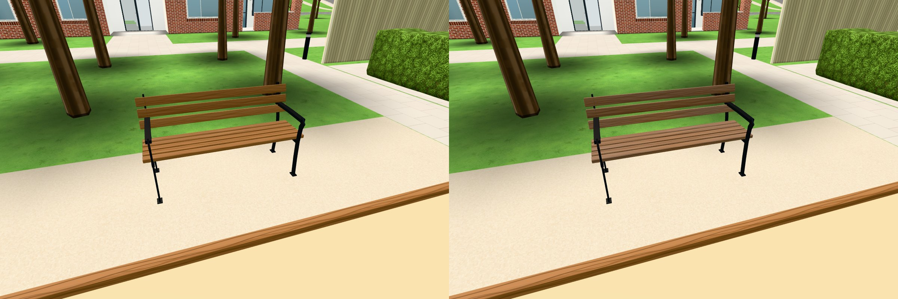
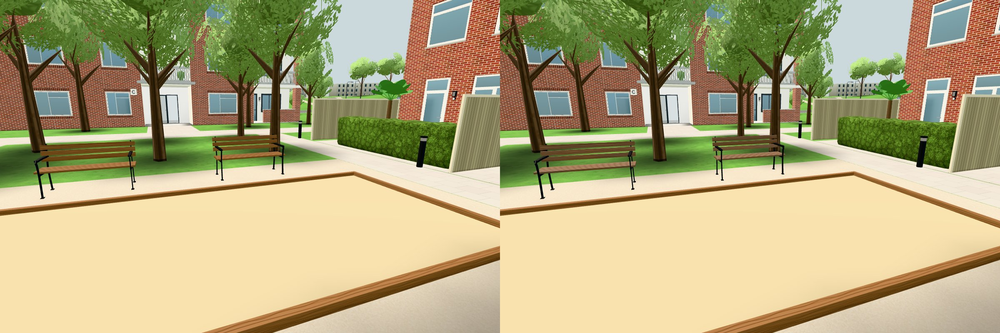
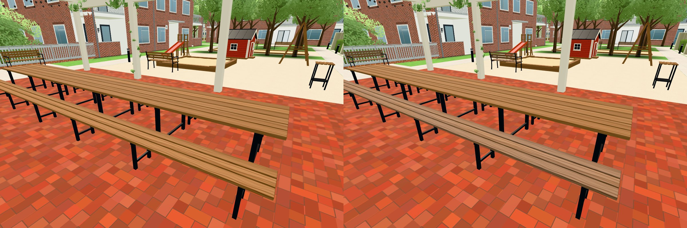
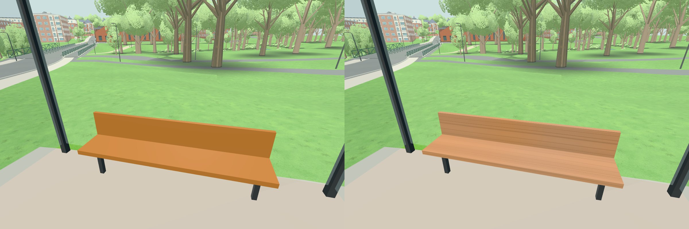
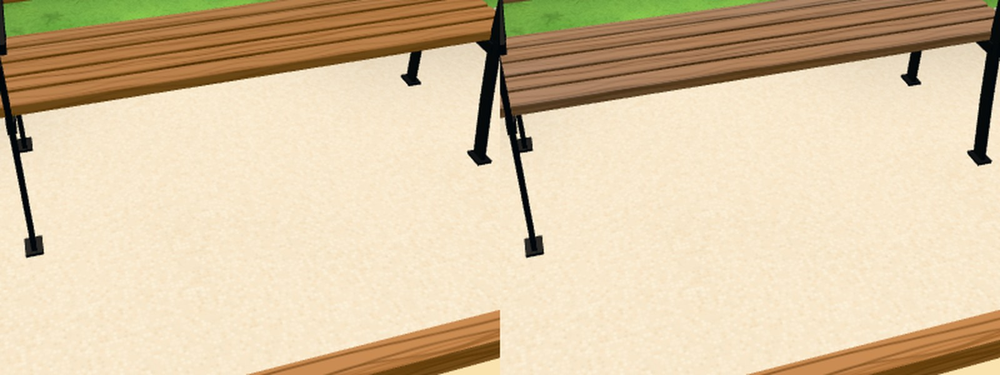
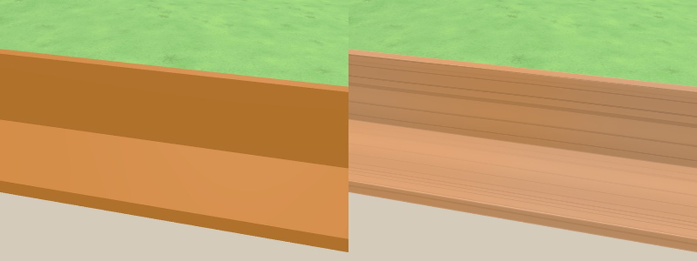

# Public #313: väderbitna bänkribbor

Publik bas `6ebab12`, granskad originalkälla `c96d77ed32fe3408bd244c018528d777b9eb43ce`
([original #2098](https://github.com/solwation/lunden-3d-apartment/issues/2098)).
Egna publikbilder från en egen körning i den riktiga publika appen (`tools/benchwood313browser.cjs`, 1200×800,
SwiftShader, juni förmiddag); före = basens `config.js`/`courtyard.js`/`busstop.js` serverade i stället för de nya
(`benchwood.js` används då inte). Kamerorna räknas fram ur scenen och är identiska i båda faserna. Inga originalbilder
återanvänds. [Browserdata med batchar, kameror, draws och program](browser.json).

Före vänster / efter höger:

Detalj, förstorade utsnitt (före | efter):

Kontroller
- `node --test tools/benchwoodtest.mjs`: 4/4 – patchen mot three 0.170:s egna shaderkällor (efter railMetals färgsteg,
  inga uniforms, statisk), kedjade programnycklar, märkningen ändrar inte position/normal, i den byggda gården och
  busskuren är exakt park- och pergolabänkarnas ribbor och busskurens sits/rygg märkta med ådring längs ribban,
  två byggen ger identiska attribut.
- `npm test` och `npm run build`: gröna.
- Browser: noll sid-/shaderfel, noll externa anrop, lagring bevarad; samma meshantal; gårdens virkesbatch (37 956
  vertices) och busskurens möbler (684) med samma gränser och skuggor; båda bär `benchWood` efter (busskuren även
  `railMetal`); samma kamera, identiska draws, trianglar och texturer i alla fyra vyer (92/130/128/572 draws).
- Kostnad: 12 byte per vertex (gårdens virke 1 670 064 → 2 125 536 byte, busskuren 24 624 → 32 832 byte), +1
  shaderprogram per vy, ingen textur, draw, uniform, ljus eller per-framearbete.

Begränsningar: skolgårdarnas bänkar ligger i andra batchar och är omärkta (som i originalet). Ådringen syns främst nära;
den tonar mot sitt medel när linjerna blir mindre än en pixel.

Publicering: Pages success på `a9476b7`; inbäddade bild-URL:er HTTP 200 före stängning.
