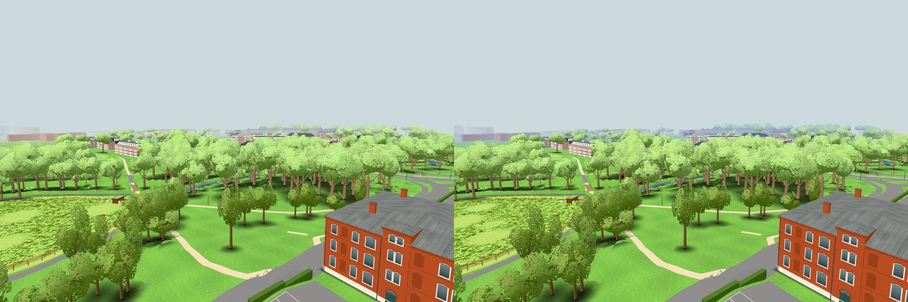
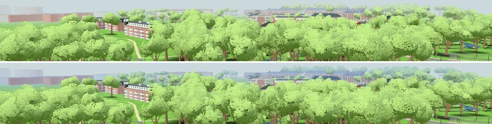
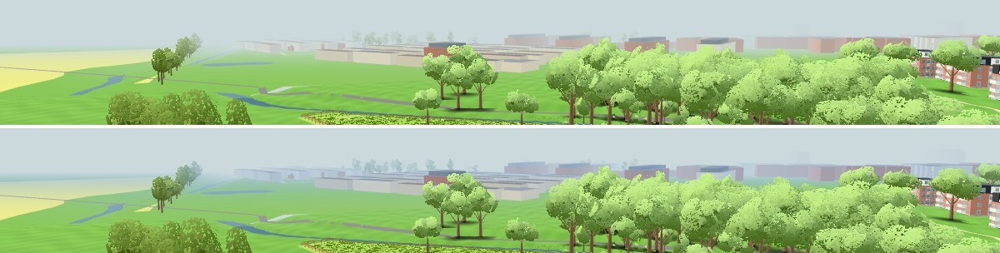
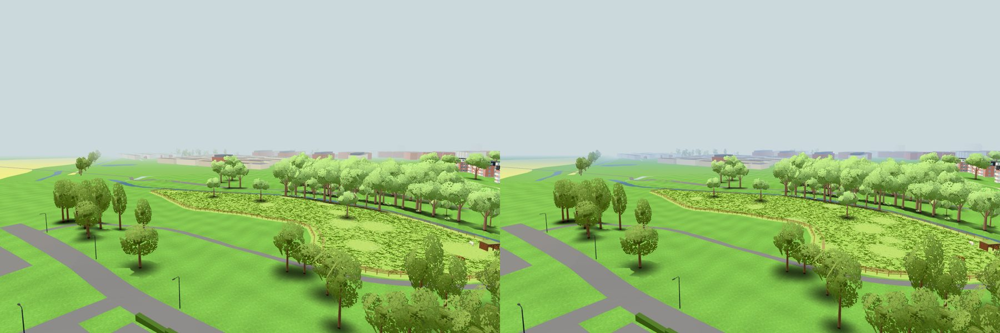
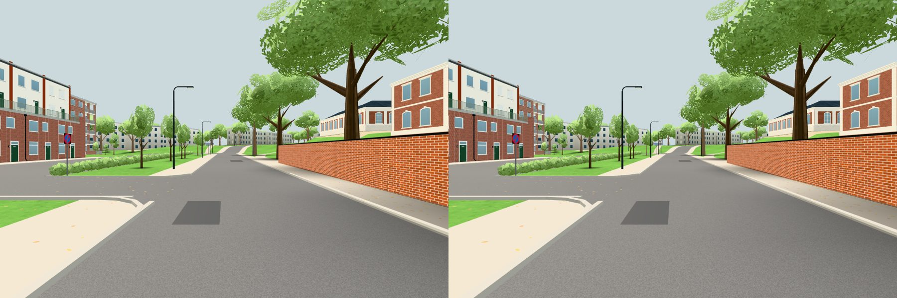
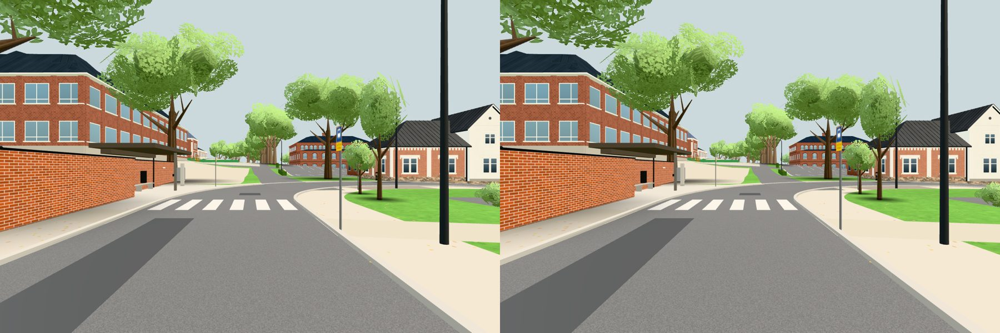

# Public #314: luftperspektiv i avståndsdiset

Publik bas `6ebab12`, granskad originalkälla `c54c3b6e081d176bfa11616a443e74287e53ee9c`
([original #2100](https://github.com/solwation/lunden-3d-apartment/issues/2100)).
Egna publikbilder från en egen körning i den riktiga publika appen (`tools/haze314browser.cjs`, 1200×800, SwiftShader,
`?keepgeo`); före = basens `main.js` serverad i stället (ingen `aerialhaze.js`-import, alltså threes vanliga dimma).
Inga originalbilder återanvänds. [Browserdata med kameror, draws, trianglar, texturer och program](browser.json).

Publiken har fast dagsljus, platt bakgrundsfärg `0xcbd9dd` = dimfärgen och dimma 200–650 m. `src/aerialhaze.js`
(byteidentisk) lappar threes fyra dimchunkar en gång vid import; `src/main.js` sätter en gång ett klart-dag-läge:
dis på mellanavstånd (störst vid halv dimma, ~425 m) dras lite mot blått (`HAZE.blue` × bakgrundsfärgen) och övergår
vid full dimma exakt i bakgrundsfärgen, så fjärran siluetter fortfarande smälter in i himlen. Kurvan mellan 200 och 650 m
blandar smoothstep 35 % mot en normaliserad exponentiell uppbyggnad (`k` 2,2): något mer dis på mellanavstånd, inget före 200 m.
Ingen varm sida mot solen: bakgrunden är platt och den fasta solen står högt (y 0,84), så en varm term skulle bara skilja
diset från himlen (`HAZE.scatter.amount` 0). Inget väder, ingen dygnscykel, himmelsshader eller dykvy finns här.

Före överst/vänster, efter under/höger:

Kontroller
- `node --test tools/aerialhazetest.mjs`: 4/4 – chunkarna lappas en gång och alla ShaderLib-poster, materialkloner och
  sammanslagna ShaderMaterial (`groundao.js`) delar uniformerna; kurvan 0 före 200 m, 1 vid 650 m, monoton och nära den
  gamla; blåare mellandis, ingen varm term/halo, full dimma = bakgrundsfärgen; apply/clear skriver uniformerna.
- `npm test` och `npm run build`: gröna.
- Browser före/efter: noll sid-/shaderfel och noll externa anrop; samma dimma (200/650/`cbd9dd`), samma kamera, draws,
  texturer och program i alla fyra vyer (619/42/147/64 draws, 73 texturer, 58 program), trianglar inom levande scenrörelse
  (+12 av 914 133). Medelpixeldiff: parkvyerna ~2–3/255 (bara i horisontbandet), gatuvyerna 0,01/255.
- Alla material kompilerar: en egen engångskörning tvingade alla 588 material i scenen synliga och körde
  `renderer.compile`: 89 program, 0 länkfel, 0 konsolfel – bl.a. gräs, grus (`gravelSurface`), häckar, tak, glas,
  räcken (`railMetal`), asfalt, åvatten, plattor och `groundao`/`groundglow`-shaderna. Puts (#311) och bänkar (#313)
  fanns inte i basen och är inte kontrollerade här.
- Kostnad: inga nya draws, texturer, program, ljus eller per-framearbete (uniformerna sätts en gång vid start);
  i varje dimmat fragment en extra varying, en pow och några mix.

Begränsningar: effekten är medvetet lågmäld och syns bara bortom 200 m (från höjd eller långa siktlinjer); gator i
ögonhöjd slutar oftast före dimmans början. `groundao.js` räknar fortfarande sin egen smoothstep-dimfaktor (som i originalet).
