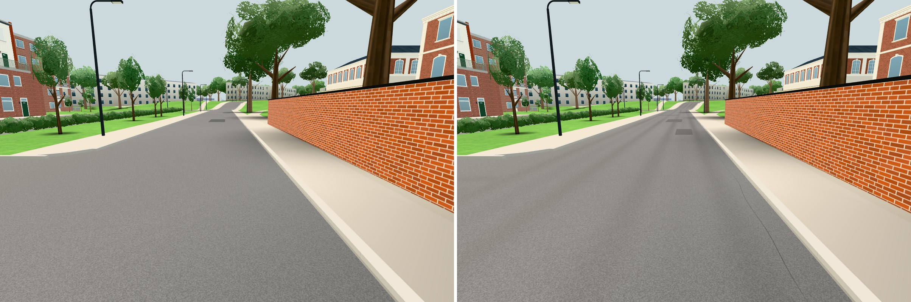
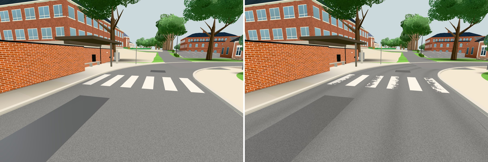
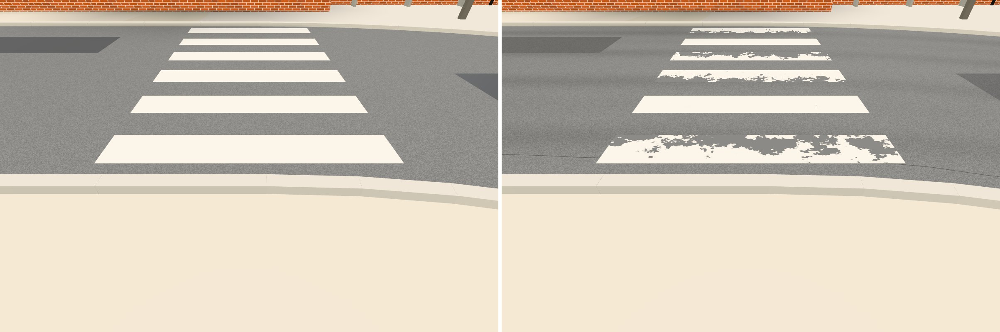
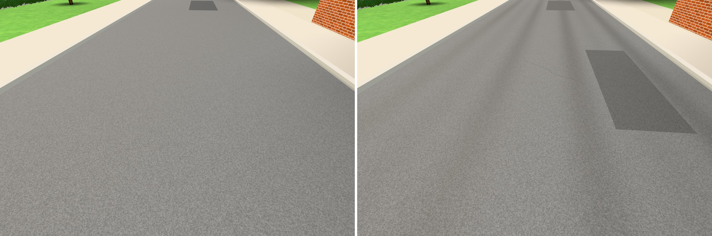

# Public #316: slitna gator och lagningar

Publik bas `7911f30`, granskad originalkälla `d9be131c19e56399fe5b7e0b4cba9afd3dfb868b`
([original #2103](https://github.com/solwation/lunden-3d-apartment/issues/2103)).
Egna publikbilder från en egen körning i den riktiga publika appen (`tools/streetwear316browser.cjs`, 1200×800, SwiftShader,
sommardag); före = basens `asphaltsurface.js`/`surroundings.js`/`street.js` serverade i stället för de nya. Inga
originalbilder återanvänds. [Browserdata med vägens, lagningarnas och övergångsställets geometri, kameror, draws och program](browser.json).

De lokala vägarnas asfalt (`src/streetwear.js`, `STREET_WEAR`, alla värden *guess*) får två svagt mörkare och lite blankare
hjulspår per körfält, en svag oljerand mitt i körfältet, enstaka smala vågiga sprickor (en del tätade med blank svart
bitumen) och en avbruten spricka längs vägkanten. Övergångsställets vita fält flagnar till asfaltfärg, mest där hjulen går.
Lagningarna får asfaltens egen ballast i mörkare ton och tre nya lagningar på gatunivån. Körfälten kommer från ett extra
vertexattribut `roadFrame` (meter tvärs vägens mittlinje, halv bredd) som beräknas en gång vid bygget; positioner, index,
vägbredder, kantstenar och gångbarhet är oförändrade.

Före vänster / efter höger:

Kontroller
- `node --test tools/streetweartest.mjs`: 5/5 – vägramen (mittlinje, kanter med motsatta tecken, Karpvägen, egen väg i en
  korsningsmynning, null långt bort), hjulspår per körfält och ett körfält på smal väg, `addRoadFrame` deterministisk utan
  positions-/indexändring, asfaltkedjan #2072-ballast → slitage med en kopia och unik nyckel `asphalt-surface-2072|wear2103-asphalt`,
  oförändrad vertexshader (bara varyings), snö (ingen karta) hoppar över slitaget, egen nyckel för färgen, lagningarna på
  asfalten fria från gamla lagningar och övergångsstället. Befintliga `asphaltsurfacetest`, `cobbledcorner299test` och
  `bridgehead1554test`: gröna.
- `npm test` och `npm run build`: gröna.
- Browser: noll sid-/shaderfel och noll externa anrop; lagring bevarad (`lunden.sentinel`); samma meshantal (1361); vägen
  (14205 vertices) och övergångsstället (180 vertices) med samma gränser och skuggor, bara `roadFrame` tillagt; lagningarna
  36 → 54 vertices; samma kameror; draws identiska (122/52/34/60), texturer identiska.
- Kostnad: inga nya draws, texturer, ljus eller per-framearbete; +6 trianglar (tre lagningar), +1 shaderprogram (lagningarna
  har nu karta; asfalten och övergångsstället byter bara nyckel), ett vec2-attribut på vägen (≈ 14205 × 8 B ≈ 111 KiB) och
  övergångsstället, en engångsberäkning av vägramar vid start; resten är fragmentarbete på vägytan.

Ej tillämpligt: originalets blöta lager (#2099, `wetground.js`) och regnvyn – publiken har varken väder eller blöt mark.

Begränsningar: sprickor, spår och lagningar är antaganden utan inmätning. Hjulspåren följer `SITE.roads`-vägarnas mittlinjer;
fillets och parkeringsytan har inga körfält men får sprickor. Snömånader visar snöytan utan slitage.

Publicering: Pages success på `98b3e3e`; inbäddade bild-URL:er HTTP 200 före stängning.
