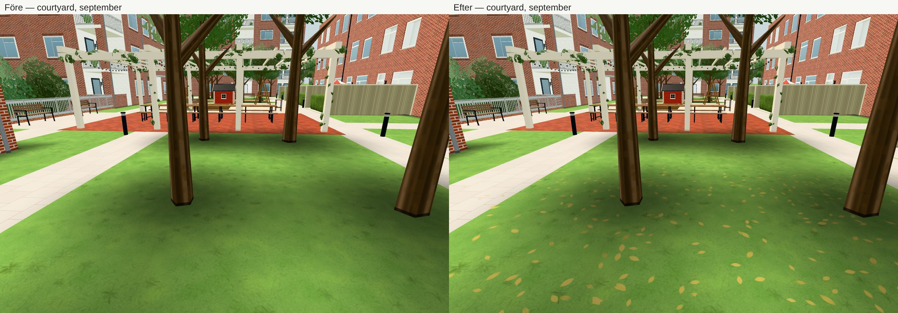
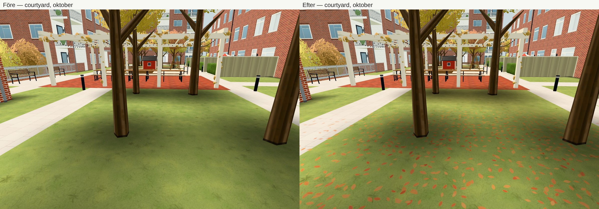
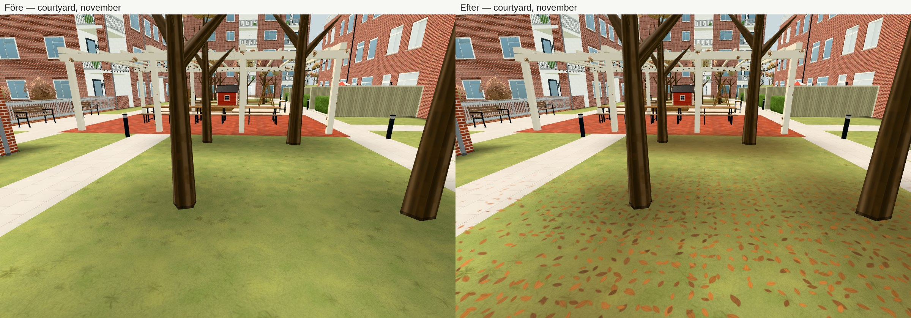
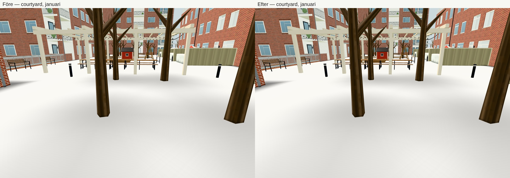
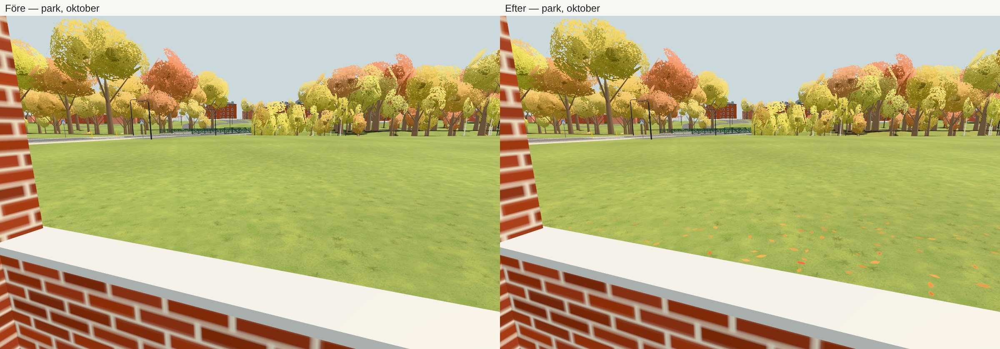
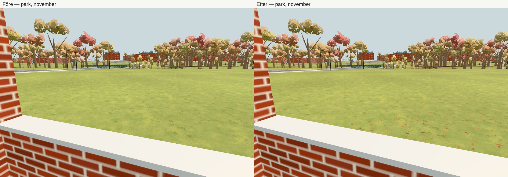
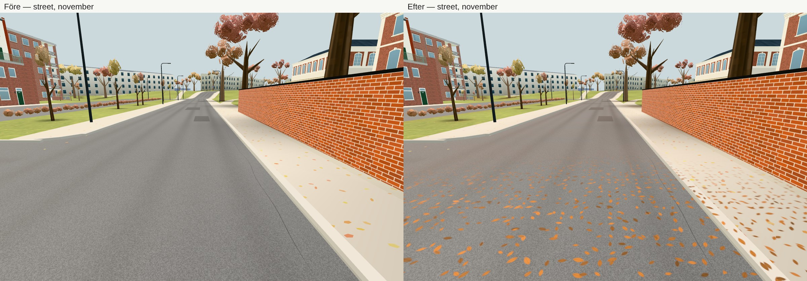

# Public #317: nedfallna höstlöv på marken

Publik bas `ea3d1f2`, granskade originalkällor `9113aa3a517a0e78c03d4f282fb8c8ee84ac469b` + `44bc8ad827cec2fd8357c7d22e9b80258ddd5f94`
([original #2105](https://github.com/solwation/lunden-3d-apartment/issues/2105)) och mobilvarianten
`dd9088d0fa549807b0c706afd64acb08ce216d96` ([original #2118](https://github.com/solwation/lunden-3d-apartment/issues/2118)).
Egna publikbilder från en egen körning i den riktiga publika appen (`tools/leaflitter317browser.cjs`, 1200×800 per halva,
SwiftShader, `?nocats`); före = basens versioner av alla ändrade moduler serverade i stället för de nya, och månaden byts i sidan
med `applySeason`. Inga originalbilder återanvänds. [Browserdata: draws, trianglar, texturer, program, kameror, bildskillnad](browser.json).

Ett delat lövtillstånd (`src/leaflitter.js`, `LEAF_LITTER`, *guess*): andel per månad sep 0,2 / okt 0,6 / nov 1, inget sommar,
vår och snömånader; månadens färska/gamla lövtoner; en R8-täthetskarta över WALK (1 m texlar, bakas en gång första höstmånaden:
gles fläckig bas, mer under varje trädkrona i `aoTrees`, ett band längs vägarnas kantsten). Ett fragmentsteg kedjat sist på
publikens markmaterial (gräs, asfalt efter ballast/slitage, grus, exponerad platta, gårdens plattor/tegel, parkens gångar,
bakgrundernas gångytor, trottoarer, kantsten, lagningar, övergångsställe, kullersten) ritar små löv i två världsrutnät som tonar
till medeltonen på håll. Gatans instansierade trottoarlöv glesnar med samma andel. Mobil (`lowMemory`) kompilerar bara
medeltonen under egna `-lite`-nycklar.

Före vänster / efter höger:

Kontroller
- `node --test tools/leaflittertest.mjs`: 5/5 – andel per månad (ingen mars–aug eller snömånader, även om en höstandel
  konfigurerades; sep < okt < nov ≤ 1; toner bara i säsong), täthetskarta gles i öppen mark, tätast vid stammen och tunnare mot
  kronkanten, band längs båda kantstenarna men inte mitt i vägen, bytedeterministisk; `LeafLitter` skriver uniforms per månad och
  bakar en gång (inte utom säsong); publikens konsumenter: kedjat sist, vertexshadern orörd, delade uniforms, unika nycklar
  (`asphalt-surface-2072|wear2103-asphalt|litter2105-asphalt`, `gravel-surface-2096|litter2105-gravel`, `…|wear2103-paint|litter2105-paint`,
  gräsets `grass-patches-688|litter2105-grass`), portikens skyddade platta opatchad, patchat en gång; mobil: ingen lövform-/hashkod,
  alla uniforms bundna, tonen kvar, egna `-lite`-nycklar och samma tonaritmetik som skrivbordets steg med `litDetail = 0`.
  `streetweartest` 5/5 och `gravelsurfacetest` godtar nyckelsuffixet resp. `leafLitter`-omslaget. Övriga nodtester: samma
  14 fel före och efter (befintliga, orelaterade frysta baslinjer).
- `npm test` och `npm run build`: gröna.
- Browser: noll sid-/shaderfel och noll externa anrop; lagring bevarad (`lunden.sentinel`, samma nycklar); samma kamera; draws ±1
  (scenrörelse); 21 patchade markmeshar, alla med skrivbordsshader. Andel ändrade pixlar (summa kanaldiff > 6) före/efter,
  juli / sep / okt / nov / jan: gården 0,16 / 3,1 / 13,7 / 41,5 / 0 %, parken 0,43 / 0,9 / 2,0 / 2,1 / 0 %, gatan
  0,43 / 4,0 / 20,3 / 21,7 / 0 % (juli: bara vajande kronor, #315). Gatans trottoarlöv: 280 / 840 / 1400 instanser sep/okt/nov
  (före: alltid 1400), därav upp till 5 600 färre trianglar i september.

Kostnad: inga nya draws, ljus eller pass. +2 texturer: en 1×1 tom platshållare och den 605×652 R8 täthetskartan (~0,39 MB, bakas
lazily första höstmånaden; säsongsbytet inklusive bakningen tog 76 ms i SwiftShader mot 1–5 ms annars). +6 shaderprogram
(markmaterialen får egna nycklar). GPU-kostnad bara på höstens marktexlar: två lövrutnätsuppslag per nära markpixel
(skrivbord; publiken har inga kvalitetsnivåer), bara medeltonen på mobil; utanför säsong hoppas grenen över (`uLitter.x = 0`).

Gränser: placeringen är en *guess*; löven är platt albedo/grovhet (ingen relief, ingen vind, de rör sig inte när man går);
kartan täcker bara WALK. Publiken har ingen blöt mark (#2099 endast original), så inga våta löv. Utan `?month=` visar publiken
sommar, så löven syns bara med `?month=9`–`11`. Mobilprofilen är verifierad i nodtestet, inte på en verklig telefon.
