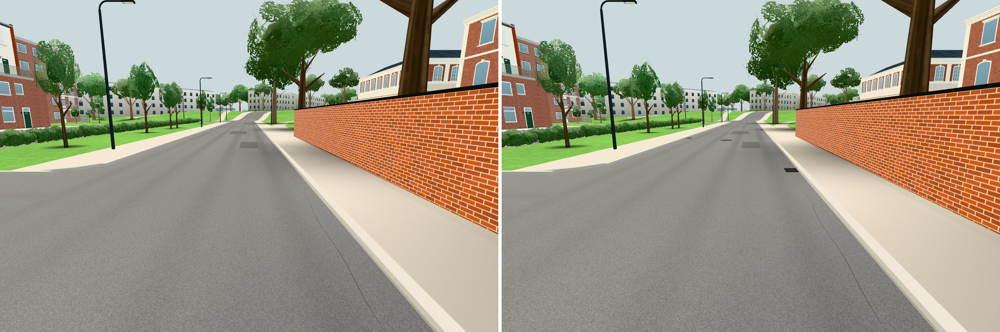
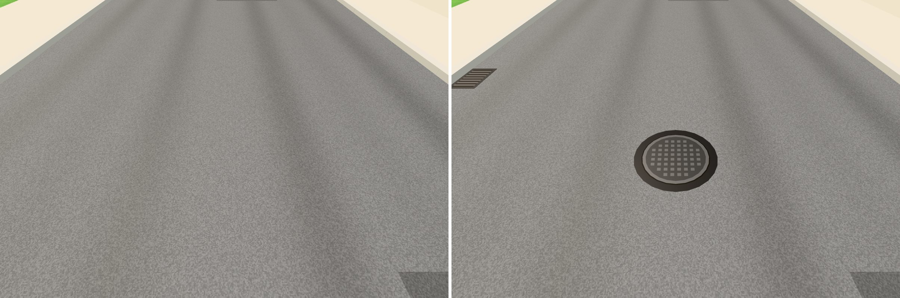
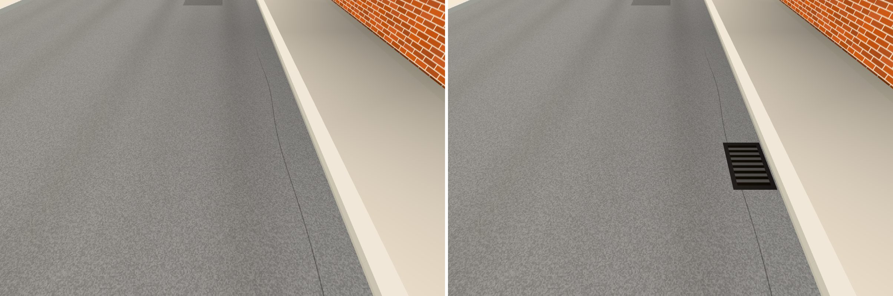
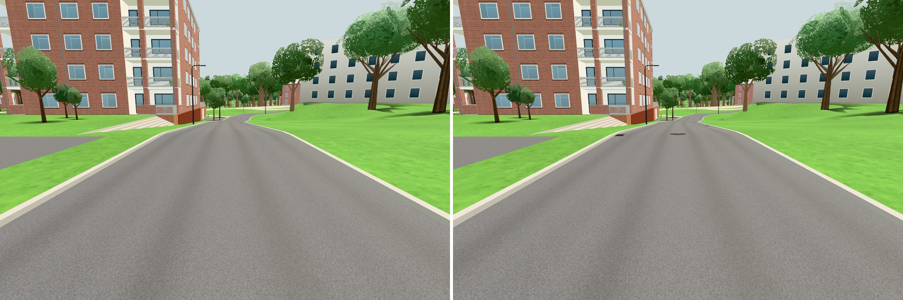
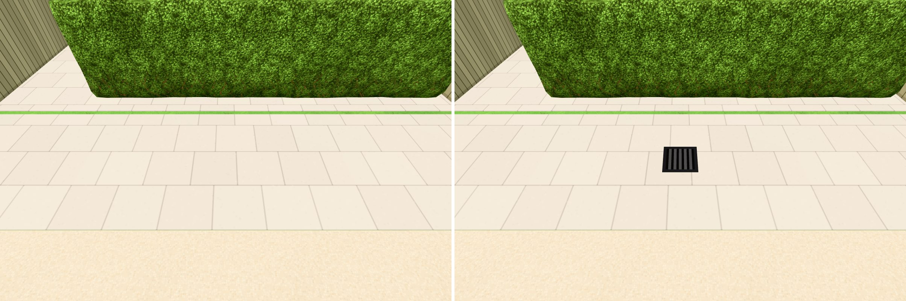

# Public #319: brunnslock och dagvattengaller

Publik bas `d190248`, granskad originalkälla `cfc519b428d02d1c84369d85e62374d54a3ffeac`, accepterad `36005ad16fb48b6fb4bfc626abb08eb27c9d9bca`
([original #2121](https://github.com/solwation/lunden-3d-apartment/issues/2121)).
Egna publikbilder från en egen körning i den riktiga publika appen (`tools/drains319browser.cjs`, 1200×800, SwiftShader,
sommardag kl. 10); före = basens `config.js`/`street.js` serverade i stället för de nya. Inga originalbilder återanvänds.
[Browserdata med kameror, draws, trianglar, texturer och program](browser.json).

`src/drains.js` (`STREET_DRAINS`, alla värden *guess*) lägger runda gjutjärnslock på mittlinjen av Sankt Lars väg och
Karpvägen, dagvattengaller i rännstenen mot kantstenen på båda sidor och tre små kvadratiska galler på gårdens gångar.
Ett lock flyttas längs vägen eller utgår om det skulle röra en lagning, ett övergångsställe, refugen, en annan väg eller en
mynning utan kantsten. Allt är platt geometri några mm över varje hörns mark, i ETT vertexfärgat mesh i `street-details`
(ingen textur, ingen kollision, ingen skugga), dolt under snömånaderna.

Före vänster / efter höger:

Kontroller
- `node --test tools/drainstest.mjs`: 6/6 mot publicens geometri – deterministiskt (7 lock, 25 rännstensgaller, 3 gårdsgaller),
  helt på den egna vägens asfalt och inte på en annan väg, lock på mittlinjen och galler mot kantsten, fritt från lagningar
  (inklusive #316:s), övergångsställen, refugen och varandra, gårdsgaller på gångarna fria från pollare/bänkar/träd, platt
  uppåtvänd geometri på rätt höjd och ett material utan kompileringskrok.
- `npm test` och `npm run build`: gröna.
- Browser: noll sid-/shaderfel och noll externa anrop; lagring bevarad (`lunden.sentinel`); +1 mesh (`street-drains` i
  `street-details`, synligt, utan karta och skugga); samma kameror.
- Kostnad: +1 draw där locken syns (122→123, 34→35, 48→49, 123→124, 83→84), +2564 trianglar, +1 geometri (≈ 7692 vertices ×
  36 B ≈ 270 KiB), 0 nya texturer, 0 nya shaderprogram (vanligt `MeshStandardMaterial` med vertexfärger), inget per-framearbete.

Ej tillämpligt: originalets blöta lager (#2099, `wetground.js`), regnvyn och telefonprofilens separata material – publiken har
varken väder eller blöt mark, så alla profiler använder samma enkla material.

Begränsningar: platser, mått och färger är antaganden utan dagvattenritning. Locken har ingen kollision och påverkar inte gång.

Publicering: Pages success på `b109a00`; inbäddade bild-URL:er HTTP 200 före stängning.
