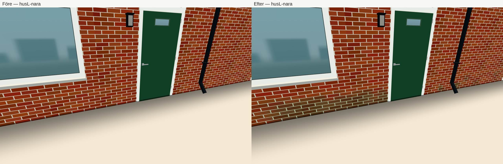
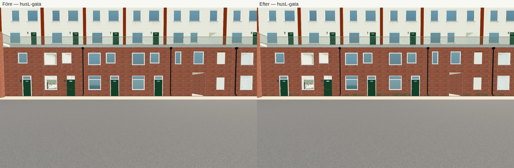
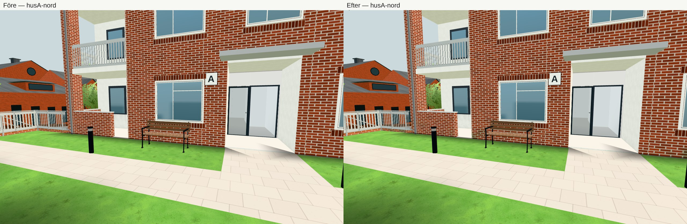
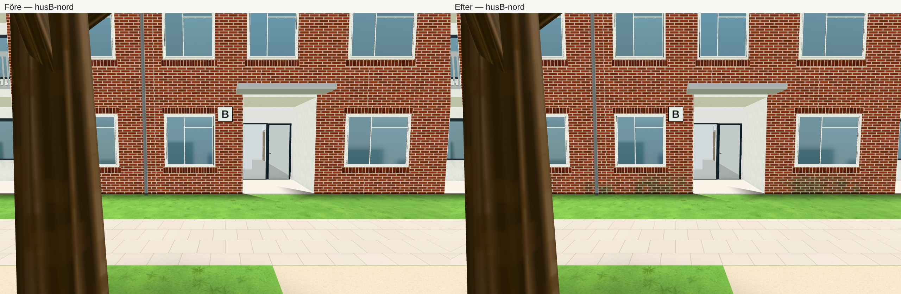
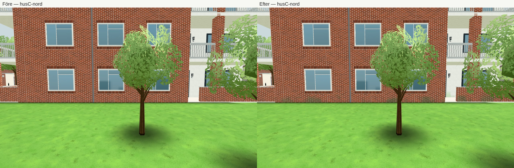

# Public #320: diskret mossa och alger lågt på skuggiga norrväggar

Publik bas `d190248`, granskade originalkällor `bc054abc` och `c6093091`
([original #2122](https://github.com/solwation/lunden-3d-apartment/issues/2122)) samt `8ca2cde5`
([original #2134](https://github.com/solwation/lunden-3d-apartment/issues/2134), JS-tvillingens brus).
Egna publikbilder från en egen körning av den riktiga publika appen; inga originalbilder återanvänds.
[Browserdata med mossiga meshar, medelton och per-vy-budget](browser.json).

`src/shademoss.js` (byteidentisk med originalets `main`) kedjar en fragmentdetalj på befintliga väggmaterial: världsnormalen
(norr = −z) och höjden över marken framför ytan (ett bakat flyttal per vertex, `mossHeight`) avgör var; ett världsbrus ger
fläckar i ett ojämnt band upp till ca 0,6 m och tunnare, mörkare grönt i fogarna upp till 1,3 m. Tonen är en dämpad
oliv/grågrön vid ytans egen luminans (`SHADE_MOSS` i `src/config.js`, *guess*). Inga nya draws, texturer, ljus, pass eller
per-frame-kod; positionerna orörda. Telefoner (`lowMemory`) får varken attribut eller shadervariant.

Varje panel är 1280×800, DPR1, native aspekt (canvasläsning efter en renderad bildruta), sammansatt sida vid sida med
en rubrikrad. Chromium/SwiftShader, fast klocka 2026-07-15, `?nocats&keepgeo`. Originalets fem vyer med samma koordinater.

## Kontroller

1. `node --test tools/shademosstest.mjs`: 7/7 (originalets funktionsnivåtest inklusive #2134:s brustest; kopplingstestet
   läser igenom originalets `snowCap`, som publiken saknar). Bara nordvända, låga ytor; deterministiskt; fasadens
   medelton inom 2 %; dämpad ton och mörkare fogar; materialkedja med unik programnyckel och telefon-no-op.
2. `npm test` och `npm run build`: gröna.
3. `node tools/shademoss320browser.cjs http://localhost:8340 docs/verification/320`: före (bas-modulerna), efter och
   telefon (`&lowmem`). Samma meshantal (1314); sex mossiga batchar efter (Hus L tegel `bump`, Å-husens vita puts `bump`,
   Å-husens tegelfasad `map`, stödmurarnas tegel `map`, socklarna och parktrappan `plain`); telefon: ingen.
   Draws, trianglar och texturer exakt lika i alla fem vyer; +4 shaderprogram; bildens medel-RGB per vy ändras högst
   1,4 % (Hus L nära, röd kanal; krav ±2 %); noll sidfel, externa anrop och lagringsändringar.

## Hus som kontrollerats

- Hus L: tegelbatchen (`exterior.js`) — åtgärdad. Putsen på Hus L sitter ≥ 6 m över gatan — ej tillämplig, som i originalet.
- Hus A, B, C: tegelfasaderna, socklarna och den vita putsen (`surroundings.js`, gemensam implementation) — åtgärdade för
  alla tre. Den gamla rutnätsbatchen (`grid`) är tom i publiken som i originalet; anropet finns kvar.
- Stödmurarna i tegel och trappan ned till parknivån — åtgärdade.

## Kostnad och gränser

- +366 KiB vertexdata (ett Float32 per vertex på 93,7k vertex i sex befintliga meshar), +4 programvarianter, inga nya
  draws, texturer, ljus eller per-frame-arbete. Höjderna bakas en gång vid bygget.
- Mossan är avsiktligt diskret och syns främst nära; på gatuavstånd bara som en svag ton vid foten.
- Originalets `lampwash` (#2123-kedjan) och `snowCap` finns inte i publiken; kedjan här är tegel #293 / puts #311 → mossa.
