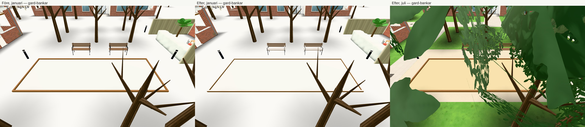
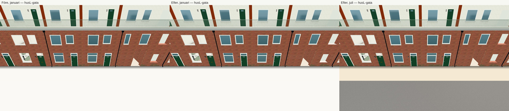
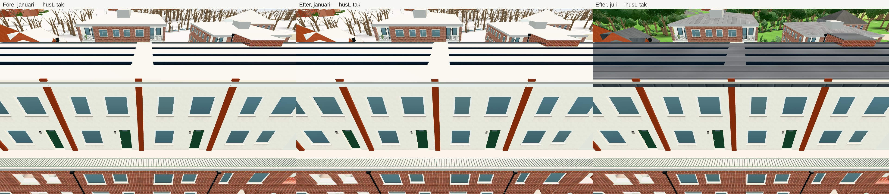
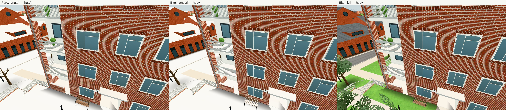

# Public #321: tunt snölager på smala uppåtvända ytor

Publik bas `d310915`, granskade originalkällor `0b2eb36b` och `cd6fd955`
([original #2123](https://github.com/solwation/lunden-3d-apartment/issues/2123)). Egna publikbilder från en egen körning av
den riktiga publika appen; inga originalbilder återanvänds. [Browserdata med snötäckta meshar, medelton och per-vy-budget](browser.json).

`src/snowcap.js` (byteidentisk med originalet) kedjar ett fragmentsteg sist på befintliga utomhusmaterial: världsnormalens
y avgör hur mycket (inget på väggar, avtagande på branta ytor), ett världsbrus tunnar ut det på sina ställen. En delad
uniform (`uSnowCap`) slås på under `SEASON.snowMonths` via årstidskroken, så månadsbyten kompilerar inget om. Inga nya
draws, texturer, ljus, pass eller per-frame-kod; positionerna orörda (`SNOW_CAP` i `src/config.js`, *guess*).

Varje panel är 1280×800, DPR1, native aspekt (canvasläsning efter en renderad bildruta), sammansatt med en rubrikrad:
före januari (basmodulerna), efter januari, efter juli. Chromium/SwiftShader, fast klocka 15 januari resp. 15 juli,
`?nocats&keepgeo&month=1|7`, upphöjd kamera som i originalets vyer.

## Kontroller

1. `node --test tools/snowcaptest.mjs`: 5/5 (bara snömånader, bara uppåtvända ytor, kedjan efter railMetal/benchWood/mossa
   med en kopia och unika nycklar, telefonregeln, kopplingen i Hus L/A/B/C, lådmurar, gård och busshållplats). Berörda
   äldre tester gröna: railmetal 3/3, rendersurface 6/6 (läser igenom `snowCap(...)`), shademoss 7/7, benchwood 4/4.
2. `npm test` och `npm run build`: gröna.
3. `node tools/snowcap321browser.cjs http://localhost:8341 docs/verification/321`: samma meshantal (1350) före/efter;
   28 snötäckta batchar; `uSnowCap` 1 i januari, 0 i juli; telefon (`&lowmem`, januari): 7 batchar, alla räcken/bänkar
   med eget kompileringssteg. Draws, trianglar och texturer exakt lika i alla fyra vyer; +2 shaderprogram per vy;
   noll sidfel, externa anrop och lagringsändringar (bara `kvarteret-lunden.*`).

## Hus som kontrollerats

- Hus L (`exterior.js`): tegel, puts, pilastrar, fascia/kappning/murkrön/fönsterbleck, loftgångs- och terrassräcken — åtgärdade.
- Hus A, B, C (`surroundings.js`, gemensam implementation): tegelfasader, vit puts (loggiaplattor, bröstningar), loggiaräcken,
  husbokstäver, ljus plåt — åtgärdade för alla tre (Hus A avbildad).
- Lådmurarna (tegel, räcken, spjälor), gårdens bänkar/metall/pergola, busshållplatsens bänk — åtgärdade.

## Kostnad och gränser

- Inga nya draws, texturer, geometri, ljus eller per-frame-arbete; en delad uniform. Programvarianter: varje berört
  material får en unik nyckel (`…|snowcap2123`); på telefon bara material som redan hade eget program.
- Utanför snömånaderna hoppar shadern över steget (`if (uSnowCap > 0.0)`), så juli ser ut som före.
- Locket följer normalen, inte verklig snöackumulering eller vind; mängden är en uppskattning (*guess*).
