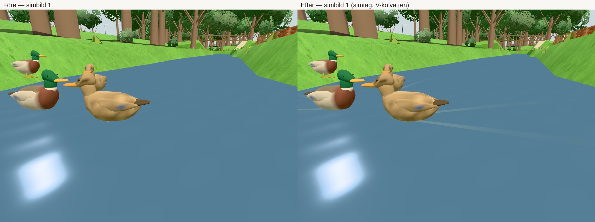
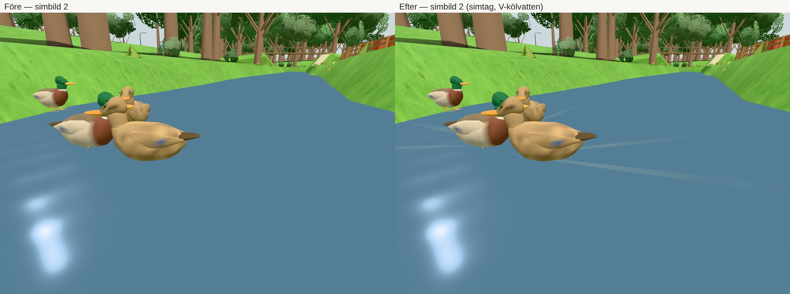
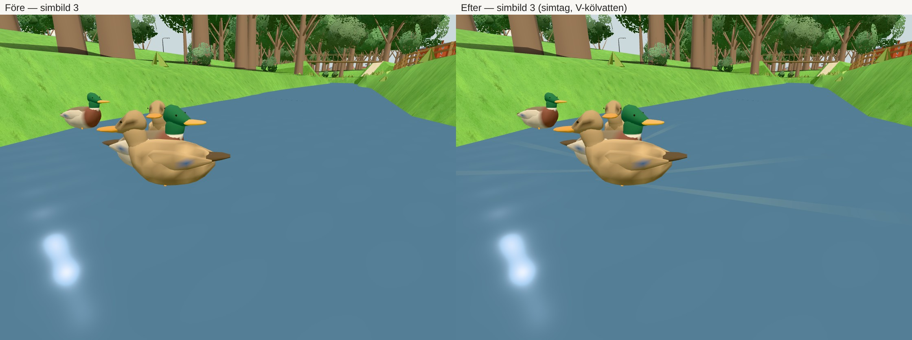
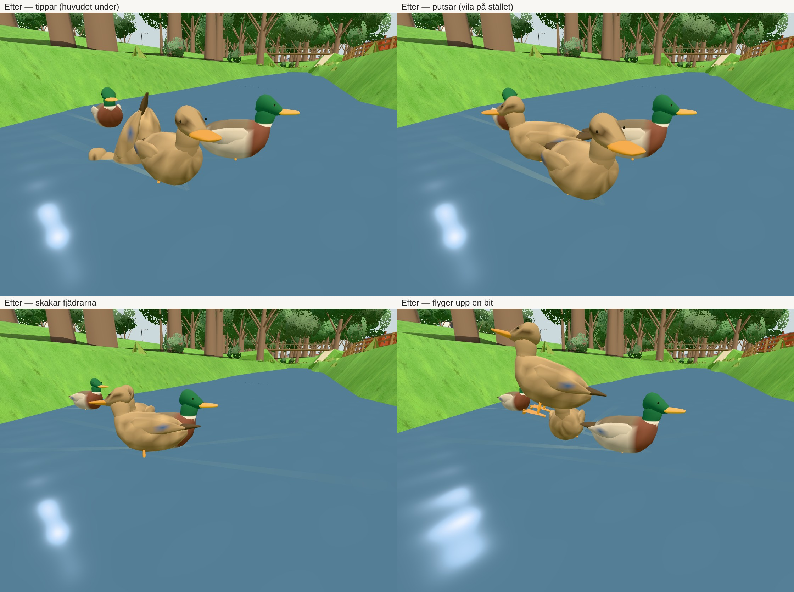

# Public #323: gräsändernas kroppsspråk och V-kölvatten

Publik bas `d310915`, granskad originalkälla `1f71fe84802961ddf8a0fee28860ba084ad5651d`
([original #2126](https://github.com/solwation/lunden-3d-apartment/issues/2126)).
Egna publikbilder från en egen körning i den riktiga publika appen (`tools/duckmotion323browser.cjs`, 1120×800 per bild,
SwiftShader, `?month=6&nocats`); före = basens `ducks.js`, `duckbrain.js` och `config.js` serverade i stället för de nya.
Flocken startas om från sina seedade hem i båda faserna och stegas tills and 0 simmar framåt mitt i ån (samma position före/efter);
observatören följer fågeln 2,1 m från sidan. Inga originalbilder återanvänds. [Browserdata](browser.json).

Simsekvens, före vänster / efter höger (samma flock- och kameraläge; efter: simtag med lätt rullning och V-kölvatten som slutar vid kanten):

Efter, påtvingade beteenden på samma fågel från samma läge: tippar (huvudet under, stjärten upp), putsar (vila på stället; syns inte
som nackvridning på den procedurala modellen), skakar fjädrarna (rullning och litet lyft) och lyfter en kort bit:

Kontroller
- `node tools/duckmotiontest.mjs`: 7/7 – en simulerad timme: tippning, putsning och skakning återkommer, vilobeteenden tar en
  minoritet av tiden (20 %), tippning bara på vatten, en vilande fågel står still, ingen uppflygning utan störning; seedat och
  repeterbart; kölvatten bara vid simning framåt (inte stilla, i land, pausad eller i luften); DuckKiss avbryter och ger exakt
  neutral pose, nedkylning efter uppflygning; publikmodellens faktiska näbb hamnar under vattenlinjen (−0,24 m) och stjärten upp
  (0,75 m) vid tippning; V-formen följer Kelvinvinkeln, tonar ut och klipps vid stranden; modulen saknar matning/poäng/ljud/lagring.
- `node tools/duckambienttest.mjs`: 3/3 (nu även `duckmotion.js` i publikgranskningen).
- `npm test` och `npm run build`: gröna.
- Browser: noll sid-/shaderfel och noll externa anrop; lagring oförändrad; signaturen för alla 1 346 icke-andmeshar (ån,
  stränder, terräng) identisk före/efter; simsekvensen visar kölvattnet (styrka 1); en verklig rusning 3 m/s mot fågeln startar
  uppflygning (25 s nedkylning); stilla fåglar och dolda änder ger inget kölvatten och ingen draw.

Kostnad (samma vy, efter mot före): +1 draw och +96 trianglar medan något kölvatten syns (0 annars), +1 program
(Lambert med vertexfärg), 0 texturer, +1 geometri (5 056 byte). `Ducks.update` median 0,21 → 0,22 ms per steg (SwiftShader,
fyra änder). Inga nya nätverks- eller lagringsfält.

Begränsningar: publikens änder är en procedural mesh utan ben, så huvudnick, putsningens nackvridning, stjärtvickning och
vingslag från originalets rigg syns inte; uppflygningen är ett lyft med lutning utan vingslag. Värdena är *guess*.
