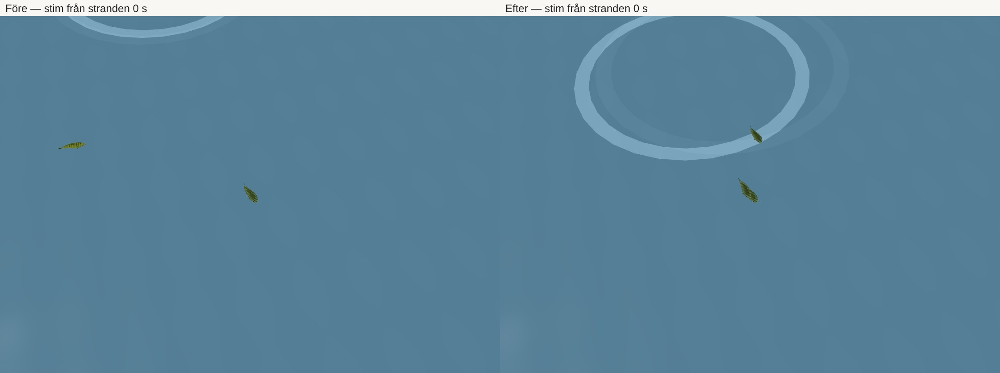
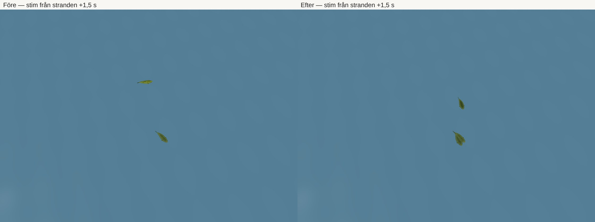
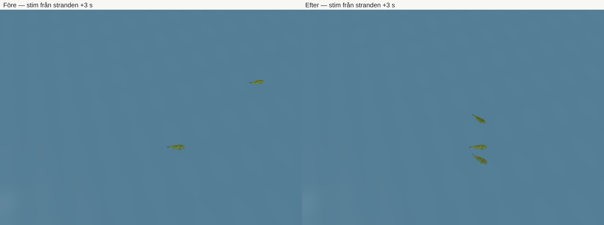
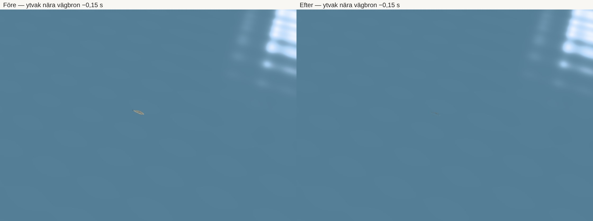
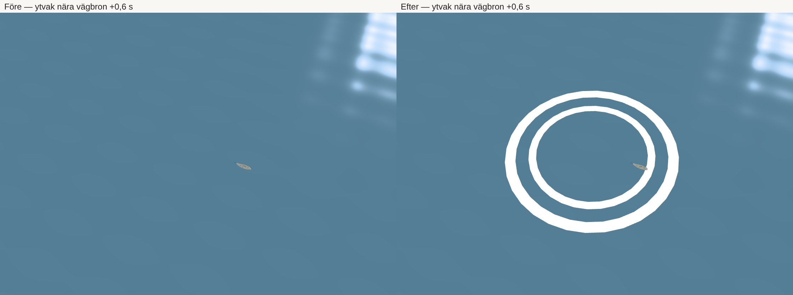
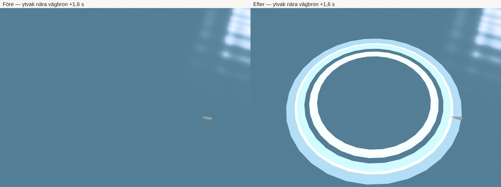
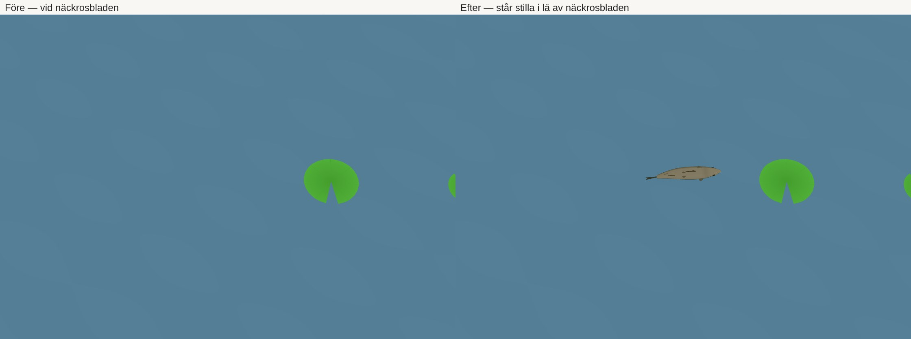

# #326 — åfiskarna i lösa stim, stilla i lä och snabba ytvak (port av original #2130)

Källa `ef43316d` i originalet; baslinje `10c4e34` (publikens `main` när arbetet började). Före-fasen serverar baslinjens
`src/riverfish.js`, `src/riverfloraview.js`, `src/main.js` och `src/config.js` i stället för arbetsfilerna; allt annat är samma
produktionskod. Båda faserna kör `tools/riverfishschool326browser.cjs` mot den riktiga appen (`/?month=7&nocats`, fast klocka)
och sätter fiskklockan till samma tider, som hittas i node med `src/riverfishschool.js` och publikens egen näckrostäckning
(92 blad) från `T0 = 1700000` s. Bilderna är sammansatta av inbyggda 1120×800-skärmbilder (JPEG q88). Rådata:
[browser.json](browser.json).

## Stim från stranden (abborrar 0, 3, 10; t = 1700045,5 s, +1,5 s, +3 s; 40°)

| Bild | |
|---|---|
| 0 s |  |
| +1,5 s |  |
| +3 s |  |

Före simmar abborrarna egna banor; efter håller de platser vid ledaren och vänder med den (två av dem ligger nästan
ovanpå varandra i den här vinkeln).

## Ytvak nära vägbron (mört 16, 23 m från brons mitt; −0,15 s, +0,6 s, +1,6 s; 40° från stranden)

| Bild | |
|---|---|
| −0,15 s |  |
| +0,6 s |  |
| +1,6 s |  |

Efter sprids ytvakens ringar (upp till 1,9 m, starkare än en vanlig uppgångs); före händer inget. Vägbrons räcke skymmer
vattnet från däcket i publikens vy, så vaket visas från stranden.

## Stilla i lä av näckrosbladen (öring 8, t = 1700019 s; 28°)

Efter står öringen stilla precis nedströms om bladen med huvudet mot strömmen; före var den utanför bild på sin egen bana.

## Kontroller

1. `node --test tools/riverfishschooltest.mjs` — PASS 7/7: originalets fem (stim bara bland mört/braxen och abborre i samma
   sträcka, lägsta id leder; medlemmar i sin plats och samma kurs > 80 %; lä sällsynt och stilla, mot strömmen, i lä > 80 %;
   ytvak sällsynta och deterministiska; seedade platser orörda, ritad fisk i fåran, mellan botten och yta, < 15 m från sin
   seedade plats) plus två publika: näckrosbladen ger lä på sommaren och inget i januari; den riktiga `RiverFish` ritar
   lagret (10 669 fiskbilder, alla med förskjutning, max 7,3 m), `shown` behåller seedade platser, två batcher, inget går att plocka.
2. `node tools/riverfish-check.mjs` PASS (befintlig #238-kontroll), `npm test` PASS, `npm run build` PASS.
3. Browser (ovan): inga sid-/shaderfel, noll externa anrop, lagring (sentinel i local/sessionStorage) oförändrad, alla
   1 349 icke-fiskmesher (vatten, näckrosor, stränder, terräng) identiska före/efter; program 68 och texturer 66 i alla vyer
   före och efter; draw calls identiska utom +1 när ringbatchen syns (vakbilderna 24 → 25, befintlig ringbatch).
   `RiverFish.update` vid stimmet 0,31 ms mot 0,21 ms före (SwiftShader, median av 3 × 300).

## Kostnad

Ingen ny draw call, program, textur eller geometri; ringbatchens instanskapacitet 72 → 90 (18 × 5; +18 × 16 × 4 B
matriser + 18 × 3 × 4 B färger ≈ 1,4 kB). CPU enligt ovan.

## Begränsningar

Fiskarna är de befintliga tillplattade formerna sedda ovanifrån, så ett stim läses som några små mörka former tätt
ihop. Ytvakens ringar använder originalets styrka (0,85 mot vanlig uppgång 0,5) i publikens additiva ringmaterial och
blir nästan vita i närbild. Publiken har inga stenar i ån, så lä finns bara vid näckrosblad (maj–september); annars i
öppet vatten. `?noflora` ger bara öppet vatten.

Publicerad: `9ecf78c`, Pages 44421775033 success.
