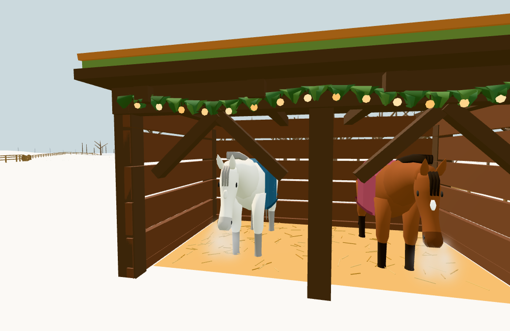

# #340 — neutral pony breath, no sound

Public base: `a08a6f3836b823f334f4ff73700f9b1781582d44`.
Reviewed original source: `b0fb62601aa732a601b8bdd92ca284bc11de55eb`
(original #2188). [selection.json](selection.json) records exact whole-file hashes
and the selected helpers/constants from ponysound/avatarbreath/paddock/config.
Only breath logic is adapted; original files/assets are not copied wholesale.

## Public adaptation

There is no actual temperature or weather engine in this public walkthrough.
Existing December/January/February snow flags provide the source's **0.7 snow
minimum**, without inventing a temperature. The default summer stays off; month
selection, calendar/default behavior, fixed noon lighting and live SiteWind are
unchanged. The pure coldness helper retains 9 °C cutoff and full value at −1 °C
for explicit numeric tests; those are not claimed to be measured app inputs.

The two generic scenery ponies use one neutral `PonyBreath` point pool. Each
exhale puts three small soft puffs at each nostril. Nostril positions come from
public `PONY_SURFACE`, with exactly the procedural head/neck counter-rotation
order and current instance roll/yaw/scale. This replaces the original's absent
rig/head-bone adapter. Warm, hidden/underground and distant views produce no new
puffs; hidden/underground clears immediately. Expiry hides the pool and zeroes
its draw range. Paused/zero-dt calls do not emit or advance time.

Depth testing stays on, depth writes off; ordinary geometry occludes the puffs.
No texture, light, extra render pass, per-pony mesh, audio, character, gameplay,
service or original storage consumer is introduced. Existing pony geometry,
head shader and fence/collision helpers are byte-preserved; main, seasons and
SiteWind are entirely unchanged ([preservation.json](preservation.json)).

## Checks and images

1. `node --test tools/ponybreath340test.mjs tools/ponymotiontest.mjs`: **14/14**,
   about 1.6 s. Cold/warm/snow, state cadence/zero dt, transformed two nostrils,
   bounded/finite pool, wind/expiry/zero draw, real Paddock warm/snow/hidden/far
   consumer and the existing secondary-motion consumers pass (`node.txt`).
2. `npm test`: **184 modules**, import graph/public isolation/identity/CSP checks
   pass (`npm-test.txt`). `npm run build`: **1182ee1a0a9a706a9d00c182** (`build.txt`).
3. `PLAYWRIGHT_MODULE=/home/devcontainers/kvarteret-lunden/node_modules/playwright /mnt/c/Users/olw/Documents/lunden-3d-apartment/tools/browsertest.sh node tools/ponybreath340browser.cjs http://localhost:8448 docs/verification/340`:
   own actual public app, one context, fixed `?month=1&wind=0.2,0`, no source
   substitution or original screenshots. App load 31.4 s. Camera is at the real
   existing shelter and the ordinary ponies retain their actual winter poses.
   The image pair freezes those poses and controls a simultaneous exhale via
   the production consumer; it does not change the breath constants/density.
   Both native 1000×650 images were opened/inspected: short faint plumes follow
   the downward muzzles and remain depth-tested against the ponies/shelter.
   The empty image is a same-revision **zero-puff control**, not a separately
   reloaded pre-port source version.

The empty-pool comparison is retained at `before/cold-empty.png` for publication before closure.
`browser.json`/`browser.txt` bind the actual source hashes, camera, wind, live
puff count, draw/resources, errors and isolation results.

## Budget and isolation

Actual paired render: 37 calls/0 points empty, **38 calls/12 points live**, then
37/0 after clear; warm season has 0/hidden. Textures stay 60, geometries 496,
programs 66 in that already-warmed scene. This does **not** mean the feature adds
no program: one new distinct puff ShaderMaterial/program is expected compared
with a scene without the feature. No separate baseline program-count run was
needed. The pool has one material/geometry; two 24×vec3 Float32 attributes occupy
**576 CPU bytes**, with the same nominal GPU vertex bytes (driver overhead not
measured). Up to 24 bounded JS puff records are allocated on emission; their heap
size is not included in 576 bytes. Maximum is 24 points and one live draw.
Point transparency adds a small amount of fragment/overdraw work. No hardware
GPU/mobile/FPS or performance improvement is claimed.

0 external requests, 0 WebSockets and 0 page/shader errors. Synthetic sentinel
values under two original keys, an unrelated key and the independent public
namespace stay unchanged; intercepted storage calls never access original or
unrelated keys and never clear storage. Existing public-only storage reads are
allowed. Source manifest equality and npm's public/service/import guard also
pass. No personal content or original services enter the import graph.

## Timing and handoff

Approximately 3 min source/policy/plan, 3 min bounded adaptation/tests, under
1 min Node/npm/build and about 1 min actual browser, then 2 min source-hash/docs/
image review. No repeated browser, broad profile or ten-minute verification
extension. The browser and local server 8448 are stopped before handoff. Root
owns integration, publishing the embedded image pair, removing the `before/`
image, release checks and closure. Public has no player changelog consumer;
README is the user-visible change note.
